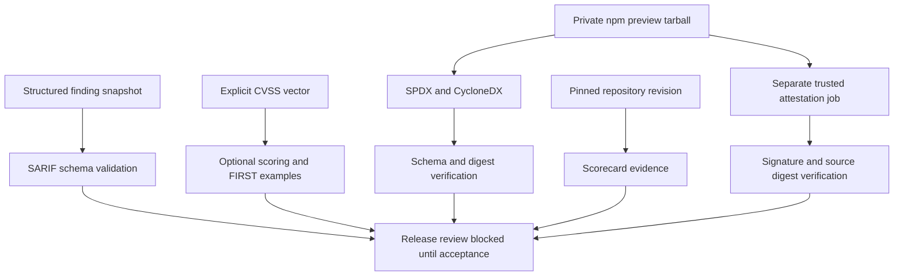

# Standards interoperability and preview supply-chain evidence (#155–160)

[فارسی](standards-acceptance-FA.md)

This is a development checkpoint, not certification or release approval. The package remains private; no npm publication or public release is performed.

| Workstream | Implemented boundary | Remaining acceptance |
|---|---|---|
| SARIF 2.1.0 (#155) | Location-free structured finding export; stable rule IDs and finding fingerprints; closed records omitted; candidates marked review. Validates against pinned OASIS schema in optional CI. | Actual consumer import and explicitly authorized safe location export; GitHub code scanning interoperability NOT_RUN. |
| CVSS 4.0 (#156) | Strict canonical explicit vectors; optional `cvss==3.6` scoring; report vector, score, severity and B/BT/BE/BTE nomenclature. Four reference cases (three published FIRST examples, one zero-impact fixture). | Review full vector corpus and metric evidence for findings; no inference from handbook severity or automatic ledger scoring. |
| SPDX 2.3 (#157) | npm SBOM generated from package extracted from private preview tarball; validate pinned publisher schema and package identity. | Final release artifact and non-npm component/license inventory. |
| CycloneDX 1.5 (#158) | Same preview tarball, separate schema and package purl checks; record SHA-256 for both SBOMs and tarball. | Final release inventory, full dependency and license adjudication. |
| OpenSSF Scorecard (#159) | Pinned 5.7.0 binary and published release digest; read-only CI against exact base SHA, output per-check results. | Actual successful results and remediation review; live repository metadata can change. |
| SLSA provenance (#160) | Main-only manual preview workflow with separate build and attestation jobs, scoped permissions, pinned GitHub attestation action and verification using source digest. | Execute on main and verify actual preview attestation; repeat for final release artifact; no SLSA level claim. |

## Reproduction

```bash
python3 <skill-dir>/scripts/security_sarif.py --source /path/to/structured-report.json
python3 -m venv /tmp/sg-standards
/tmp/sg-standards/bin/python -m pip install cvss==3.6
/tmp/sg-standards/bin/python <skill-dir>/scripts/security_cvss.py 'CVSS:4.0/AV:L/AC:L/AT:P/PR:L/UI:N/VC:H/VI:H/VA:H/SC:N/SI:N/SA:N'
python3 scripts/standards_inventory.py
```

Use trusted isolated tooling. The SARIF export contains no project paths, source snippets, arbitrary descriptions or raw evidence. It rejects invalid finding IDs, unknown statuses and private projections. Findings and fingerprints can still be sensitive: review before sharing. Location-free reports are not advertised as importable in GitHub code scanning. CVSS is separate from ledger severity; never assign a vector without evidence. The optional calculator must be explicitly installed; no dependency is silently introduced into the skill.



Official references: [SARIF 2.1.0](https://docs.oasis-open.org/sarif/sarif/v2.1.0/sarif-v2.1.0.html), [FIRST examples](https://www.first.org/cvss/v4.0/examples), [SPDX 2.3](https://spdx.github.io/spdx-spec/v2.3/), [CycloneDX 1.5](https://cyclonedx.org/docs/1.5/json/), [npm SBOM](https://docs.npmjs.com/cli/commands/npm-sbom/), [Scorecard v5.7.0](https://github.com/ossf/scorecard/releases/tag/v5.7.0), [artifact attestation verification](https://docs.github.com/en/actions/how-tos/secure-your-work/use-artifact-attestations/use-artifact-attestations). The schema Git blobs and tool pins are in the implementation and workflow. No standards prose is bundled. Report actual run results; a workflow definition alone is not execution proof.

## Preview provenance execution and action pins

The provenance workflow also triggers on a change to its own file merged into main, with no PR execution or package publication. Verify the signed preview using the expected repository, signer workflow, main source ref and exact source digest; the signature result must be a nonempty JSON list. Both new standards workflows pin their actions to exact commits. This improves the new workflow supply chain only; the repository-wide Scorecard findings, including older unpinned actions, still require review. Do not claim a SLSA level or final release provenance.

## Repository workflow hardening (#159)

The follow-up pins all existing main workflow Action references to exact commit SHAs, disables checkout credential persistence, and separates release verification (read-only) from the release creation job (contents: write, no checkout). The required CI runs a bounded textual workflow baseline check and regression tests. This check covers the repository's current YAML formatting; it is not a general YAML security analyzer, dependency-integrity guarantee or substitute for Scorecard. The earlier Scorecard results are historical; rerun against the merged revision before claiming improvement. Private vulnerability reporting, actual review practices, dependency findings and release acceptance remain separate. No release or npm publication is performed.

## Opt-in SARIF locations and expanded CVSS tests (#155–156)

The default SARIF output remains location-free. For explicitly reviewed disclosure, pass `--reviewed-locations locations.json` alongside `--source report.json`. The sidecar binds the SHA-256 of the exact source bytes and supplies only selected finding IDs, relative ASCII paths and positive line numbers. It rejects traversal, absolute paths, URI escapes, hidden path segments, selected secret-related names/extensions, stale digests and closed/unknown finding IDs. These are syntax checks, not proof of safe disclosure: paths may still identify a private project. No target file is opened or checked, and user-supplied locations are not independent evidence. Review before sharing; no automatic upload or GitHub code-scanning compatibility claim.

```json
{"schema_version":1,"source_sha256":"<64 lowercase hex digits of report.json SHA-256>","locations":{"SG-API-07-123456789ABC":{"path":"src/demo.ts","line":7}}}
```

Optional CI validates both projections against the pinned OASIS schema and runs the actual Microsoft [sarif-tools 3.0.0](https://pypi.org/project/sarif-tools/3.0.0/) CSV consumer against synthetic data, checking the two records and their distinct statuses and paths. This does not test every consumer. The CVSS test suite now contains twelve vectors, eleven from [FIRST examples, document v1.9](https://www.first.org/cvss/v4.0/examples) and one synthetic zero-impact vector; Base, Threat, Environmental and combined cases are represented. The optional pinned calculator, explicit vector policy and evidence limits are unchanged. A curated reference set is not exhaustive validation. CI results must be observed before claiming these tests passed.

## Portable SARIF paths and explicit CVSS output checks (#155–156)

The opt-in location sidecar rejects Windows reserved device names in every path segment. Fingerprint identity remains stable when the ledger status or severity changes. CVSS output is checked for finite one-decimal scores within 0–10 and matching qualitative severity. Environmental metric membership is explicit; supplemental metrics and explicit Not Defined values do not change the B/BT/BE/BTE nomenclature. New regression tests exercise these boundaries and malformed calculator output. This is not exhaustive scoring validation or GitHub code scanning import evidence.
