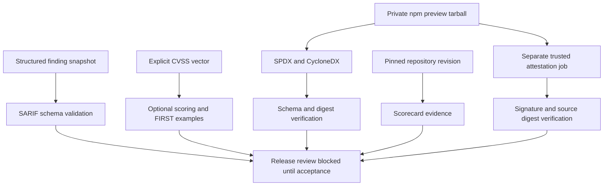

# Standards interoperability and preview supply-chain evidence (#155–160)

[فارسی](standards-acceptance-FA.md)

This is a development checkpoint, not certification or release approval. The package remains private; no npm publication or public release is performed.

| Workstream | Implemented boundary | Remaining acceptance |
|---|---|---|
| SARIF 2.1.0 (#155) | Location-free structured finding export; stable rule IDs and finding fingerprints; closed records omitted; candidates marked review. Validates against pinned OASIS schema in optional CI. | Actual consumer import and explicitly authorized safe location export; GitHub code scanning interoperability NOT_RUN. |
| CVSS 4.0 (#156) | Strict canonical explicit vectors; optional `cvss==3.6` scoring; report vector, score, severity and B/BT/BE/BTE nomenclature. Four reference cases (three published FIRST examples, one zero-impact fixture). | Review full vector corpus and metric evidence for findings; no inference from handbook severity or automatic ledger scoring. |
| SPDX 2.3 (#157) | npm SBOM generated from package extracted from private preview tarball; validate pinned publisher schema and package identity. | Final release artifact and non-npm component/license inventory. |
| CycloneDX 1.5 (#158) | Same preview tarball, separate schema and package purl checks; record SHA-256 for both SBOMs and tarball. | Final release inventory, full dependency and license adjudication. |
| OpenSSF Scorecard (#159) | Pinned 5.7.0 binary and published release digest; read-only CI against exact base SHA, output per-check results. | Actual successful results and remediation review; live repository metadata can change. |
| SLSA provenance (#160) | Main-only manual preview workflow with separate build and attestation jobs, scoped permissions, pinned GitHub attestation action and verification using source digest. | Execute on main and verify actual preview attestation; repeat for final release artifact; no SLSA level claim. |

## Reproduction

```bash
python3 <skill-dir>/scripts/security_sarif.py --source /path/to/structured-report.json
python3 -m venv /tmp/sg-standards
/tmp/sg-standards/bin/python -m pip install cvss==3.6
/tmp/sg-standards/bin/python <skill-dir>/scripts/security_cvss.py 'CVSS:4.0/AV:L/AC:L/AT:P/PR:L/UI:N/VC:H/VI:H/VA:H/SC:N/SI:N/SA:N'
python3 scripts/standards_inventory.py
```

Use trusted isolated tooling. The SARIF export contains no project paths, source snippets, arbitrary descriptions or raw evidence. It rejects invalid finding IDs, unknown statuses and private projections. Findings and fingerprints can still be sensitive: review before sharing. Location-free reports are not advertised as importable in GitHub code scanning. CVSS is separate from ledger severity; never assign a vector without evidence. The optional calculator must be explicitly installed; no dependency is silently introduced into the skill.



Official references: [SARIF 2.1.0](https://docs.oasis-open.org/sarif/sarif/v2.1.0/sarif-v2.1.0.html), [FIRST examples](https://www.first.org/cvss/v4.0/examples), [SPDX 2.3](https://spdx.github.io/spdx-spec/v2.3/), [CycloneDX 1.5](https://cyclonedx.org/docs/1.5/json/), [npm SBOM](https://docs.npmjs.com/cli/commands/npm-sbom/), [Scorecard v5.7.0](https://github.com/ossf/scorecard/releases/tag/v5.7.0), [artifact attestation verification](https://docs.github.com/en/actions/how-tos/secure-your-work/use-artifact-attestations/use-artifact-attestations). The schema Git blobs and tool pins are in the implementation and workflow. No standards prose is bundled. Report actual run results; a workflow definition alone is not execution proof.

## Preview provenance execution and action pins

The provenance workflow also triggers on a change to its own file merged into main, with no PR execution or package publication. Verify the signed preview using the expected repository, signer workflow, main source ref and exact source digest; the signature result must be a nonempty JSON list. Both new standards workflows pin their actions to exact commits. This improves the new workflow supply chain only; the repository-wide Scorecard findings, including older unpinned actions, still require review. Do not claim a SLSA level or final release provenance.

## Repository workflow hardening (#159)

The follow-up pins all existing main workflow Action references to exact commit SHAs, disables checkout credential persistence, and separates release verification (read-only) from the release creation job (contents: write, no checkout). The required CI runs a bounded textual workflow baseline check and regression tests. This check covers the repository's current YAML formatting; it is not a general YAML security analyzer, dependency-integrity guarantee or substitute for Scorecard. The earlier Scorecard results are historical; rerun against the merged revision before claiming improvement. Private vulnerability reporting, actual review practices, dependency findings and release acceptance remain separate. No release or npm publication is performed.

## Opt-in SARIF locations and expanded CVSS tests (#155–156)

The default SARIF output remains location-free. For explicitly reviewed disclosure, pass `--reviewed-locations locations.json` alongside `--source report.json`. The sidecar binds the SHA-256 of the exact source bytes and supplies only selected finding IDs, relative ASCII paths and positive line numbers. It rejects traversal, absolute paths, URI escapes, hidden path segments, selected secret-related names/extensions, stale digests and closed/unknown finding IDs. These are syntax checks, not proof of safe disclosure: paths may still identify a private project. No target file is opened or checked, and user-supplied locations are not independent evidence. Review before sharing; no automatic upload or GitHub code-scanning compatibility claim.

```json
{"schema_version":1,"source_sha256":"<64 lowercase hex digits of report.json SHA-256>","locations":{"SG-API-07-123456789ABC":{"path":"src/demo.ts","line":7}}}
```

Optional CI validates both projections against the pinned OASIS schema and runs the actual Microsoft [sarif-tools 3.0.0](https://pypi.org/project/sarif-tools/3.0.0/) CSV consumer against synthetic data, checking the two records and their distinct statuses and paths. This does not test every consumer. The CVSS test suite now contains twelve vectors, eleven from [FIRST examples, document v1.9](https://www.first.org/cvss/v4.0/examples) and one synthetic zero-impact vector; Base, Threat, Environmental and combined cases are represented. The optional pinned calculator, explicit vector policy and evidence limits are unchanged. A curated reference set is not exhaustive validation. CI results must be observed before claiming these tests passed.

## Separate read-only provenance verification (#160)

The private preview workflow now separates build, signing and verification into three jobs. Only the signing job has token and attestation write permissions; verification downloads the exact private preview again, checks its digest, and runs `gh attestation verify` against the repository, signer workflow, main ref and exact source commit. A companion receipt binds the artifact SHA-256, verification JSON hash and workflow run ID. Main execution is required before claiming successful verification; no public npm publication or SLSA level claim.

## Shipped file inventory (#157–158)

Preview evidence now enumerates and hashes every regular file in the exact npm tarball, including shipped Python, JavaScript and reference assets. Unsafe paths, duplicate members, links and oversized archives fail before inventory acceptance. The declared package license is separate from file-level NOASSERTION. This is a companion inventory, not a modification of the npm-generated SPDX or CycloneDX SBOM or a full Python dependency/license adjudication. Final published artifact validation remains pending.

## Portable SARIF paths and explicit CVSS output checks (#155–156)

The opt-in location sidecar rejects Windows reserved device names in every path segment. Fingerprint identity remains stable when the ledger status or severity changes. CVSS output is checked for finite one-decimal scores within 0–10 and matching qualitative severity. Environmental metric membership is explicit; supplemental metrics and explicit Not Defined values do not change the B/BT/BE/BTE nomenclature. New regression tests exercise these boundaries and malformed calculator output. This is not exhaustive scoring validation or GitHub code scanning import evidence.

## Scorecard vulnerability remediation (#159)

The actual Scorecard JSON for base `dce0edab69154c956495e8bb469fbce33133c3e0` (run 46082477887, artifact 15236998997, 2026-11-27) reports five OSV advisories: [PYSEC-2026-2151](https://osv.dev/vulnerability/PYSEC-2026-2151) (Flask) and [PYSEC-2026-2044](https://osv.dev/vulnerability/PYSEC-2026-2044), [PYSEC-2026-2046](https://osv.dev/vulnerability/PYSEC-2026-2046), [PYSEC-2026-2320](https://osv.dev/vulnerability/PYSEC-2026-2320), [PYSEC-2026-4312](https://osv.dev/vulnerability/PYSEC-2026-4312) (Werkzeug). Update isolated CI Flask fixture from 3.1.2 to [3.1.3](https://pypi.org/project/Flask/3.1.3/) and Werkzeug from 3.1.3 to [3.1.9](https://pypi.org/project/Werkzeug/3.1.9/). Existing mandatory runtime fixture tests and version assertions remain unchanged. These packages are CI fixture dependencies, not Node package runtime dependencies. Actual installation, regression results and Scorecard remeasurement on the new main revision remain pending. Code-Review is 0/30 approved changesets; 42/42 GitHub-owned actions are SHA-pinned, while six npm and two pip commands lack hash pinning per that report. No zero-vulnerability claim.

## Tested preview provenance and pre-extraction validation (#157 #158 #160)

The private preview provenance build now exports the exact offline smoke-tested tarball, validates its checksum, and renames it without repacking. The separate read-only verification job checks the GitHub attestation and binds the tested-artifact receipt to the exact source commit, package and byte digest. The receipt hash is recorded alongside the verification evidence. The standards SBOM workflow validates regular archive member inventory and the canonical private manifest before extraction. Neither workflow publishes to npm. The previous CI artifact 15236429458 independently reconciled 170 shipped file hashes, the tarball digest and both SBOM digests; final release and independent license review remain outstanding. Actual main provenance run is required, no SLSA level claimed.

## Publisher terms and reporting attribution (#155–156)

SARIF 2.1.0 plus Errata 01 (28 August 2023) is the pinned edition used for schema validation. The [OASIS repository terms](https://github.com/oasis-tcs/sarif-spec/blob/1742a253eb654bf8a4ed7c60eaef7412b2c23553/LICENSE.md) at the same revision as the schema are identified by Git blob `4f6c09850303dbc804e8b8aa34eab7acc5ad1817`; the schema blob is `0f58372b548f60c84d20fca77687435e71b3b3a3`. The [published standard](https://docs.oasis-open.org/sarif/sarif/v2.1.0/sarif-v2.1.0.html) uses the OASIS RF on RAND IPR mode and includes copyright notices. The schema is fetched for CI validation, not redistributed in the package; no claim of relicensing publisher material.

CVSS is owned by FIRST.Org, Inc. and used by permission. [CVSS 4.0 specification](https://www.first.org/cvss/v4.0/specification-document) and [examples document v1.9](https://www.first.org/cvss/v4.0/examples) require attribution and publication of both vector and score. The optional calculator output adds `attribution` and `specification_url` alongside existing score/vector fields; no existing field is removed. The 11 published reference vectors and one synthetic vector are exercised by the pinned calculator tests. The publisher web pages may change; no whole-document byte digest is claimed. External source review is not independent implementation certification. Actual fresh CI remains pending.

## Seven bounded MASVS CLI contracts (#151)

The mobile metadata reviewer now checks decoded XML characters before parsing, including BOM-marked UTF-16, and rejects entity declarations and ambiguous encodings. Normal UTF-8, BOM-marked UTF-16 and binary iOS plists remain in scope; unsupported encodings fail closed. The update and observation reviewers reject excessive JSON nesting without traceback. A real subprocess regression suite exercises all seven existing review contracts with synthetic matching, contradictory and malformed cases (exit codes 0, 1 and 2), verifies that runtime and compliance remain unassessed, and checks that malformed private canaries are not echoed. This tests the review CLIs, not a device, actual evidence authenticity, platform authentication, or MASVS compliance. Fresh CI pending.

## Pinned FIRST reference comparison (#156)

The CI-only comparison uses the FIRST-owned [CVSS specification Markdown v1.2](https://github.com/FIRSTdotorg/cvss-resources/blob/d766d0c8ab4368b67bf27dd0e411eb481f05fdbb/spec-rev/specification-document.md), exact Git blob `c2135ee7f7baa7ca7e511018befaebdb6c6fdf11`. It also retrieves the official [reference calculator](https://github.com/FIRSTdotorg/cvss-v4-calculator/tree/c5b0d409ae9f57c44264c6ce5f27d89298e1d32a) and its BSD-2-Clause license by exact reviewed Git blobs. The specification requires FIRST attribution and score/vector pairing. The code checks metric order and allowed values, compares all 12 existing vectors and up to 64 additional deterministic authored vectors against the actual reference implementation and emits machine-readable comparison evidence, failing if any score differs. It runs in a separate temporary CI process without project data or credentials; the Node VM is not a security sandbox. No reference code is shipped in npm. The publisher's examples page remains a versioned web reference, not a byte-pinned copy. This is differential testing, not an independent audit, exhaustive validation or evidence of real finding severity. Fresh CI must be observed.

## SBOM semantic inventory acceptance (#157–158)

The existing pinned schemas remain mandatory. The verifier now also reconciles the SPDX package purl, document-to-package DESCRIBES relationship and absence of file-analysis claims with the canonical dependency-free npm manifest. CycloneDX must identify the same package and contain only the root dependency node with no dependency edges or nested components. Both documents must agree with the declared MIT package license; this is declaration consistency, not file-level license adjudication. Duplicate JSON keys are rejected. The evidence records semantic validation separately from schema validation. Negative regression cases cover wrong purl, false file-analysis claims, foreign graph edges and contradictory license declarations. The actual npm 11.19.1 preview output from [Standards #65](https://github.com/omidkh68/security-guardian/actions/runs/46136743177/job/140953621051) is the baseline. This bounded invariant is specific to the current dependency-free npm distribution; adding dependencies or changing license requires reviewed updates. No final tagged artifact or registry verification is claimed. Fresh CI pending.

Source terms reviewed: [SPDX 2.3 license](https://github.com/spdx/spdx-spec/blob/v2.3/LICENSE) CC BY 3.0, blob `44a22d370bba8d13c7dd7449d71b40ea8842788e`; [CycloneDX 1.5 license](https://github.com/CycloneDX/specification/blob/1.5/LICENSE) Apache-2.0, blob `0808751c23d827d483dc3673d6e3f49514e49d1f`. Existing schema blob pins are retained. No publisher schema is shipped in npm.

## Scorecard report acceptance (#159)

The pinned Scorecard v5.7.0 report is validated for the canonical repository, exact scanned base SHA, tool commit, date, baseline check identities, bounded score domains and duplicate keys before evidence upload. A separate SHA-256-bound receipt preserves observed scores and unknown/nonmaximum checks without copying raw check details. The original tool report remains available for review. Actual [Standards #66](https://github.com/omidkh68/security-guardian/actions/runs/46137820788) artifact 15260173498 reported nine selected checks, aggregate 8.5, 58/58 Actions pinned, 0/9 npm commands and 0/2 pip commands hash-pinned, Code-Review 0. The last two gaps remain explicit; no fabricated review, unsupported score threshold, or full coverage claim. The receipt is not a signature and does not attest an independently reviewed candidate. Tests cover drift, missing/duplicate checks, malformed values and privacy. Fresh CI pending.
