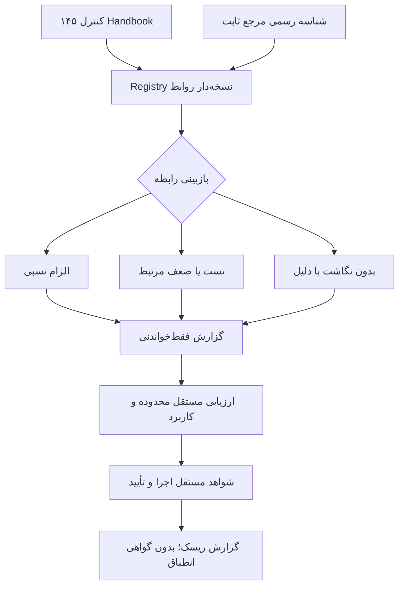

# نگاشت نسخه‌دار استانداردها (#97)

[English](standards-crosswalk.md)

نسخه ۱ Schema: هر ۱۴۵ کنترل ردیف صریح دارد؛ ۱۰۳ نگاشت نسبی، ۴۲ بدون نگاشت، ۱۷۱ شناسه مرجع منتخب یکتا و ۲۵۹ رابطه. این اعداد پوشش امنیتی، انطباق یا نتیجه تأییدشده نیستند.

| مرجع | نسخه ثابت | نوع | تعداد شناسه |
|---|---|---|---:|
| [ASVS](https://github.com/OWASP/ASVS/tree/180622b1329ee7ed349c9f5ce5e14fa91f42c359) | 5.0.0 | الزام | ۱۴۷ |
| [WSTG](https://github.com/OWASP/wstg/tree/dd33419e10edb22b78d89325a6c2aad9f184e3a2) | 4.2 | تست | ۴ |
| [MASVS](https://github.com/OWASP/masvs/tree/8e133d09f4140518ed04cc254b18be9ff4990ffc) | 2.1.0 | الزام | ۸ |
| [MASTG](https://github.com/OWASP/mastg/tree/990472dbcffe126f5556045d60270c4ffdfdde72) | 2.0.0 | تست | ۲ |
| [MASWE](https://github.com/OWASP/maswe/tree/308b82b4bbe29166934fb5a621b40471cfea61db) | 1.0.0 | ضعف | ۲ |
| [CWE](https://cwe.mitre.org/data/) | 5.0 | ضعف | ۸ |

شناسه‌های OWASP از Blob رسمی ثابت و شناسه دقیق ASVS از JSON رسمی استخراج و بررسی شدند. WSTG نسخه‌دار است. موارد MASTG در مسیر tests-beta قرار دارند و صرفاً راهنمای تست‌اند. نسخه‌های MASWE و MASTG مستقل‌اند؛ ارجاعات تاریخی صرفاً با شماره شناسه متصل نشوند. شناسه‌های CWE در صفحات رسمی نسخه 5.0 در 2026-11-25 بررسی شدند؛ لینک زنده ممکن است تغییر کند. Registry شناسه، مسیر، هویت Git Blob و خلاصه مستقل موضوع و دلیل را نگه می‌دارد، نه متن استاندارد. بازبینی نویسنده ثبت شده، نه تأیید مستقل انسانی.



## اجرا

```bash
python3 <skill-dir>/scripts/security_standards.py
python3 <skill-dir>/scripts/security_standards.py --control API-07 --control MOB-03
```

فرمان پروژه یا Ledger را باز نمی‌کند. PARTIAL یعنی رابطه منتخب، نه انطباق نسبی. UNMAPPED یعنی رابطه دقیق کافی در این نسخه تعیین نشده، نه خارج از محدوده یا امن. هر رابطه دلیل و نشانه کاربرد مشروط دارد. ارزیابی و تأیید به‌ترتیب NOT_ASSESSED و NOT_VERIFIED هستند. CWE/MASWE طبقه‌بندی ضعف، WSTG/MASTG راهنمای تست و ASVS/MASVS الزام هستند؛ مخرج‌ها جمع نشوند. درصد انطباق تولید نمی‌شود.

برای مثال API-07 با ASVS 5.0.0 1.2.4، WSTG-v42-INPV-05 و CWE-89 مرتبط است. MOB-03 با MASVS-NETWORK-2، MASWE-0028 و MASTG-TEST-0242 ارتباط دارد. سیاست Pinning مبتنی بر ریسک Handbook معادل الزام MASVS نیست؛ کاربرد تست Android جداست.

## ارزش تست و نگهداری

هویت Git Blob کاتالوگ از تغییر خاموش جلوگیری می‌کند. تست آفلاین همه ردیف‌ها، انتخاب دقیق، شناسه ناشناخته، تکرار، نسخه/Revision، URL، نوع رابطه و کاربرد، عدم ادعای انطباق، استقلال نسخه موبایل، بدون نگاشت، خروجی قطعی و اعتبارسنجی Blob/شناسه با Fixture مصنوعی را بررسی می‌کند. منابع رسمی دوباره دریافت یا معنا داوری مستقل نمی‌شود.

برای بازبینی اختیاری منابع، فایل‌های رسمی را با Revisionهای Registry و مسیر نسبی در پوشه‌های ASVS، WSTG، MASVS، MASTG و MASWE دریافت کنید؛ XML رسمی CWE 5.0 را نیز از آرشیو ناشر دریافت کنید:

```bash
python3 scripts/verify_standards_sources.py --source-dir /path/to/publisher-artifacts --cwe-xml /path/to/cwe_v5.0.xml
```

هویت Blob و شناسه دقیق، نسخه و شناسه ضعف CWE بدون اجرای کد ناشر بررسی می‌شوند. اجرای کامل با فایل‌های دانلودشده ادعا نشده و این مسیر نگهداری جدا از CI آفلاین است. نسخه جدید نیازمند بررسی شناسه و معنا، حفظ تاریخچه و بازبینی مستقل انسانی پیش از ادعای خارجی است. #98 می‌تواند Registry را مصرف کند و #105 ادعاهای انتشار را بررسی می‌کند. کنترل‌های بدون نگاشت حاکمیتی و زیرساختی و فرایندی به منابع مناسب دیگر نیاز دارند، نه نگاشت ساختگی. Ledger تغییر نمی‌کند؛ بازگشت با Revert.

## سخت‌گیری سازگاری نگاشت #97

رد نسخه بولی/اعشاری Schema، ادعای اضافی در ردیف نگاشت و گروه منابع ناهمگون. این اعتبارسنجی یکپارچگی Registry است نه برابری معنایی یا بازبینی انسانی مستقل. اعتبارسنجی کامل منابع رسمی همچنان تسک پذیرش جداگانه است؛ ادعای اجرای آن در این تغییر نداریم. CI در انتظار است.

## گیت اعتبارسنجی مجدد منابع رسمی (#97)

۱۷ فایل ثابت OWASP جداگانه در Revision دقیق ناشر خوانده شدند؛ ۱۶۳ شناسه و Git Blob ثبت‌شده منطبق بودند (۱۴۷ ASVS، ۴ WSTG، ۸ MASVS، ۲ MASTG، ۲ MASWE). CI اکنون `python scripts/verify_standards_sources.py --fetch-official` را با دریافت محدود عمومی، فایل Git ثابت و ZIP رسمی XML نسخه ۵٫۰ CWE اجرا می‌کند؛ ۱۷۱ شناسه، هویت فایل و نسخه دقیق CWE را بررسی و SHA-256 XML را ثبت می‌کند. بدون استخراج ZIP روی فایل‌سیستم، بازتوزیع سورس یا اجرای کد هدف. حالت ورودی محلی همچنان پشتیبانی می‌شود. تست آفلاین رد نسخه و شناسه اشتباه را بررسی می‌کند. نتیجه CI در انتظار؛ برابری معنایی و تأیید انسانی مستقل اثبات نشده‌اند.
