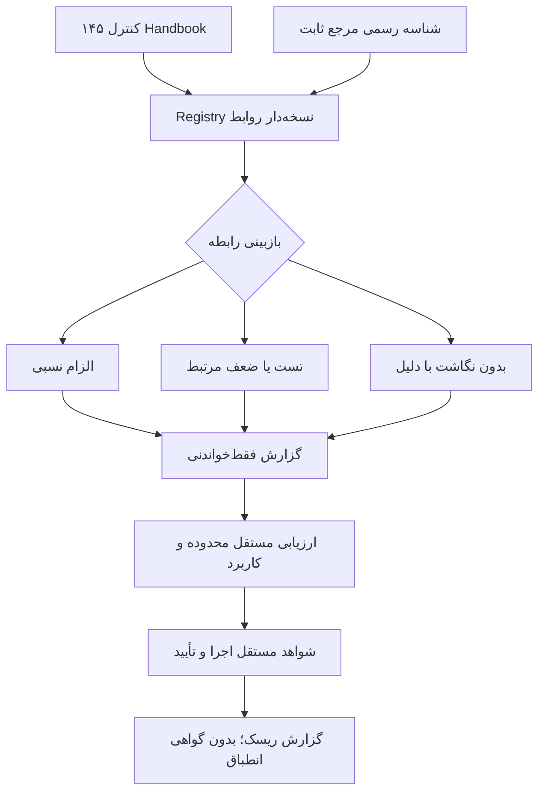
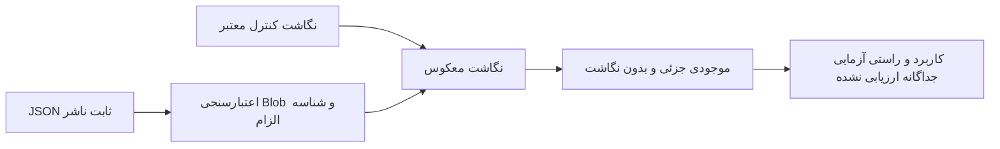
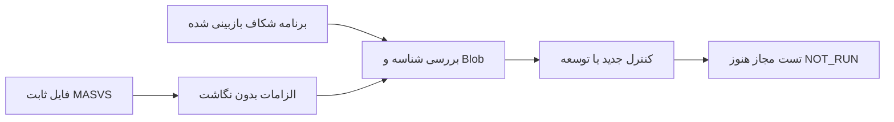

# نگاشت نسخه‌دار استانداردها (#97)

[English](standards-crosswalk.md)

نسخه ۱ Schema: هر ۱۴۵ کنترل ردیف صریح دارد؛ ۱۰۳ نگاشت نسبی، ۴۲ بدون نگاشت، ۱۷۱ شناسه مرجع منتخب یکتا و ۲۵۹ رابطه. این اعداد پوشش امنیتی، انطباق یا نتیجه تأییدشده نیستند.

| مرجع | نسخه ثابت | نوع | تعداد شناسه |
|---|---|---|---:|
| [ASVS](https://github.com/OWASP/ASVS/tree/180622b1329ee7ed349c9f5ce5e14fa91f42c359) | 5.0.0 | الزام | ۱۴۷ |
| [WSTG](https://github.com/OWASP/wstg/tree/dd33419e10edb22b78d89325a6c2aad9f184e3a2) | 4.2 | تست | ۴ |
| [MASVS](https://github.com/OWASP/masvs/tree/8e133d09f4140518ed04cc254b18be9ff4990ffc) | 2.1.0 | الزام | ۸ |
| [MASTG](https://github.com/OWASP/mastg/tree/990472dbcffe126f5556045d60270c4ffdfdde72) | 2.0.0 | تست | ۲ |
| [MASWE](https://github.com/OWASP/maswe/tree/308b82b4bbe29166934fb5a621b40471cfea61db) | 1.0.0 | ضعف | ۲ |
| [CWE](https://cwe.mitre.org/data/) | 5.0 | ضعف | ۸ |

شناسه‌های OWASP از Blob رسمی ثابت و شناسه دقیق ASVS از JSON رسمی استخراج و بررسی شدند. WSTG نسخه‌دار است. موارد MASTG در مسیر tests-beta قرار دارند و صرفاً راهنمای تست‌اند. نسخه‌های MASWE و MASTG مستقل‌اند؛ ارجاعات تاریخی صرفاً با شماره شناسه متصل نشوند. شناسه‌های CWE در صفحات رسمی نسخه 5.0 در 2026-11-25 بررسی شدند؛ لینک زنده ممکن است تغییر کند. Registry شناسه، مسیر، هویت Git Blob و خلاصه مستقل موضوع و دلیل را نگه می‌دارد، نه متن استاندارد. بازبینی نویسنده ثبت شده، نه تأیید مستقل انسانی.



## اجرا

```bash
python3 <skill-dir>/scripts/security_standards.py
python3 <skill-dir>/scripts/security_standards.py --control API-07 --control MOB-03
```

فرمان پروژه یا Ledger را باز نمی‌کند. PARTIAL یعنی رابطه منتخب، نه انطباق نسبی. UNMAPPED یعنی رابطه دقیق کافی در این نسخه تعیین نشده، نه خارج از محدوده یا امن. هر رابطه دلیل و نشانه کاربرد مشروط دارد. ارزیابی و تأیید به‌ترتیب NOT_ASSESSED و NOT_VERIFIED هستند. CWE/MASWE طبقه‌بندی ضعف، WSTG/MASTG راهنمای تست و ASVS/MASVS الزام هستند؛ مخرج‌ها جمع نشوند. درصد انطباق تولید نمی‌شود.

برای مثال API-07 با ASVS 5.0.0 1.2.4، WSTG-v42-INPV-05 و CWE-89 مرتبط است. MOB-03 با MASVS-NETWORK-2، MASWE-0028 و MASTG-TEST-0242 ارتباط دارد. سیاست Pinning مبتنی بر ریسک Handbook معادل الزام MASVS نیست؛ کاربرد تست Android جداست.

## ارزش تست و نگهداری

هویت Git Blob کاتالوگ از تغییر خاموش جلوگیری می‌کند. تست آفلاین همه ردیف‌ها، انتخاب دقیق، شناسه ناشناخته، تکرار، نسخه/Revision، URL، نوع رابطه و کاربرد، عدم ادعای انطباق، استقلال نسخه موبایل، بدون نگاشت، خروجی قطعی و اعتبارسنجی Blob/شناسه با Fixture مصنوعی را بررسی می‌کند. منابع رسمی دوباره دریافت یا معنا داوری مستقل نمی‌شود.

برای بازبینی اختیاری منابع، فایل‌های رسمی را با Revisionهای Registry و مسیر نسبی در پوشه‌های ASVS، WSTG، MASVS، MASTG و MASWE دریافت کنید؛ XML رسمی CWE 5.0 را نیز از آرشیو ناشر دریافت کنید:

```bash
python3 scripts/verify_standards_sources.py --source-dir /path/to/publisher-artifacts --cwe-xml /path/to/cwe_v5.0.xml
```

هویت Blob و شناسه دقیق، نسخه و شناسه ضعف CWE بدون اجرای کد ناشر بررسی می‌شوند. اجرای کامل با فایل‌های دانلودشده ادعا نشده و این مسیر نگهداری جدا از CI آفلاین است. نسخه جدید نیازمند بررسی شناسه و معنا، حفظ تاریخچه و بازبینی مستقل انسانی پیش از ادعای خارجی است. #98 می‌تواند Registry را مصرف کند و #105 ادعاهای انتشار را بررسی می‌کند. کنترل‌های بدون نگاشت حاکمیتی و زیرساختی و فرایندی به منابع مناسب دیگر نیاز دارند، نه نگاشت ساختگی. Ledger تغییر نمی‌کند؛ بازگشت با Revert.

## سخت‌گیری سازگاری نگاشت #97

رد نسخه بولی/اعشاری Schema، ادعای اضافی در ردیف نگاشت و گروه منابع ناهمگون. این اعتبارسنجی یکپارچگی Registry است نه برابری معنایی یا بازبینی انسانی مستقل. اعتبارسنجی کامل منابع رسمی همچنان تسک پذیرش جداگانه است؛ ادعای اجرای آن در این تغییر نداریم. CI در انتظار است.

## گیت اعتبارسنجی مجدد منابع رسمی (#97)

۱۷ فایل ثابت OWASP جداگانه در Revision دقیق ناشر خوانده شدند؛ ۱۶۳ شناسه و Git Blob ثبت‌شده منطبق بودند (۱۴۷ ASVS، ۴ WSTG، ۸ MASVS، ۲ MASTG، ۲ MASWE). CI اکنون `python scripts/verify_standards_sources.py --fetch-official` را با دریافت محدود عمومی، فایل Git ثابت و ZIP رسمی XML نسخه ۵٫۰ CWE اجرا می‌کند؛ ۱۷۱ شناسه، هویت فایل و نسخه دقیق CWE را بررسی و SHA-256 XML را ثبت می‌کند. بدون استخراج ZIP روی فایل‌سیستم، بازتوزیع سورس یا اجرای کد هدف. حالت ورودی محلی همچنان پشتیبانی می‌شود. تست آفلاین رد نسخه و شناسه اشتباه را بررسی می‌کند. نتیجه CI در انتظار؛ برابری معنایی و تأیید انسانی مستقل اثبات نشده‌اند.

## موجودی کامل الزامات ASVS (#149)

JSON ثابت OWASP ASVS 5.0.0 در Revision `180622b1329ee7ed349c9f5ce5e14fa91f42c359` (Git blob `16a314527781b79f2e499ac8f1e33eaf76234d22`) شامل ۳۴۵ الزام نهایی در ۱۷ فصل است؛ ۷۰ الزام دارای برچسب سطح ۱، ۱۸۳ سطح ۲ و ۹۲ سطح ۳ (نه مجموع تجمعی سطح). مجوز ناشر: [CC BY-SA 4.0](https://github.com/OWASP/ASVS/blob/180622b1329ee7ed349c9f5ce5e14fa91f42c359/LICENSE.md). موجودی جداگانه و فقط خواندنی شناسه، برچسب سطح، پیوند معکوس کنترل، شمارنده و شکاف را صادر می‌کند، نه متن الزام ناشر. خط مبنای نگاشت فعلی: ۱۴۷ نگاشت جزئی و ۱۹۸ بدون نگاشت؛ همه وضعیت‌های کاربرد و راستی‌آزمایی همچنان ارزیابی‌نشده و تأییدنشده‌اند. این موجودی کامل شناسه‌هاست، نه نگاشت معنایی کامل، ارزیابی اجرایی یا پوشش انطباق.

```bash
python3 <skill-dir>/scripts/security_asvs.py --source /path/to/pinned-asvs.json
python3 scripts/verify_standards_sources.py --fetch-official --asvs-inventory-output /tmp/asvs-inventory.json
```



CI موجودی تولیدشده از بایت‌های تأییدشده ناشر را نگه می‌دارد. پنج تست جدید هویت دقیق، وضعیت نامشخص، تغییر منبع، شناسه نامعتبر و پیوند یتیم را پوشش می‌دهند. پذیرش CI فقط پس از مشاهده Artifact و نتیجه تست قابل ادعا است. توسعه روابط مرتبط و بازبینی مستقل معنایی هنوز باقی است. پروژه خوانده یا نوشته نمی‌شود، سورس اجرا نمی‌شود و حکم خودکار کنترل صادر نمی‌شود.

## مسیرهای پذیرش گروهی (#149–160)

موجودی جداگانه ASVS ادغام شده است؛ #149 هنوز نیازمند توسعه نگاشت معنادار، شواهد کاربرد و راستی‌آزمایی و بازبینی مستقل معنایی است. از شباهت نام، رابطه خودکار ساخته نمی‌شود. ابزار جدید مخزن `scripts/standards_inventory.py` JSON ثابت Checklist عمومی WSTG 4.2، فایل کنترل MASVS 2.1.0، هویت فایل تست/test-beta در MASTG 2.0.0، فایل ضعف MASWE 1.0.0 و XML ضعف CWE 5.0 را دریافت می‌کند. نگاشت معکوس و شکاف بدون متن منبع گزارش می‌شود. بررسی مستقیم Tree تعداد ۲۴ کنترل MASVS، ۲۹۲ مسیر تست MASTG، ۷۸ مسیر ضعف MASWE و ۹۸ ورودی Checklist WSTG با ۹۷ شناسه یکتا را نشان داد. ناشر WSTG-INPV-13 را تکرار کرده است؛ صفحه حذف‌شده Buffer Overflow و صفحه Format String Injection شناسه مشترک دارند. تعارض صریح حفظ می‌شود؛ موجودی Checklist راستی‌آزمایی جامع همه صفحات تست نیست. چرخه عمر MASTG، کاربرد پلتفرم و اجرای واقعی تست همچنان تأیید نشده‌اند. نسخه و SHA-256 XML CWE ثبت شده و Category/View حذف می‌شوند. نگاشت خودکار، گواهی یا ارزیابی پروژه وجود ندارد.

برای SARIF، CVSS، SBOM، Scorecard و منشأ پیش‌نمایش، [شواهد سازگاری انتشار](standards-acceptance-FA.md) را ببینید. معیار #105 همچنان BLOCKED است.

## نسخه ۲ نگاشت — توسعه بازبینی‌شده (#149–154)

شمارنده‌های نسخه ۱ بالا تاریخی هستند. نسخه ۲ همه روابط قبلی را حفظ و ۵۵ رابطه جدید بازبینی‌شده توسط نویسنده با شناسه دقیق ناشر و دلیل تألیفی و مرز جزئی صریح اضافه می‌کند. Schema نسخه ۱ باقی است؛ نسخه نگاشت جاری ۲ است. مجموع جدید: ۲۲۶ شناسه مرجع، ۳۱۴ رابطه؛ ۱۰۵ کنترل Handbook با نگاشت جزئی و ۴۰ کنترل بدون نگاشت از ۱۴۵. ASVS تعداد ۱۶۴، WSTG تعداد ۱۴، MASVS تعداد ۱۷، MASTG تعداد ۷، MASWE تعداد ۸ و CWE تعداد ۱۶. مخرج موجودی‌ها جدا باقی می‌ماند؛ درصد مشترک نداریم. سوابق نسخه ۱ تاریخی‌اند و نباید شواهد نسخه ۲ تلقی شوند. همه روابط جدید مشورتی‌اند، نه اجرای تست یا بازبینی مستقل. استانداردها نسخه و چرخه عمر متفاوت دارند؛ رابطه MASWE از Front matter نسخه بتای MASTG خودکار استنباط نشود. الزامات بدون نگاشت شکاف واقعی هستند که نیازمند بازبینی یا دلیل خارج‌بودن از Scope هستند؛ برای افزایش شمارنده نگاشت ساختگی ایجاد نشود.

## بازبینی الزامات بدون نگاشت MASVS (#151)

هفت الزام بدون نگاشت MASVS 2.1.0 جداگانه با Handbook جاری و فایل ثابت ناشر مقایسه شدند. فایل ماشین‌خوان `masvs-gap-review.json` شناسه دقیق Blob ناشر، دلیل تألیفی و سناریوی پذیرش مجاز برنامه‌ریزی‌شده را ثبت می‌کند. سه الزام نیازمند کنترل جدید هستند (AUTH-2 احراز هویت محلی، CODE-1 پشتیبانی سیستم‌عامل، CODE-2 اجبار به‌روزرسانی)؛ چهار الزام نیازمند توسعه‌اند (PRIVACY-2 جلوگیری از ارتباط هویت، PRIVACY-3 شفافیت، PRIVACY-4 اختیار داده کاربر، RESILIENCE-4 مقاومت زمان اجرا). شناسه کنترل‌های مرتبط صرفاً زمینه بررسی‌اند، نه نگاشت جدید. موجودی هر هفت تصمیم را با Tree دقیق ناشر و نسخه نگاشت تطبیق می‌دهد و موارد قدیمی، ناقص و ادعای تأیید نامعتبر را رد می‌کند. پوشش موجود ۱۷ نگاشت جزئی و ۷ بدون نگاشت باقی می‌ماند؛ همه تست‌های برنامه‌ریزی‌شده اجرا نشده‌اند و بازبینی مستقل NOT_RUN است. این فهرست کار بازبینی‌شده است، نه پیاده‌سازی کنترل‌های جاافتاده.



## MASVS-CODE-1: کنترل پیکربندی حداقل سیستم‌عامل (#151)

فرمان `python3 <skill-dir>/scripts/security_mobile_policy.py --platform android --metadata /path/to/resolved-AndroidManifest.xml --required-floor 28` یا گزینه‌های `--platform ios --metadata /path/to/Info.plist --required-floor 16.0` را اجرا کنید. اعداد مثال هستند، نه حداقل پیشنهادی. کاربر سیاست محصول و فراداده نهایی برنامه را تعیین می‌کند. ابزار نسخه عددی Android API یا iOS را مقایسه و هش فراداده و وضعیت انطباق پیکربندی با سیاست یا نامشخص بودن را ثبت می‌کند. عدم تحقق یا نامشخص بودن سیاست با خروجی غیرصفر همراه است. فقط فراداده ورودی خوانده می‌شود؛ اجرای دستگاه، چرخه پشتیبانی و وصله امنیتی، کفایت سیاست و پذیرش کامل MASVS-CODE-1 تأیید نشده‌اند. نگاشت جدید یا ادعای انطباق استاندارد ایجاد نمی‌شود.

## تطبیق موجودی ناشر (#150–154)

مراجع نگاشت‌شده MASVS، MASTG و MASWE باید مسیر و شناسه Git Blob دقیق در موجودی ثابت ناشر داشته باشند. شناسه موبایل یا CWE مفقود رد می‌شود؛ موارد خارج از Checklist یا شناسه تکراری WSTG صریحاً نیازمند بازبینی باقی می‌مانند و حذف نمی‌شوند. گزارش تعداد شناسه‌های منطبق و وضعیت تطبیق را ثبت می‌کند. ASVS اعتبارسنجی دقیق شناسه برگ و Artifact قبلی را حفظ می‌کند. این کنترل شواهد هویت را تقویت می‌کند، نه نگاشت معنایی، کاربردپذیری پروژه یا تست اجراشده. پذیرش مستلزم مشاهده CI است.

## برنامه بازبینی تجمعی ASVS (#149)

فرمان `python3 <skill-dir>/scripts/security_asvs.py --source /path/to/pinned-asvs.json --review-level 2` فهرست بازبینی تجمعی سطح ۱ و ۲ را همراه همه الزامات بدون نگاشت منتخب تولید می‌کند. سطوح ۱، ۲ و ۳ انتخاب صریح بازبینی هستند و شناسه‌های سطوح بالاتر جداگانه ثبت می‌شوند. هر الزام منتخب اقدام بعدی بازبینی نگاشت و کاربردپذیری را مشخص می‌کند و وضعیت NOT_ASSESSED/NOT_VERIFIED حفظ می‌شود. سطح تضمین، ارزیابی یا انطباق استنباط نمی‌شود. موجودی کامل پیش‌فرض بدون تغییر است. تست‌های آفلاین انتخاب و وضعیت نامعلوم را پوشش می‌دهند؛ CI باقی است.

## MASVS-CODE-2: بازبینی شواهد الزام حداقل Build (#151)

فرمان `python3 <skill-dir>/scripts/security_mobile_update.py --policy policy.json --observations observations.json` شواهد صریح سه حالت مرزی درخواست مصنوعی دارای مجوز را بررسی می‌کند. سیاست فقط شامل `schema_version: 1`، `platform: android|ios` و `minimum_build` صحیح (۲ تا ۲۱۴۷۴۸۳۶۴۶) است. فایل مشاهده شامل `schema_version: 1`، `policy_sha256` از بایت‌های دقیق سیاست و آرایه `observations` است. هر رکورد شامل `scenario` (`BELOW_MINIMUM`، `AT_MINIMUM`، `ABOVE_MINIMUM`)، `build` صحیح مجاور، `decision` (`ALLOWED`، `DENIED`، `INCONCLUSIVE`) و `evidence_sha256` متمایز با حروف کوچک است. نسخه قدیمی باید رد و نسخه مجاز فعلی و جدید پذیرفته شوند. شواهد ناقص، متناقض یا نامشخص خروجی غیرصفر دارند؛ شواهد خام خوانده یا منتشر نمی‌شوند. ابزار درخواست اجرا نمی‌کند، امضای سیاست یا صحت مشاهده را اثبات نمی‌کند و پذیرش کامل MASVS-CODE-2 نیست. نسخه چندبخشی iOS، استثنای انتشار تدریجی و رفتار آفلاین نیازمند بازبینی جداگانه‌اند. CI باقی است.

## بازبینی مشاهده‌های مصنوعی احراز هویت و حریم خصوصی MASVS (#151)

فرمان `python3 <skill-dir>/scripts/security_mobile_observations.py --reference MASVS-AUTH-2 --observations synthetic.json` را اجرا کنید (همچنین `MASVS-PRIVACY-2` و `MASVS-PRIVACY-3`). همه ورودی‌ها به `schema_version: 1` و `synthetic_only: true` نیاز دارند؛ شناسه واقعی وارد نکنید. AUTH-2 تصمیم و هش شواهد متمایز برای چالش معتبر، لغو، شکست احراز هویت، بازپخش، چالش نامنطبق و احراز مجدد پس از تغییر ثبت بیومتریک را بررسی می‌کند. PRIVACY-2 اشتراک SHA-256 شناسه مصنوعی میان اهداف و PRIVACY-3 تطابق دسته داده، هدف، گیرنده و مدت نگه‌داری اعلام‌شده و مشاهده‌شده را بررسی می‌کند. مشاهده ناقص یا متناقض خروجی غیرصفر دارد. ورودی ادعای کاربر است؛ صحت شواهد، اتصال کلید، اجرای دستگاه، عدم ارتباط شناسه، اعلان و نگه‌داری واقعی مستقلاً تأیید نمی‌شوند. ادعای انطباق یا نگاشت جدید وجود ندارد. CI باقی است.

## نسخه ۳ نگاشت — بسته پذیرش وب (#149–150)

تمام روابط نسخه ۲ حفظ شده و ۸ مرجع ASVS و ۹ مرجع WSTG (۱۷ رابطه راهنما) اضافه شده‌اند. مجموع: 243 شناسه، 331 رابطه، 105 کنترل با نگاشت جزئی و 40 کنترل بدون نگاشت. ASVS برابر ۱۷۲ از ۳۴۵ و WSTG برابر ۲۳ از ۹۷ شناسه یکتای Checklist است. سایر استانداردها تغییر نکرده‌اند. منابع JSON دقیق ASVS و صفحات نسخه 4.2 WSTG با Blob پین‌شده در CI بررسی می‌شوند. مجوز WSTG: [CC BY-SA 4.0](https://owasp.org/projects/web-security-testing-guide?tab=main). صفحه ادغام‌شده WSTG-ERRH-02 به‌عنوان رویه مستقل اضافه نشده و تعارض INPV-13 همچنان باز است. این روابط راهنما هستند، نه اسکنر جدید یا نتیجه اجرای تست.

| مرجع | کنترل | موضوع بازبینی |
|---|---|---|
| WSTG-v42-INPV-19 | API-08 | SSRF و محدودیت مقصد |
| WSTG-v42-INPV-17 | ANG-06 | اعتبارسنجی Host در SSR |
| WSTG-v42-CLNT-04 | ANG-11 | کنترل مقصد تغییر مسیر |
| WSTG-v42-CLNT-10 | API-11 | احراز هویت و مجوز WebSocket |
| WSTG-v42-ERRH-01 | API-10 | عدم افشای خطا |
| WSTG-v42-CONF-11 | DATA-06 | مجوز ذخیره‌سازی ابری |
| WSTG-v42-BUSL-06 | BIZ-04 | ترتیب مجاز مراحل کسب‌وکار |
| WSTG-v42-SESS-07 | IAM-09 | انقضای نشست |
| WSTG-v42-CRYP-01 | HOST-04 | امنیت TLS |
| ASVS 3.2.1 | API-03 | زمینه نمایش پاسخ در مرورگر |
| ASVS 4.3.2 | API-12 | Introspection در GraphQL |
| ASVS 5.2.4 | API-09 | سهمیه حجم و تعداد فایل |
| ASVS 5.4.1 | DATA-06 | نام فایل دانلودی |
| ASVS 7.1.1 | IAM-09 | سیاست طول عمر نشست |
| ASVS 12.2.2 | HOST-04 | اعتماد گواهی TLS عمومی |
| ASVS 12.3.3 | DATA-03 | رمزنگاری انتقال داخلی |
| ASVS 14.1.2 | GOV-05 | سیاست حفاظت داده حساس |

تست رگرسیون جدید تک‌تک روابط، وضعیت نامشخص ارزیابی و عدم راستی‌آزمایی، و رد نسخه قدیمی نگاشت را می‌سنجد. اتصال نسخه بازبینی هفت شکاف MASVS به‌روز شده ولی محتوای آن‌ها تغییر نکرده است. بازبینی انسانی مستقل، اجرای روی پروژه، رویه خودکار WSTG و ادعای انطباق انجام نشده‌اند. موارد بدون نگاشت همچنان نیازمند بازبینی هستند؛ نتیجه CI باقی است.

## نسخه ۴ نگاشت — بسته موبایل و CWE (#151–154)

نسخه ۳ حفظ شده و هشت تست اندروید MASTG، هفت ضعف MASWE و پنج ضعف CWE (۲۰ رابطه راهنما) اضافه شده‌اند. مجموع 263 شناسه و 351 رابطه، ۱۰۵ کنترل با نگاشت جزئی و ۴۰ بدون نگاشت است. MASTG برابر ۱۵/۲۹۲، MASWE برابر ۱۵/۷۸ و CWE برابر ۲۱/۹۸۴ است. MASVS همچنان ۱۷/۲۴ است؛ هفت ابزار بررسی شواهد جداگانه معادل نگاشت جدید Handbook نیستند. صفحات Beta پین‌شده جداگانه بررسی شدند و Placeholderهای 0237 تا 0239 حذف از انتخاب شدند. نوع بررسی زیر برداشت فنی نگه‌دارنده از صفحات است، نه اجرای خودکار یا اعلام وضعیت رسمی چرخه عمر. شناسه‌های MASWE 1.0 و MASTG Beta خودکار به هم متصل نمی‌شوند. شناسه ضعف‌های CWE با XML نسخه 5.0 بررسی می‌شود؛ ادعای کشف یا انطباق نداریم.

| مرجع | کنترل | نوع بررسی |
|---|---|---|
| MASTG-TEST-0218 | MOB-02 | شبکه پویا |
| MASTG-TEST-0233 | MOB-02 | کد ایستا |
| MASTG-TEST-0234 | MOB-02 | کد ایستا |
| MASTG-TEST-0235 | MOB-02 | کد ایستا |
| MASTG-TEST-0250 | MOB-05 | کد ایستا |
| MASTG-TEST-0251 | MOB-05 | پویا و دستی |
| MASTG-TEST-0252 | MOB-05 | کد ایستا |
| MASTG-TEST-0253 | MOB-05 | پویا و دستی |
| MASWE-0027 | MOB-02 | طبقه‌بندی ضعف |
| MASWE-0029 | MOB-04 | طبقه‌بندی ضعف |
| MASWE-0030 | MOB-11 | طبقه‌بندی ضعف |
| MASWE-0032 | MOB-04 | طبقه‌بندی ضعف |
| MASWE-0033 | MOB-05 | طبقه‌بندی ضعف |
| MASWE-0034 | MOB-05 | طبقه‌بندی ضعف |
| MASWE-0035 | MOB-05 | طبقه‌بندی ضعف |
| CWE-295 | MOB-02 | طبقه‌بندی ضعف |
| CWE-297 | MOB-02 | طبقه‌بندی ضعف |
| CWE-601 | ANG-11 | طبقه‌بندی ضعف |
| CWE-209 | API-10 | طبقه‌بندی ضعف |
| CWE-22 | API-09 | طبقه‌بندی ضعف |

تست رگرسیون هر رابطه جدید و عدم تأیید ارزیابی را می‌سنجد. اجرای واقعی دستگاه و بازبینی مستقل معنایی انجام نشده‌اند. برنامه هفت شکاف MASVS جز اتصال نسخه تغییر نکرده است. CI تازه باقی است.
