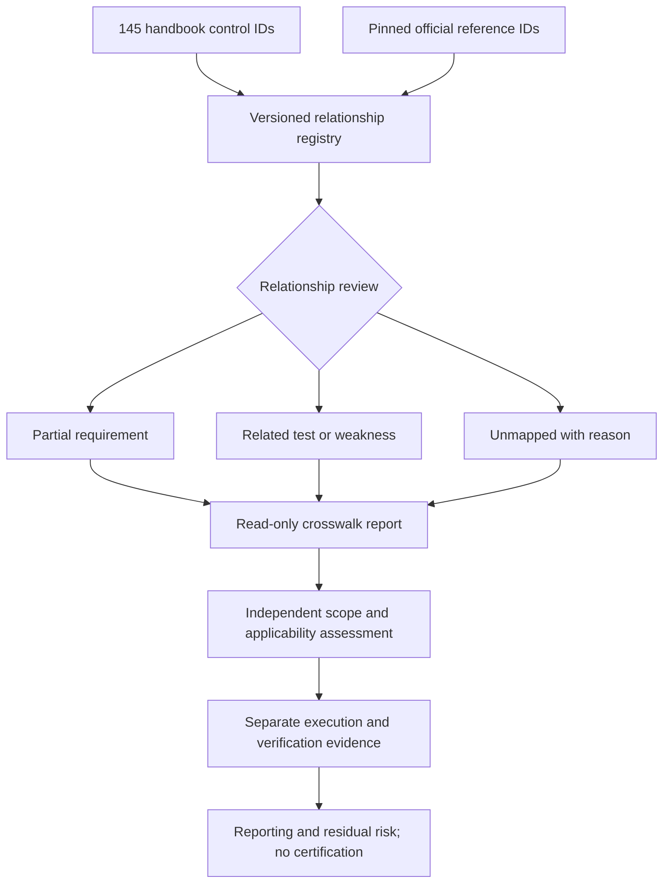
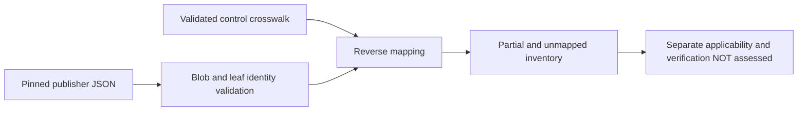
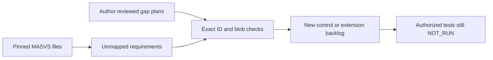

# Standards crosswalk (#97)

[فارسی](standards-crosswalk-FA.md)

Schema v1: all 145 handbook controls have explicit rows, 103 partial and 42 unmapped; 171 unique selected reference IDs and 259 relationships. These are catalog mapping counts, not coverage, compliance or verified results.

| Source | Pinned version | Type | Selected IDs |
|---|---|---|---:|
| [ASVS](https://github.com/OWASP/ASVS/tree/180622b1329ee7ed349c9f5ce5e14fa91f42c359) | 5.0.0 | Requirement | 147 |
| [WSTG](https://github.com/OWASP/wstg/tree/dd33419e10edb22b78d89325a6c2aad9f184e3a2) | 4.2 | Test | 4 |
| [MASVS](https://github.com/OWASP/masvs/tree/8e133d09f4140518ed04cc254b18be9ff4990ffc) | 2.1.0 | Requirement | 8 |
| [MASTG](https://github.com/OWASP/mastg/tree/990472dbcffe126f5556045d60270c4ffdfdde72) | 2.0.0 | Test | 2 |
| [MASWE](https://github.com/OWASP/maswe/tree/308b82b4bbe29166934fb5a621b40471cfea61db) | 1.0.0 | Weakness | 2 |
| [CWE](https://cwe.mitre.org/data/) | 5.0 | Weakness | 8 |

OWASP IDs were checked against pinned Git blobs; ASVS leaf IDs were extracted from the official JSON. WSTG IDs are versioned. MASTG entries reside in tests-beta paths and are test guidance only. MASWE and MASTG are separate editions; do not join historical cross-references by ID alone. CWE IDs were checked against official 5.0 definition pages on 2026-11-25; live URLs can change. The registry stores IDs, source paths, Git blob identities and original short topic/rationale summaries, not standards texts. Author review is recorded, not independent human approval.



## Usage

```bash
python3 <skill-dir>/scripts/security_standards.py
python3 <skill-dir>/scripts/security_standards.py --control API-07 --control MOB-03
```

No project or ledger is opened. PARTIAL means selected relationship, not partial compliance. UNMAPPED means no sufficiently specific relationship established in this edition, not out of scope or safe. Each relationship has a rationale and conditional applicability hint. Assessment and verification remain NOT_ASSESSED and NOT_VERIFIED. CWE/MASWE weakness taxonomies, WSTG/MASTG test guidance and ASVS/MASVS requirements have distinct denominators. No compliance percentage.

API-07 relates to ASVS 5.0.0 1.2.4, WSTG-v42-INPV-05 and CWE-89. MOB-03 relates to MASVS-NETWORK-2, MASWE-0028 and MASTG-TEST-0242. Risk-based handbook pinning policy differs from the MASVS requirement. Android applicability is separate.

## Testing and maintenance

The catalog Git blob identity guards silent changes. Offline tests check complete rows, exact selection, unknown IDs, duplicates, versions and revisions, source URLs, relationship/applicability types, no false certification, mobile editions, unmapped status, deterministic CLI and blob/ID validation with synthetic fixtures. Offline tests do not refetch publisher content or adjudicate semantics.

For optional upstream revalidation, obtain official pinned files at the registry paths under directories ASVS, WSTG, MASVS, MASTG and MASWE, and the official CWE 5.0 XML from the publisher archive:

```bash
python3 scripts/verify_standards_sources.py --source-dir /path/to/publisher-artifacts --cwe-xml /path/to/cwe_v5.0.xml
```

This checks Git blob identity, exact IDs and CWE XML edition/weakness IDs without executing publisher code. Full execution with downloaded artifacts is not claimed; maintenance recheck is separate from default offline CI. New editions require reviewed identifiers and semantics, retained history and independent human review before external claims. #98 can consume the registry; #105 reviews release claims. Unmapped governance, infrastructure and process controls need appropriate additional references rather than invented links. No ledger migration. Rollback via PR revert.

## Crosswalk consistency hardening (#97)

Reject boolean/float schema versions, extra mapping claims and mixed source artifact groups. This validates registry integrity, not semantic equivalence or independent human review. Full official artifact revalidation remains an explicit separate acceptance task; no claim of execution in this increment. CI pending.

## Official source revalidation gate (#97)

17 pinned OWASP artifacts were separately re-read at their exact publisher revisions; 163 IDs and the recorded Git blob identities matched (147 ASVS, 4 WSTG, 8 MASVS, 2 MASTG, 2 MASWE). CI now runs `python scripts/verify_standards_sources.py --fetch-official` using bounded public retrieval, the pinned raw Git files and the official CWE 5.0 XML ZIP; checks all 171 IDs, artifact identity and exact CWE edition, emits the CWE XML SHA-256. No ZIP extraction to filesystem, no source redistribution or target code execution. Local input mode remains supported. Offline tests exercise archive edition and identifier rejection. CI result pending; semantic equivalence and independent human approval are not established.

## Full ASVS requirement inventory (#149)

The pinned OWASP ASVS 5.0.0 JSON at revision `180622b1329ee7ed349c9f5ce5e14fa91f42c359` (Git blob `16a314527781b79f2e499ac8f1e33eaf76234d22`) contains 345 leaf requirements in 17 chapters, including 70 level-1, 183 level-2 and 92 level-3 requirement labels (not cumulative level totals). Publisher license: [CC BY-SA 4.0](https://github.com/OWASP/ASVS/blob/180622b1329ee7ed349c9f5ce5e14fa91f42c359/LICENSE.md). The separate read-only inventory emits IDs, level labels, reverse control links, counts and gaps, not publisher requirement prose. Existing mapping baseline: 147 partially mapped and 198 unmapped; all applicability and verification states remain unknown/not verified. This is a complete identity inventory, not complete semantic mapping, runtime assessment, or compliance coverage.

```bash
python3 <skill-dir>/scripts/security_asvs.py --source /path/to/pinned-asvs.json
python3 scripts/verify_standards_sources.py --fetch-official --asvs-inventory-output /tmp/asvs-inventory.json
```



CI retains the inventory generated from the verified publisher bytes. Five new tests cover exact identity, unknown states, source mutation, malformed identities and orphan links. The artifact and test results must be observed before claiming CI acceptance. Expansion of relevant relationships and independent semantic review remain open. No project read or write, source execution or automatic control verdict.

## Batch acceptance workstreams (#149–160)

The separate [ASVS inventory](#full-asvs-requirement-inventory-149) is merged; #149 still requires meaningful mapping expansion, applicability and verification evidence and independent semantic review. No relationship is automatically added from matching names. The new repository-only `scripts/standards_inventory.py` retrieves pinned public WSTG 4.2 checklist JSON, MASVS 2.1.0 control files, MASTG 2.0.0 test/test-beta file identities, MASWE 1.0.0 weakness file identities and CWE 5.0 Weakness XML. It reports reverse mapping and gaps without source prose. Direct tree inspection found 24 MASVS controls, 292 MASTG test paths, 78 MASWE weakness paths, and 98 WSTG checklist entries / 97 unique identifiers. The publisher checklist duplicates WSTG-INPV-13; a removed Buffer Overflow page and a Format String Injection page share it. Keep the conflict explicit; checklist inventory is not exhaustive verification of all test pages. MASTG lifecycle, platform applicability and actual test execution remain unverified. CWE XML edition and SHA-256 are recorded; categories/views are excluded. No auto-mapping, certification or project assessment.

See [release interoperability evidence](standards-acceptance.md) for SARIF, CVSS, SBOM, Scorecard and preview provenance. Full #105 remains BLOCKED.

## Mapping edition v2 — curated expansion (#149–154)

The v1 counts above are historical. V2 retains all previous links and adds 55 individually author-reviewed relationships to exact new publisher IDs, with original rationale and explicit partial boundaries. The schema stays v1; current mapping edition is v2. New totals: 226 reference IDs, 314 relationships; 105 partially mapped handbook controls and 40 unmapped controls, out of 145. ASVS 164, WSTG 14, MASVS 17, MASTG 7, MASWE 8 and CWE 16. The inventory denominators remain distinct; no combined percentage. Previous v1 records remain historical and must not be reinterpreted as v2 evidence. All additions are advisory, not test execution or independent review. Some standards use different edition/lifecycle models; do not derive automatic MASWE relationships from MASTG beta front matter. Unmapped requirements remain genuine gaps requiring review or a justified out-of-scope assessment; do not fabricate mappings to increase counts.

## MASVS unmapped requirement review (#151)

The seven unmapped MASVS 2.1.0 requirements were individually compared with the current handbook and pinned publisher files. The machine-readable `masvs-gap-review.json` records exact publisher blob IDs, original rationales and planned authorized acceptance scenarios. Three require a new control (AUTH-2 local authentication, CODE-1 platform support, CODE-2 enforced updates); four require extensions (PRIVACY-2 unlinkability, PRIVACY-3 transparency, PRIVACY-4 user data control, RESILIENCE-4 runtime resistance). Contextual control IDs are not new mappings. The inventory validates all seven dispositions against the exact publisher tree and mapping edition; stale, missing and falsely approved entries fail. Existing coverage stays 17 partial / 7 unmapped; all planned tests are unexecuted, and independent review remains NOT_RUN. This is a reviewed backlog, not implementation of the missing controls.



## MASVS-CODE-1: explicit OS floor configuration check (#151)

Use `python3 <skill-dir>/scripts/security_mobile_policy.py --platform android --metadata /path/to/resolved-AndroidManifest.xml --required-floor 28` or `--platform ios --metadata /path/to/Info.plist --required-floor 16.0`. Values are examples, not recommended minimums. The caller selects the product policy and provides resolved app metadata. The check compares numeric Android API/iOS versions, emits metadata digest and MEETS/BELOW/INCONCLUSIVE configuration status, and fails nonzero on unmet or unresolved policy. It reads only supplied metadata, not target code execution. Device runtime, patch/support lifecycle, policy adequacy and full MASVS-CODE-1 acceptance remain unverified. No new catalog mapping or compliance assertion.

## Publisher inventory reconciliation (#150–154)

Mapped MASVS, MASTG and MASWE references now require exact path and Git blob identity in the pinned publisher inventory. Missing mapped mobile or CWE IDs fail; WSTG checklist omissions and duplicated identities remain explicit review-required cases rather than being silently dropped. The report records matched identities and reconciliation status for each standard. ASVS retains its existing exact leaf/artifact validation. This strengthens identity evidence only, not semantic mapping, project applicability or executed tests. CI must be observed before acceptance.

## Cumulative ASVS review plan (#149)

Use `python3 <skill-dir>/scripts/security_asvs.py --source /path/to/pinned-asvs.json --review-level 2` to produce a cumulative Level 1+2 review worklist, including every unmapped selected requirement. Levels 1, 2 and 3 are explicit review selections; higher-level IDs remain listed separately. Each selected requirement identifies the next mapping/applicability review action and retains NOT_ASSESSED/NOT_VERIFIED. No inferred assurance level, assessment or compliance. Default full inventory is unchanged. Offline regression tests cover selection and unknown states; CI pending.

## MASVS-CODE-2: minimum build enforcement evidence review (#151)

`python3 <skill-dir>/scripts/security_mobile_update.py --policy policy.json --observations observations.json` evaluates explicitly supplied boundary observations for otherwise authorized synthetic requests. The policy contains only `schema_version: 1`, `platform: android|ios`, and integer `minimum_build` (2 to 2147483646). Observations contain `schema_version: 1`, `policy_sha256` of the exact policy bytes, and an `observations` array. Each row contains `scenario` (`BELOW_MINIMUM`, `AT_MINIMUM`, `ABOVE_MINIMUM`), adjacent integer `build`, `decision` (`ALLOWED`, `DENIED`, `INCONCLUSIVE`) and distinct lowercase `evidence_sha256`. Old build must be denied and adjacent authorized current/new builds allowed. Missing, contradictory or inconclusive evidence returns nonzero; raw evidence is not read or published. This intentionally limited reviewer does not execute requests, verify policy signatures or prove the supplied observations, and is not full MASVS-CODE-2 acceptance. Dotted iOS builds, staged rollout exceptions and offline behavior require separate review. CI pending.

## MASVS synthetic authentication and privacy observation review (#151)

`python3 <skill-dir>/scripts/security_mobile_observations.py --reference MASVS-AUTH-2 --observations synthetic.json` (also accepts `MASVS-PRIVACY-2` and `MASVS-PRIVACY-3`). All inputs require `schema_version: 1` and `synthetic_only: true`; never supply real identifiers. AUTH-2 requires distinct evidence digests and decisions for valid bound challenge, cancellation, failed authentication, replayed and mismatched challenges, and enrollment-change reauthentication. PRIVACY-2 checks shared synthetic identifier SHA-256 values across supplied purposes; PRIVACY-3 compares declared and observed category/purpose/recipient tuples and retention days. Missing or contradictory observations return nonzero. Inputs are caller assertions; no source evidence, key binding, device runtime, linkability, actual notices or retention is independently verified. No compliance claim or new crosswalk mapping. CI pending.

## Mapping edition v3 — web acceptance batch (#149–150)

This increment preserves every v2 relationship and adds 8 ASVS and 9 WSTG references (17 new advisory relationships). Current totals: 243 selected IDs, 331 relationships, 105 partially mapped and 40 unmapped handbook controls. ASVS 172/345, WSTG 23/97 unique checklist identities. Other standard counts unchanged. Source scope: exact pinned ASVS JSON and WSTG 4.2 pages, with source blob checks in CI. WSTG publisher license: [CC BY-SA 4.0](https://owasp.org/projects/web-security-testing-guide?tab=main); publisher revision and checklist digest remain pinned. WSTG-ERRH-02 is a merged page, not added as a separate active procedure. The duplicate INPV-13 remains unresolved. Mapping is advisory, not an implemented scanner or execution result. The following table identifies each new relationship and its bounded review purpose.

| Reference | Control | Review purpose |
|---|---|---|
| WSTG-v42-INPV-19 | API-08 | SSRF |
| WSTG-v42-INPV-17 | ANG-06 | Host header trust |
| WSTG-v42-CLNT-04 | ANG-11 | Client redirect validation |
| WSTG-v42-CLNT-10 | API-11 | WebSocket security |
| WSTG-v42-ERRH-01 | API-10 | Error disclosure |
| WSTG-v42-CONF-11 | DATA-06 | Cloud storage authorization |
| WSTG-v42-BUSL-06 | BIZ-04 | Workflow state integrity |
| WSTG-v42-SESS-07 | IAM-09 | Session expiry |
| WSTG-v42-CRYP-01 | HOST-04 | Transport security |
| ASVS 3.2.1 | API-03 | Response rendering context |
| ASVS 4.3.2 | API-12 | GraphQL introspection |
| ASVS 5.2.4 | API-09 | Upload resource quotas |
| ASVS 5.4.1 | DATA-06 | Download filename handling |
| ASVS 7.1.1 | IAM-09 | Session lifetime policy |
| ASVS 12.2.2 | HOST-04 | Public TLS certificate trust |
| ASVS 12.3.3 | DATA-03 | Internal transport confidentiality |
| ASVS 14.1.2 | GOV-05 | Sensitive data protection policy |

The new regression test checks every added relationship, unknown verification and assessment states, and rejects a stale mapping edition. MASVS gap-review edition binding is refreshed without changing its seven reviewed gaps. No independent human review, target execution, automatic WSTG procedure or compliance claim. All remaining unmapped requirements need review; CI results are pending.
