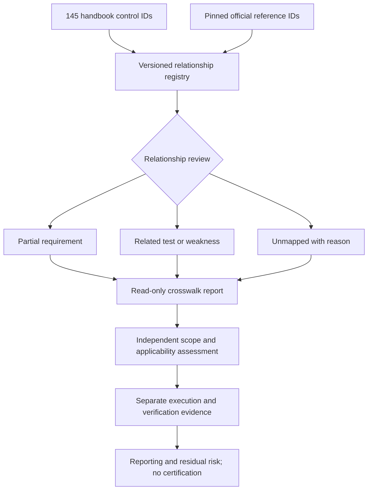

# Standards crosswalk (#97)

[فارسی](standards-crosswalk-FA.md)

Schema v1: all 145 handbook controls have explicit rows, 103 partial and 42 unmapped; 171 unique selected reference IDs and 259 relationships. These are catalog mapping counts, not coverage, compliance or verified results.

| Source | Pinned version | Type | Selected IDs |
|---|---|---|---:|
| [ASVS](https://github.com/OWASP/ASVS/tree/180622b1329ee7ed349c9f5ce5e14fa91f42c359) | 5.0.0 | Requirement | 147 |
| [WSTG](https://github.com/OWASP/wstg/tree/dd33419e10edb22b78d89325a6c2aad9f184e3a2) | 4.2 | Test | 4 |
| [MASVS](https://github.com/OWASP/masvs/tree/8e133d09f4140518ed04cc254b18be9ff4990ffc) | 2.1.0 | Requirement | 8 |
| [MASTG](https://github.com/OWASP/mastg/tree/990472dbcffe126f5556045d60270c4ffdfdde72) | 2.0.0 | Test | 2 |
| [MASWE](https://github.com/OWASP/maswe/tree/308b82b4bbe29166934fb5a621b40471cfea61db) | 1.0.0 | Weakness | 2 |
| [CWE](https://cwe.mitre.org/data/) | 5.0 | Weakness | 8 |

OWASP IDs were checked against pinned Git blobs; ASVS leaf IDs were extracted from the official JSON. WSTG IDs are versioned. MASTG entries reside in tests-beta paths and are test guidance only. MASWE and MASTG are separate editions; do not join historical cross-references by ID alone. CWE IDs were checked against official 5.0 definition pages on 2026-11-25; live URLs can change. The registry stores IDs, source paths, Git blob identities and original short topic/rationale summaries, not standards texts. Author review is recorded, not independent human approval.



## Usage

```bash
python3 <skill-dir>/scripts/security_standards.py
python3 <skill-dir>/scripts/security_standards.py --control API-07 --control MOB-03
```

No project or ledger is opened. PARTIAL means selected relationship, not partial compliance. UNMAPPED means no sufficiently specific relationship established in this edition, not out of scope or safe. Each relationship has a rationale and conditional applicability hint. Assessment and verification remain NOT_ASSESSED and NOT_VERIFIED. CWE/MASWE weakness taxonomies, WSTG/MASTG test guidance and ASVS/MASVS requirements have distinct denominators. No compliance percentage.

API-07 relates to ASVS 5.0.0 1.2.4, WSTG-v42-INPV-05 and CWE-89. MOB-03 relates to MASVS-NETWORK-2, MASWE-0028 and MASTG-TEST-0242. Risk-based handbook pinning policy differs from the MASVS requirement. Android applicability is separate.

## Testing and maintenance

The catalog Git blob identity guards silent changes. Offline tests check complete rows, exact selection, unknown IDs, duplicates, versions and revisions, source URLs, relationship/applicability types, no false certification, mobile editions, unmapped status, deterministic CLI and blob/ID validation with synthetic fixtures. Offline tests do not refetch publisher content or adjudicate semantics.

For optional upstream revalidation, obtain official pinned files at the registry paths under directories ASVS, WSTG, MASVS, MASTG and MASWE, and the official CWE 5.0 XML from the publisher archive:

```bash
python3 scripts/verify_standards_sources.py --source-dir /path/to/publisher-artifacts --cwe-xml /path/to/cwe_v5.0.xml
```

This checks Git blob identity, exact IDs and CWE XML edition/weakness IDs without executing publisher code. Full execution with downloaded artifacts is not claimed; maintenance recheck is separate from default offline CI. New editions require reviewed identifiers and semantics, retained history and independent human review before external claims. #98 can consume the registry; #105 reviews release claims. Unmapped governance, infrastructure and process controls need appropriate additional references rather than invented links. No ledger migration. Rollback via PR revert.

## Crosswalk consistency hardening (#97)

Reject boolean/float schema versions, extra mapping claims and mixed source artifact groups. This validates registry integrity, not semantic equivalence or independent human review. Full official artifact revalidation remains an explicit separate acceptance task; no claim of execution in this increment. CI pending.

## Official source revalidation gate (#97)

17 pinned OWASP artifacts were separately re-read at their exact publisher revisions; 163 IDs and the recorded Git blob identities matched (147 ASVS, 4 WSTG, 8 MASVS, 2 MASTG, 2 MASWE). CI now runs `python scripts/verify_standards_sources.py --fetch-official` using bounded public retrieval, the pinned raw Git files and the official CWE 5.0 XML ZIP; checks all 171 IDs, artifact identity and exact CWE edition, emits the CWE XML SHA-256. No ZIP extraction to filesystem, no source redistribution or target code execution. Local input mode remains supported. Offline tests exercise archive edition and identifier rejection. CI result pending; semantic equivalence and independent human approval are not established.
