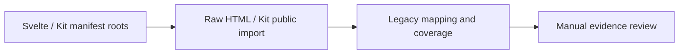

# بسته بازبینی Svelte و SvelteKit

نگه‌دارنده: @omidkh68 · اولویت P0 · #33، #72 · [English](svelte-kit.md)

## قرارداد

بسته Svelte/Kit نسخه ۱ دو نشانه متنی محدود و آفلاین را برای مؤلفه‌های Frontend منتخب و کشف‌شده از Manifest اضافه می‌کند. کاتالوگ تاریخی ۱۴۵ کنترل و اسکن بدون محدوده بدون تغییر می‌مانند.

| شناسه Rule | نگاشت تاریخی | Candidate |
|---|---|---|
| SVELTE.DOM.RAW_HTML | ANG-01 | تگ HTML خام در فایل .svelte |
| KIT.ENV.PUBLIC_SECRET_NAME | ANG-12 | Import نام‌دار محدود و تک‌خطی با شناسه حساس‌نما از ماژول محیطی عمومی |

نشانه دوم به شواهد Manifest مربوط به SvelteKit نیاز دارد و روی JS/TS و .svelte اعمال می‌شود. هر دو ماژول قدیمی $env/static/public و جدیدتر $app/env/public را می‌شناسد. زیررشته‌های حساس‌نما شامل SECRET، PRIVATE_KEY، PASSWORD، ACCESS_TOKEN، REFRESH_TOKEN و API_KEY هستند. برخی شناسه‌های عمومی عمدی‌اند. اسکنر شناسه یا مقدار را گزارش نمی‌کند. HTML خام ممکن است پاک‌سازی شده باشد.

## استفاده و شواهد

```bash
python3 <skill-dir>/scripts/security_scan.py --root . --profile frontend --format json
```

خلاصه svelte_kit ریشه‌های منتخب، ریشه‌های Kit، فایل‌های واجد شرایط، قواعد فعال و شمارش را فهرست می‌کند. سقف‌های سراسری و هر کنترل اعمال می‌شوند. فیلد scoped_additional_indicator_rules شامل قواعد فعال است. Tracker شناسه‌های تاریخی و عنوان‌های متمایز را استفاده می‌کند؛ مهاجرت Ledger لازم نیست.

منبع واقعی HTML و پاک‌سازی، اعلان متغیرهای محیطی عمومی و Artifactهای Build کلاینت را با Fixture مجاز بررسی کنید. در SvelteKit 3 ماژول‌های قدیمی $env به نفع متغیرهای محیطی صریح منسوخ شده‌اند؛ فقط از Manifest نسخه نصب‌شده را استنباط نکنید. توابع Load سرور، Form Action، Route Handler، مجوز Resource، Payloadهای SSR و جداسازی Cache کاربران را مستقل از ناوبری کلاینت بررسی کنید. نشانه، بهره‌برداری یا افشای راز را اثبات نمی‌کند.

## محدودیت‌ها و بازگردانی

Parser Svelte، جریان داده، تحلیل Alias، Import پویا/Namespace، Import نام‌دار چندخطی، تحلیل اعلان، اسکن واقعی Bundle یا تأیید نسخه فریم‌ورک نداریم. Regex ممکن است Comment، Literal یا Alias را هم علامت بزند. کد هدف اجرا نمی‌شود، شبکه استفاده نمی‌شود و فایل .env حذف‌شده بررسی نمی‌شود. نبود نشانه امنیت را اثبات نمی‌کند. اعتبارسنجی بسته، رگرسیون و بررسی tarball npm را اجرا کنید. Fixtureهای مصنوعی مثبت/منفی، محدوده، فیلتر Kit، سازگاری قدیمی و عدم افشای سورس را پوشش می‌دهند. برای بازگردانی PR مستقل را Revert کنید.

مراجع: [HTML خام Svelte](https://svelte.dev/docs/svelte/@html)، [متغیرهای محیطی SvelteKit](https://svelte.dev/docs/kit/environment-variables)، [ماژول عمومی قدیمی](https://svelte.dev/docs/kit/$env-static-public).

## معماری و ارزش تست (#72)



نمونه‌ها تطابق اختصاصی Kit، منفی، محدوده و حذف داده را می‌سنجند؛ اثبات Runtime نیست.
