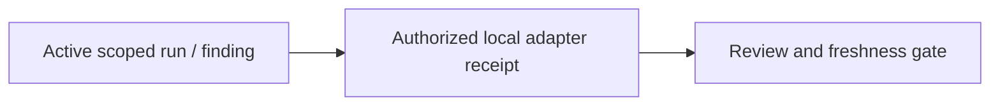

# Tracker-bound local execution evidence

P0 · Related to #58 and RFC #35 · Maintainer @omidkh68. [فارسی](tracker-execution-evidence-FA.md)

## Usage

Start an explicit, resolved component scope in fix or verify mode. Record the confirmed or fixed-unverified finding first. Select the existing finding source path, every recorded fix file and the trusted Python unittest module; all must belong to selected components.

```bash
python3 <skill-dir>/scripts/security_tracker.py run-test --root . --run <run-id> --finding-id <finding-id> --test-file api/test_security.py --file api/test_security.py --file api/app.py --timeout 15 --authorize-local-test
```

The tracker invokes the local adapter directly, records its receipt in the active run and returns a test ID. Exit 0 means the record was saved, not that the test passed: inspect the JSON result. No arbitrary imported receipt can become LOCAL_EXECUTION through the manual test command. Manual evidence is MANUAL_REPORTED, including historical records without a quality field.

For a local PASS to support a subsequent explicit VERIFIED_FIXED record, supply the linked test ID and a meaningful `verification.security_assertion_review` (10–2000 characters) explaining why the assertion covers the actual security weakness. Keep the recorded finding location and fix unchanged. The tracker validates run/finding identity, timestamps, adapter, counts, exit code, output metadata and current selected-file fingerprint; changed selected inputs or finding invalidate eligibility. Failed/blocked/incomplete runs cannot support this transition. A passing test alone never changes status.

## Trust and compatibility

Existing manually reported verification remains compatible, explicitly labeled MANUAL_REPORTED, and must not be represented as independent execution. LOCAL_EXECUTION is stronger provenance within the trusted local process, not cryptographic attestation or proof of semantic test adequacy; independently_verified_fix stays false. Tests can have side effects; use trusted code in an isolated authorized environment, no production credentials. Scope is a selected-file boundary, not a sandbox or transitive dependency inventory. Scope uses the run's stored component inventory; rediscover and start a new run if the project structure changes. The tracker does not detect all changes outside selected inputs, nor malicious modification of local history. Archived runs remain immutable through tracker commands. Historical evidence is not automatically downgraded after later source edits.

## Verification and rollback

Run package validation and the offline unittest suite. Fixtures exercise positive execution, stale source, missing review, consent, unknown finding, excluded components, manual provenance spoofing, failed execution and finalized runs. Revert the feature if necessary; existing manual commands and archives remain compatible. Wider independent attestation and framework adapters remain follow-up work.

The receipt is also bound to the stored scope digest. Regression coverage includes malformed and unrelated receipt fields, duplicate record transitions are rejected, and the positive fixture asserts both allowed and denied property updates in a local synthetic module.

The tracker rejects inputs outside the stored component scope before reading their bytes for fingerprinting.

Node 22/24 support: use `--adapter node-test-v1`, matching explicit test file and selected source/config files. See [runner](verification-runner.md#nodejs-local-adapter-35). All evidence gates remain in force.

## Architecture and testing value (#58 / #35)



Tests reject unrelated, stale, failed and forged manual execution evidence; only reviewed current receipts qualify.
