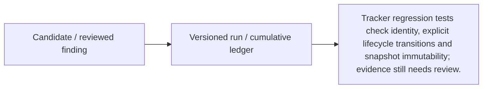

# ردیابی یافته، نسخه‌ها و شواهد

[English](tracking.md)

تمام فراخوانی‌های Security Guardian گزارش مسیر ثابت در **پروژه هدف** زیر `.security-guardian/` می‌سازند. در `audit` و `plan` کد اصلی تغییر نمی‌کند، ولی فایل Audit نوشته می‌شود.

## فایل‌های گزارش

| فایل | هدف |
|---|---|
| `CURRENT.md` | ثبت تجمعی خوانا، وضعیت و دلیل حل‌نشده |
| `index.json` | Index افزایشی نسخه/Run، وضعیت پایان و فراداده |
| `ledger.json` | رکوردهای پایدار فعلی یافته و تاریخچه وضعیت |
| `runs/vNNNN-.../RUN.md` | Snapshot خوانای یک فراخوانی |
| `runs/vNNNN-.../scanner.json` | سیگنال Candidate اولیه و ماتریس کاربرد ۱۴۵ کنترل |
| `runs/vNNNN-.../findings.json` | Snapshot یافته‌های ثبت‌شده پس از Run |
| `runs/vNNNN-.../events.jsonl` | رویدادهای زمانی فقط افزایشی حین Run |
| `runs/vNNNN-.../manifest.json` | Mode، Context Git، وضعیت پایان و تست |

## چرخه وضعیت

| وضعیت | مفهوم | شواهد پذیرفتنی |
|---|---|---|
| `CANDIDATE` | الگوی Scanner؛ **تأییدنشده** | سیگنال فایل/Rule، بدون ادعای Exploit |
| `NEEDS_REVIEW` | مرتبط ولی سورس/Context ناکافی برای تأیید | مرز یا پیش‌نیاز تست غایب |
| `CONFIRMED_OPEN` | ضعف دارای شواهد و نیازمند اقدام | فایل/محل، نقض مشخص Trust Boundary، اقدام بعد |
| `FIXED_UNVERIFIED` | کد/Config تغییر کرده ولی اصلاح مستقل تأیید نشده | خلاصه Patch و دلیل عدم تکمیل تست |
| `VERIFIED_FIXED` | اصلاح با بررسی موفق اجراشده تأیید شده | روش Verification، executed=true، PASS، شواهد |
| `DEFERRED` | عمداً به تعویق افتاده | دلیل، اقدام بعد و برنامه مالک/زمان |
| `BLOCKED` | امکان ادامه امن نیست | وابستگی/مجوز مانع و اقدام بعد |
| `FALSE_POSITIVE` | سیگنال بازبینی‌شده آسیب‌پذیری نیست | دلیل و شواهد کفایت کنترل |
| `ACCEPTED_RISK` | مالک مجاز ریسک باقی‌مانده را می‌پذیرد | تأییدکننده نام‌دار و اقدام بعد مستند |

`NOT_APPLICABLE`، `OUT_OF_SCOPE` و `VERIFIED_PASS` به **کاربرد/ارزیابی در سطح کنترل** تعلق دارند، نه وضعیت هر یافته. این دو را تفکیک کنید.

## پیشروی واقع‌بینانه

```text
v0001: CANDIDATE        -> possible unsafe NestJS ValidationPipe config
v0002: CONFIRMED_OPEN   -> unsafe update accepted unauthorized role field
v0003: FIXED_UNVERIFIED -> strict DTO patch; e2e fixture unavailable
v0004: VERIFIED_FIXED  -> targeted negative API regression executed and passed
v0005: CONFIRMED_OPEN   -> regression reopened under the same ID
```

به‌ترتیب: احتمال Config ناامن ValidationPipe، پذیرش فیلد role غیرمجاز، Patch سخت‌گیر DTO بدون Fixture E2E، اجرای موفق رگرسیون منفی هدفمند API، بازگشایی رگرسیون با همان ID.

## چرا چیزی اصلاح نشد

دلیل دقیق ثبت کنید، مثلاً: «کاربران Seed با Tenant لازم در دسترس نیستند؛ تست مجاز بین Tenant ممکن نیست»، «تغییر Session Cookie به Deployment هماهنگ Client بومی نیاز دارد»، «تغییر Firewall تولید به مجوز عملیات و بازه Rollback نیاز دارد». از عبارت مبهم «اصلاح نشد» بدون توضیح بپرهیزید.

## خلاصه بازبینی و تاریخچه فردی

نصب Standalone:

```bash
python3 ~/.claude/skills/security-guardian/scripts/security_tracker.py summary --root .
python3 ~/.claude/skills/security-guardian/scripts/security_tracker.py history --root . --id SG-API-01-<real-suffix>
```

نصب Marketplace: اسکریپت `scripts/security_tracker.py` نصب‌شده Skill را از جزئیات Plugin در Claude Code پیدا کنید یا از Skill در حال اجرا بخواهید آخرین Run را خلاصه کند. مسیر ثابت در Cache پلاگین Claude را مفروض نگیرید.

## حفاظت گزارش‌ها

- **هرگز Ledger و یافته‌های هر Run را خودکار Commit یا Push نکنید.**
- `.security-guardian/` را به `.gitignore` مخزن تحت Audit اضافه کنید یا مخزن خصوصی شواهد امنیتی با کنترل دسترسی، Redaction و تأیید صریح استفاده کنید.
- Credential خام، JWT، API Key، بدنه درخواست Production، داده شخصی یا Payload بهره‌برداری را در Ledger ذخیره نکنید. ارجاع file:line پاک‌سازی‌شده و Hash ترجیح دارد.
- Retention، کنترل دسترسی و Backup را مستقل اعمال کنید؛ Snapshotها از طریق Workflow Tracker تغییرناپذیرند، **نه از نظر رمزنگاری غیرقابل دست‌کاری**. مدیر فایل‌سیستم همچنان می‌تواند تغییرشان دهد.

جزئیات Schema و فرمان‌ها: [Workflow ردیابی](../plugins/security-guardian/skills/security-guardian/references/workflows/tracking.md).

## شواهد تست متصل برای اصلاح تأییدشده (انتشار بعد)

پیش از `VERIFIED_FIXED` تست رگرسیون واقعی را با `finding_ids` شامل ID پایدار یافته ثبت کنید. Tracker `test_id` برمی‌گرداند. یافته تأییدشده بعدی باید در `verification.test_id` ارجاع دهد. Tracker به PASS، Run و Finding یکسان و Git HEAD بدون تغییر در صورت دسترسی نیاز دارد. ارجاع CI URL/خروجی پاک‌شده را ثبت کنید. این سازگاری گزارش را بررسی می‌کند، نه اصالت اجرای واقعی تست، و تغییرات Commitنشده را Fingerprint نمی‌کند. [ماتریس Verification](verification-matrix.md) را ببینید.

## اصلاح طبقه‌بندی اشتباه یافته (Issue #7)

پیش از ثبت، پیاده‌سازی واقعی کنترل و معیار پذیرش را استفاده کنید؛ Tracker محافظ محدود نگاشت Category دارد. تطبیق محافظه‌کارانه است: `MATCHED`، `MISMATCH`، `NEEDS_REVIEW` و `OVERRIDDEN` مستندشده توسط بازبین. محافظ مجموعه محدود دسته‌های رایج را می‌سنجد، نه تمام معنای امنیت. متن ناشناخته طبقه‌بندی دستی می‌خواهد.

**Audit قدیمی فقط خواندنی:**

```bash
python3 ~/.claude/skills/security-guardian/scripts/security_tracker.py mapping-audit --root .
```

**مهاجرت صریح و غیرمخرب (داخل Run جدید):**

```bash
python3 ~/.claude/skills/security-guardian/scripts/security_tracker.py begin --root . --mode verify
python3 ~/.claude/skills/security-guardian/scripts/security_tracker.py reclassify \
  --root . --run ACTUAL_RUN_ID --id ACTUAL_OLD_FINDING_ID \
  --new-control-id API-03 --category security_headers \
  --reason "Reviewed security header finding and corrected its handbook mapping"
python3 ~/.claude/skills/security-guardian/scripts/security_tracker.py finish \
  --root . --run ACTUAL_RUN_ID
```

رکورد قدیمی به‌صورت Tombstone با `SUPERSEDED` باقی می‌ماند؛ جایگزین `reclassified_from`، وضعیت اولیه و تاریخچه کامل دارد. آرشیوهای `runs/` دست‌نخورده می‌مانند و فقط یافته جدید فعال شمرده می‌شود. Audit را خصوصی نگه دارید و نگاشت مبهم را دستی بررسی کنید. [Workflow ردیابی](../plugins/security-guardian/skills/security-guardian/references/workflows/tracking.md) را ببینید.

### اصلاح قدیمی Host/Proxy در SSR

وقتی `mapping-audit` یافته Host routing قدیمی BIZ-01 را شناسایی می‌کند، **فقط** پس از خواندن شواهد اصلی، با `--category ssr_host_proxy_trust` به `ANG-06` بازطبقه‌بندی کنید. بدون تست Host/X-Forwarded-Host در Deployment مجاز، آن را امن ندانید. `ANG-06` فراداده قابل اعتماد SSR Host/Proxy، `BIZ-01` مجوز شیء و `API-15` انتساب IP قابل اعتماد Client را پوشش می‌دهند.

### طبقه‌بندی Build کانتینر و Image CI

`container_build_secret_exposure` به `CLOUD-05` نگاشت می‌شود وقتی شواهد مربوط به Credential، Secret یا فایل Environment وارد Context ساخت Docker یا لایه Image است. نبود فایل Ignore به‌تنهایی اثبات افشای Secret نیست. `ci_image_pinning` برای Imageهای CI/Runner قابل تغییر یا Pinنشده به `SDLC-08` نگاشت می‌شود، متمایز از سخت‌سازی Base Image تولید در `CLOUD-04`. Ruleها محافظ فراداده‌اند؛ Match نه آسیب‌پذیری را اثبات می‌کند نه اصلاح را تأیید. توصیف واقعاً مبهم/ناشناخته را دستی بررسی کنید.

## معماری و ارزش تست (Ledger lifecycle)



undefined
