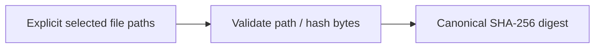

# زیرساخت راستی‌آزمایی: اثرانگشت فایل‌های انتخاب‌شده

نگه‌دارنده: [@omidkh68](https://github.com/omidkh68). اولویت P0؛ [مایلستون v1.3.0](https://github.com/omidkh68/security-guardian/milestone/1). مرتبط با #51 و RFC #35. [English](verification-fingerprint.md)

## هدف
تشخیص تغییر فایل‌های سورس، تنظیمات و تست که صریحاً انتخاب شده‌اند، پیش از پذیرش شواهد آزمون. این جزء فقط خواندنی است؛ Runner، فهرست کامل وابستگی‌ها یا تصمیم تأیید یک یافته محسوب نمی‌شود.

## استفاده
دستور را در مخزن محلی تحت مالکیت و بدون تغییر همزمان، با انتخاب صریح تمام ورودی‌های مرتبط شناخته‌شده اجرا کنید:

```bash
python3 <skill-dir>/scripts/security_fingerprint.py --root . --file src/app.py --file tests/test_security.py --file pyproject.toml
```

در موفقیت (کد خروجی ۰)، JSON شامل schema_version، algorithm، scope (SELECTED_FILES_ONLY)، مسیرهای نسبی مرتب‌شده، file_count، total_bytes و digest است. اثرانگشت نسخه‌دار SHA-256 به نام نسبی استاندارد، طول دقیق بایت‌ها و هش هر فایل متصل است. ترتیب انتخاب اثر ندارد؛ تغییر محتوا، نام یا مجموعه فایل‌ها اثرانگشت را تغییر می‌دهد. تغییرات ذخیره‌شده روی دیسک که Commit نشده‌اند محاسبه می‌شوند؛ بافر ذخیره‌نشده ویرایشگر لحاظ نمی‌شود.

## ایمنی و محدودیت‌ها
- ۱ تا ۲۵۶ فایل عادی یکتا با مسیر نسبی و جداکننده اسلش؛ ۴ MiB برای هر فایل و ۱۶ MiB در مجموع.
- فایل غایب یا ناخوانا، خروج از محدوده، Symlink، دسته مسیر خصوصی، فایل غیرعادی، عبور از سقف منابع یا تغییر قابل تشخیص حین خواندن باعث شکست ایمن می‌شود (کد ۲، بدون Digest).
- دسته‌های خصوصی شناخته‌شده حذف می‌شوند؛ سایر فایل‌های دارای اطلاعات محرمانه نباید انتخاب شوند. خروجی شامل نام‌های نسبی و هش تجمیعی است و باید خصوصی بماند. محتوا چاپ نمی‌شود؛ اجرای فرمان، شبکه یا نوشتن در پروژه وجود ندارد.
- این ابزار Sandbox در برابر عامل خصمانه همزمان روی فایل‌سیستم نیست. از مخزن پایدار و مجاز استفاده کنید. اثرانگشت شامل وابستگی‌های انتخاب‌نشده، فایل‌های انتخاب‌نشده خارج از Git یا Ignore، محیط اجرا، تنظیمات راه‌دور یا اسرار نیست. برابری هش به‌تنهایی کامل‌بودن شواهد یا تأیید اصلاح را اثبات نمی‌کند.

## آزمون و بازگردانی
تست‌های آفلاین، قطعیت، تغییر محتوا و مجموعه فایل‌ها، مسیر نامعتبر، انتخاب تکراری، Symlink و سقف منابع را بررسی می‌کنند:

```bash
python3 scripts/validate_package.py
python3 -m unittest discover -s plugins/security-guardian/skills/security-guardian/tests -v
```

Tracker و قواعد VERIFIED_FIXED فعلی تغییر نکرده‌اند. Runner آینده باید اثرانگشت قبل و بعد را ثبت، کفایت محدوده را بررسی و شواهد قدیمی را رد کند. بازگردانی این اسکریپت مستقل و تست‌ها نیاز به مهاجرت Ledger ندارد.

## معماری و ارزش تست (#51)



نمونه‌ها استقلال ترتیب، تغییر بایت، Symlink و مسیر نامعتبر را می‌سنجند؛ فایل منتخب موجودی کامل وابستگی نیست.
