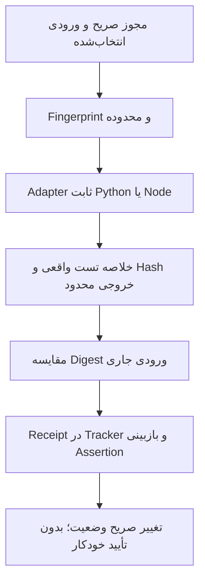
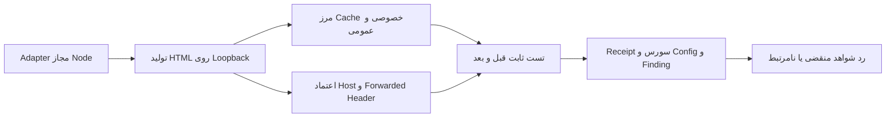
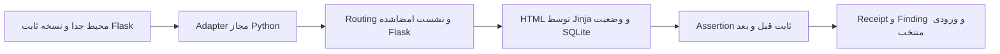
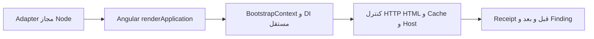
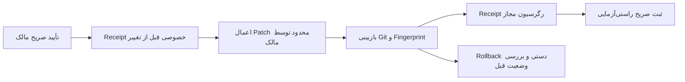

# اجراکننده محلی راستی‌آزمایی با مجوز صریح

نگه‌دارنده: [@omidkh68](https://github.com/omidkh68). اولویت P0، مایلستون v1.3.0، #53 / RFC #35. [English](verification-runner.md)

## قرارداد

Adapter اولیه یک ماژول مشخص و قابل اعتماد تست Python `unittest` را روی POSIX با مفسر فعلی Python اجرا می‌کند. کاربر باید اجرای محلی را مجاز کند؛ در ممیزی خودکار اجرا نشود. فرمان Shell دلخواه نمی‌پذیرد، ابزار نصب نمی‌کند و وضعیت Tracker را تغییر نمی‌دهد.

```bash
python3 <skill-dir>/scripts/security_test_runner.py --root . --test-file tests/test_security.py --file tests/test_security.py --file src/app.py --finding-id SG-ANG-01-0123456789AB --timeout 15 --authorize-local-test
```

شناسه واقعی یافته و تمام ورودی‌های مرتبط سورس/تنظیمات/تست را صریحاً انتخاب کنید. فایل تست باید فایل نسبی `test_*.py` انتخاب‌شده باشد. فایل‌های خصوصی شناخته‌شده، خروج از محدوده، Symlink، ورودی غایب و سقف منابع از [قواعد اثرانگشت](verification-fingerprint.md) پیروی می‌کنند. این اجرای تست محلی است، نه بهره‌برداری یا مجوز دسترسی به تولید.

## رسید و نتایج

رسید JSON هویت Adapter، نسخه Python، شناسه یافته، مسیر تست، Timeout، زمان‌ها، کد خروج واقعی، تعداد تست‌ها، تعداد بایت/هش خروجی محدود، اثرانگشت ورودی‌های انتخاب‌شده قبل و بعد و شروع‌شدن فرایند فرزند را ثبت می‌کند. stdout/stderr عادی Python در تست‌ها دور ریخته می‌شود؛ هش مربوط به پروتکل فرزند و خروجی مستقیم FD نگه‌داری‌شده است، نه لاگ خام کامل تست.

| نتیجه | معنا | کد خروج CLI |
|---|---|---|
| PASS | تعداد تست غیرصفر، بدون شکست/خطا/Skip/شکست مورد انتظار، ورودی‌های انتخاب‌شده بدون تغییر | 0 |
| FAIL | شکست Assertion، خطای تست یا موفقیت غیرمنتظره | 1 |
| INCOMPLETE | نبود تست یا موارد Skip/شکست مورد انتظار | 2 |
| BLOCKED | نبود مجوز، محدوده نامعتبر، سیستم‌عامل پشتیبانی‌نشده یا مشکل شروع/Import/پروتکل | 2 |
| TIMEOUT / OUTPUT_LIMIT / CANCELLED | اجرا در سقف تعیین‌شده کامل نشده یا لغو شده است | 2 |
| STALE | اثرانگشت انتخاب‌شده تغییر کرده یا دیگر قابل محاسبه نیست؛ نتیجه اولیه اجرا جداگانه حفظ می‌شود | 2 |

هیچ نتیجه‌ای `independently_verified_fix` را true نمی‌کند. مرحله بعد باید رسید را در برابر اجرای فعال، یافته، ورودی فعلی، محدوده و Assertionهای امنیتی مرتبط اعتبارسنجی کند.

## ایمنی و محدودیت‌ها

Timeout بین ۱ تا ۶۰ ثانیه است؛ خروجی ترکیبی ذخیره‌شده حداکثر ۱۶ KiB است. فرزند در گروه فرایند جدا اجرا می‌شود؛ شکست/لغو تلاش برای خاتمه گروه ایجاد می‌کند. حالت ایزوله Python و محیط کاهش‌یافته دفاع چندلایه‌اند، نه Sandbox. تست قابل اعتماد همچنان می‌تواند فایل بنویسد، داده در دسترس بخواند، به شبکه دسترسی پیدا کند، فرایند جداشده ایجاد یا خروجی پروتکل را جعل کند. از Fixture محلی تحت مالکیت و مناسب ایزوله‌شده، بدون اعتبارنامه تولید استفاده کنید و ابتدا کد تست و وابستگی‌ها را بازبینی کنید. صرف وجود Flag مجوز اجرای کد غیرقابل اعتماد مخزن نیست. رسید احراز اصالت رمزنگاری‌شده ندارد. اثرانگشت قبل/بعد فقط ورودی‌های انتخاب‌شده روی دیسک را پوشش می‌دهد، نه وابستگی‌های گذرا، سرویس خارجی، بافر ذخیره‌نشده و تغییر موقتی که قبل از اثرانگشت دوم بازگردانده شده است.

## آزمون و بازگردانی

`python3 scripts/validate_package.py` و `python3 -m unittest discover -s plugins/security-guardian/skills/security-guardian/tests -v` را اجرا کنید. تست‌های مصنوعی مجوز، محدوده، موفقیت/شکست واقعی، تست صفر/Skip، Timeout، سورس تغییرکرده و سقف خروجی مستقیم را بررسی می‌کنند. Windows و Adapterهای تخصصی فریم‌ورک هنوز پیاده‌سازی نشده‌اند. در صورت نیاز Adapter مستقل، تست‌ها و مستندات را بازگردانید؛ رکوردهای Ledger قبلی مهاجرت نمی‌کنند.

برای ثبت شواهد در اجرای فعال، به‌جای واردکردن JSON مستقل، از [یکپارچه‌سازی مجاز Tracker](tracker-execution-evidence-FA.md) استفاده کنید. فرمان مستقل همچنان وضعیت یافته را تغییر نمی‌دهد.

## Adapter محلی Node.js (#35)

گزینه `--adapter node-test-v1` باینری قابل اعتماد Node 22/24 خارج از پروژه در PATH و یک ماژول تست صریح JS/MJS/CJS با نام `*.test.*` یا `test_*` را انتخاب می‌کند. npm script، نصب، Shell دلخواه یا اجرای Production ندارد. Worker ثابت خلاصه نهایی node:test را خوانده، تعدادها را اعتبارسنجی و شکست/لغو/Skip/Todo را نگاشت می‌کند؛ stdout تست را برنمی‌گرداند. نسخه Runtime و Fingerprint ورودی‌های انتخاب‌شده در Receipt هستند. Node غایب/ناسازگار BLOCKED، تست صفر یا Skip/Todo برابر INCOMPLETE و شکست FAIL است. محدودیت گروه پردازه، خروجی و زمان مانند Python است. فقط Fixture محلی بازبینی‌شده را اجرا کنید؛ Sandbox، Attestation احرازشده یا اثبات امنیت کل Framework نیست.

```bash
python3 <skill-dir>/scripts/security_tracker.py run-test --root . --run <run-id> --finding-id <finding-id> --adapter node-test-v1 --test-file api/guard.test.mjs --file api/guard.test.mjs --file api/guard.mjs --timeout 15 --authorize-local-test
```



Fixture رگرسیون Assertion مالک/غیرمالک، تغییر ورودی تست، شکست، Skip، Todo، Component خارج از محدوده و اتصال صریح Receipt را بررسی می‌کند. Adapter مرورگر/Flutter/Android/JVM و پذیرش واقعی SSR/cache/race باقی است. شواهد شکست قبل از اصلاح و کفایت پوشش نیازمند نظر بازبین است؛ ادعای پذیرش کامل RFC وجود ندارد.


## پذیرش نمونه محلی قبل/بعد (#35)

نمونه مصنوعی Tracker دو Tenant و GET/PATCH/DELETE را در سطح سیاست مجوز بررسی می‌کند؛ دو Worker واقعی SQLite با Barrier روی یک تغییر وضعیت رقابت می‌کنند. همان فایل تست بدون تغییر ابتدا دو شکست و پس از اصلاح مالکیت و UPDATE شرطی، دو موفقیت می‌خواهد. Digest سورس باید متفاوت و Digest قبل/بعد اجرای موفق برابر باشد. رسید یافته برای کنترل دیگری قابل استفاده نیست. این تست رفتار API واقعی فریم‌ورک، احراز هویت شبکه یا پایگاه داده Production را تأیید نمی‌کند.

## سخت‌سازی نهایی (#35)

پیش از اجرای محلی و پذیرش Receipt موفق، موجودی Component با ریشه‌های اولیه دوباره کشف می‌شود. تغییر مالکیت، Manifest نامعتبر یا کشف ناقص مانع پذیرش است؛ Run جدید با محدوده صریح لازم است. این بررسی سورس را تغییر نمی‌دهد. Hash تمام وابستگی‌ها نیست؛ ورودی‌های منتخب سورس/Config همچنان باید Fingerprint شوند. Ctrl-C حین اجرای Runner گروه پردازه Worker را متوقف و CANCELLED ثبت می‌کند، نه شواهد موفق. فرزندان جداشده و کد تست متخاصم خارج از قرارداد اجرای محلی قابل اعتمادند. رگرسیون، توقف Worker واقعی، رد موجودی قدیمی و حفظ تغییرات Git staged و unstaged نامرتبط را می‌سنجد؛ رفتار Patch دلخواه Agent اثبات نمی‌شود.

## رگرسیون مهلت اجرا در CI (پیش‌نیاز #111 / #35)

در اجرای 45792838058 شاخه اصلی، تست Receipt مربوط به Node با مهلت صریح پنج ثانیه به‌جای PASS نتیجه TIMEOUT داشت. لاگ علت کندی یا گیرکردن Worker را اثبات نمی‌کند. ماتریس Python در CI اکنون Node 24 را صریح انتخاب کرده و نسخه Runtime را ثبت می‌کند. تست عملکرد Receipt از مهلت پیش‌فرض مستند ۱۵ ثانیه استفاده می‌کند؛ Fixture کند مستقل Node باید در مهلت صریح یک ثانیه TIMEOUT برگرداند و Receipt آن برای VERIFIED_FIXED رد شود. مهلت، سقف، طبقه‌بندی نتیجه و مجوز اجرای Runner عملیاتی تغییر نکرده‌اند. تکرار خودکار آزمون برای گرفتن PASS وجود ندارد. پیام تشخیصی فقط فراداده Receipt مصنوعی دارد. شواهد CI در انتظار اجراست.

## نمونه پذیرش مجوزدهی HTTP روی Loopback (#35)

Adapter پایتون یک ماژول تست بدون تغییر را روی سرور موقت HTTP کتابخانه استاندارد اجرا می‌کند که فقط به 127.0.0.1 و پورت تخصیص‌یافته توسط سیستم‌عامل متصل است. سه هویت مصنوعی در دو Tenant تعریف می‌شوند. درخواست‌های GET/PATCH/DELETE شامل اعتبارنامه ناموجود/نامعتبر، غیرمالک در همان Tenant، دسترسی بین Tenantها در هر دو جهت، Header جعلی Tenant، رکورد ناموجود و عملیات موفق مالک هستند. درخواست ردشده نباید مقدار خصوصی افشا کند یا وضعیت را تغییر دهد. نسخه آسیب‌پذیر نمونه باید در Assertion شکست بخورد (نه در زیرساخت)؛ فقط Policy مصنوعی مجوزدهی بازبینی و اصلاح می‌شود و همان تست‌ها باید موفق شوند. Receipt شکست‌خورده نمی‌تواند VERIFIED_FIXED را اثبات کند؛ Receipt موفق Digest سورس تغییرکرده و ورودی تست بدون تغییر را به همان Finding همراه با بازبینی صریح Assertion متصل می‌کند.


مجموعه تست آفلاین unittest موجود را اجرا کنید. وابستگی Runtime یا مجوز Runner جدید اضافه نشده است؛ بازگشت با Revert تغییر نمونه و مستندات. این نمونه انتقال واقعی HTTP را آزمایش می‌کند، نه NestJS، Angular SSR، احراز هویت عملیاتی، پایگاه داده واقعی یا اعتبارسنجی رمزنگاری اعتبارنامه. شواهد نمونه امنیت برنامه‌های دلخواه مشتری را تضمین نمی‌کند. نتیجه CI در انتظار است.

### شمارش نتایج Subtest پایتون (#35)

اجرای CI شماره ۲۲۲ (45829434169) در هر سه نسخه Python شکست خورد، زیرا ماتریس HTTP چند رویداد ناموفق `unittest.subTest()` را در یک متد ثبت کرد. `tests_run` تعداد متدهای شروع‌شده و `failures` تعداد رویدادهای شکست را نشان می‌دهد که می‌تواند به‌درستی بیشتر باشد. Adapter اکنون این مقادیر را حفظ کرده و خروج ۱ همراه با شکست را FAIL، نه BLOCKED، طبقه‌بندی می‌کند. شمارش نامعتبر، منفی یا غیرصحیح و خروج ناسازگار همچنان Fail-Closed است؛ PASS همچنان به تعداد تست غیرصفر و صفر شکست، خطا، Skip، Expected Failure و Unexpected Success نیاز دارد. Worker ثابت Node اعتبارسنجی جداگانه خود را حفظ می‌کند. تست متمرکز سه Subtest ناموفق در یک متد، Subtestهای موفق، Receipt محدود و پاک‌سازی‌شده و Fingerprint بدون تغییر را بررسی می‌کند؛ نمونه HTTP نیز چند رویداد شکست واقعی را الزام می‌کند. هیچ Assertion، تست، مجوز یا Timeout حذف نشده است. تأیید CI در انتظار است.

## نمونه پاسخ HTTP و Cache اشتراکی SSR (ANG-06، #35)

Adapter نسخه ۲۲/۲۴ Node تست‌های بدون تغییر node:test را روی سرور موقت Loopback با خروجی HTML اجرا می‌کند. دو هویت مصنوعی احرازشده و درخواست ناشناس، جداسازی Cache خصوصی، نشست نامعتبر، Cookie و Authorization، دسترسی ناشناس معادل خروج در سطح درخواست، Host و Forwarded Header نامعتبر، URL اصلی و رفتار Cache عمومی را بررسی می‌کنند. سه تست باید در نمونه عمداً آسیب‌پذیر شکست بخورند و کنترل مسیر عمومی موفق بماند؛ پس از اصلاح محدود Policy نمونه هر چهار تست باید پاس شوند. Receipt شکست‌خورده و منقضی به علت تغییر Config نمی‌تواند اصلاح را تأیید کند؛ ورودی خارج از Component رد می‌شود. سورس، Config و تست صریحاً Fingerprint می‌شوند؛ فایل پروژه هدف یا مجوزها تغییر نکرده‌اند. نمونه از HTTP استاندارد Node و تولید HTML استفاده می‌کند، نه Runtime فریم‌ورک Angular/React، پراکسی عملیاتی، Cache مرورگر یا ابطال واقعی نشست. تست فریم‌ورک واقعی و شواهد تأیید و Rollback اصلاح همچنان باقی‌اند. بدون شبکه خارجی یا وابستگی جدید. نتیجه CI در انتظار است.



## گیت راستی‌آزمایی Runtime واقعی Flask (#35)

مرحله اجباری Job موجود Python 3.12 در CI نسخه‌های صریحاً ثابت Flask، Jinja، Werkzeug و وابستگی‌های انتقالی را در محیط مجازی موقت نصب و سازگاری وابستگی‌ها را بررسی کرده و نمونه Receipt فریم‌ورک را اجرا می‌کند. تست آفلاین اصلی و نصب محصول بدون وابستگی جدید می‌مانند. Adapter مجاز Python موجود Routing واقعی Flask، Cookie نشست امضاشده، تولید HTML توسط Jinja، وضعیت SQLite در حافظه و Test Client فریم‌ورک (WSGI، نه انتقال شبکه) را آزمایش می‌کند. شش تست بدون تغییر شامل جداسازی Cache خصوصی، خروج و دسترسی ناشناس، Host معتبر، Forwarded Header، عملیات داده مالک/Tenant و موفقیت Cache عمومی هستند. پیش از اصلاح پنج شکست Assertion و یک کنترل مثبت؛ پس از اصلاح هر شش تست موفق. Receipt ناموفق رد می‌شود و Receipt موفق سورس، Manifest وابستگی و بایت‌های ثابت تست را به Finding متصل می‌کند. نسخه‌ها در تست بیرونی بررسی می‌شوند، نه اثبات رمزنگاری وابستگی؛ بدون ترافیک عملیاتی، اعتبارنامه یا تراکنش واقعی. خروج نشست Client را پاک می‌کند، نه ابطال Cookie سرقت‌شده. Runtime واقعی Angular/NestJS و پذیرش تأیید و Rollback باقی‌اند. اجرا: `python -m venv /tmp/sg-framework-fixture`، نصب `scripts/requirements-framework-fixture.txt` با Python همان محیط و اجرای `scripts/test_framework_verification.py -v`. شواهد CI در انتظار؛ بازگشت با Revert تغییر تست و CI.



## گیت Runtime واقعی Angular SSR (#35، ANG-06)

مرحله اجباری Python 3.12 در CI وابستگی‌های مستقیم Angular 20.3.34 با نسخه دقیق را در مسیر موقت و با Lifecycle Script غیرفعال نصب می‌کند. Adapter موجود Node 24، `renderApplication` واقعی Standalone JIT انگولار را با `BootstrapContext` جدا و Provider تزریق مختص درخواست، Change Detection بدون Zone و HTTP روی Loopback اجرا می‌کند. پنج تست شامل Injector مستقل هم‌زمان و HTML واقعی، جداسازی Cache خصوصی و ناشناس، Host، Forwarded Header غیرقابل اعتماد و کنترل مثبت Cache عمومی است. هدف قبل: سه شکست و دو کنترل مثبت؛ بعد: پنج موفقیت با تست ثابت. سورس، تست، Manifest و Lockfile تولیدشده npm Fingerprint می‌شوند؛ نسخه مستقیم بررسی می‌شود. Lockfile در CI تولید می‌شود و در مخزن ثابت نشده؛ نسخه‌های انتقالی می‌توانند بین اجراها تغییر کنند و اثبات اصالت وابستگی ادعا نمی‌شود. فقط Policy نمونه موقت تغییر می‌کند؛ وابستگی یا مجوز محصول تغییر ندارد. این Runtime platform-server انگولار است، نه Angular CLI AOT، Routing کتابخانه @angular/ssr، Hydration، پراکسی عملیاتی یا احراز هویت واقعی. اجرای دستور CI در مسیر موقت تازه؛ بازگشت با Revert نمونه و CI. NestJS و پذیرش Approval/Rollback باقی‌اند. نتیجه CI در انتظار است.



## پذیرش سخت‌گیرانه Receipt اجرای ذخیره‌شده (بازگشایی #58)

Receipt موفق محلی باید execution_result برابر PASS، نسخه Schema دقیقاً عدد صحیح ۱، Timeout صحیح در بازه مجاز، زمان سپری‌شده صحیح نامنفی و تعداد بایت غیرصفر و محدود همراه Hash خروجی داشته باشد. تست ذخیره‌شده باید executed=true بولی، نوع شواهد شناخته‌شده و Adapter برابر Receipt داشته باشد. رکورد دستی نباید Receipt اجرا داشته باشد؛ رکورد دستی قدیمی بدون نوع شواهد همچنان صریحاً MANUAL_REPORTED تلقی می‌شود. مقایسه JSON استاندارد Fingerprint از پذیرش بولی/اعشاری به‌جای فراداده عدد صحیح جلوگیری می‌کند. آرشیو نهایی قدیمی بازنویسی نمی‌شود. تست‌ها Receipt مصنوعی ذخیره‌شده را برای بررسی Fail-Closed فراداده و Schema تغییر می‌دهند و شواهد معتبر را بازیابی می‌کنند؛ این کنترل سازگاری وضعیت خصوصی محلی مورد اعتماد است، نه اثبات رمزنگاری یا تضمین در برابر کسی که امکان بازنویسی کل وضعیت را دارد. مجوز اجرا و سقف Timeout تغییر نکرده‌اند. اجرای مجموعه تست آفلاین موجود؛ بازگشت با Revert این تغییر. شواهد CI در انتظار است.

## اقدام بعدی یافته تأییدنشده و مرز Approval #35

رکورد تازه FIXED_UNVERIFIED بدون اقدام بعدی راهنمای صریح اجرای رگرسیون مجاز مختص یافته و بازبینی شواهد یا مانع دریافت می‌کند؛ اقدام داده‌شده حفظ می‌شود. گردش اصلاح کنترل‌شده محدوده تأیید، Fingerprint قبل/بعد، Diff خصوصی و مرجع Rollback را مشخص می‌کند. Tracker Patch اجرا یا خودکار تأیید نمی‌کند. نمونه NestJS، شواهد قابل اعتبارسنجی Approval/Rollback و پذیرش سرتاسری باقی‌اند. CI در انتظار است.

## Receipt تأیید اصلاح، Diff و Rollback (#35)

در اجرای `fix` با محدوده صریح، یافته CONFIRMED_OPEN ثبت کنید. تأیید مشخص مالک را بگیرید، سپس `security_tracker.py prepare-fix --run RUN --finding-id FINDING --file api/app.py --risk HIGH --approver owner --approval-ref approved-ticket --change-summary 'Scoped change' --rollback-plan 'Reverse reviewed patch'` را اجرا کنید. شواهد خصوصی Git/فایل قبل از تغییر ثبت می‌شود؛ مجوز صادر یا Patch اجرا نمی‌شود. فقط اصلاح تأییدشده را پس از بررسی مالکیت اعمال کنید. `review-fix --run RUN --plan-id PLAN` و فیلدهای `risk_class`، `files` دقیق و `remediation_plan_id` را در شیء fix ثبت کنید. برای وضعیت اصلاح‌شده، Receipt مطابق و بازبینی‌شده و شواهد بدون تغییر لازم است. برای Rollback فقط تغییر بازبینی‌شده را دستی برگردانید و `review-fix --rollback --run RUN --plan-id PLAN` را اجرا کنید؛ وضعیت قبل بررسی می‌شود و فایلی تغییر نمی‌کند. یافته را دوباره ارزیابی/باز کنید. رکوردهای دستی بدون ساختار قدیمی سازگارند و تأیید را اثبات نمی‌کنند. همه Planهای ثبت‌شده به فراداده تأیید نیاز دارند؛ گردش کار نباید طبقه‌بندی پرریسک لازم را حذف کند. قرارداد محدود محلی فایل‌های موجود Trackشده بدون تغییر هم‌پوشان، HEAD، Index، Diff خارج از محدوده و محتوای Untracked غیرنادیده را بررسی می‌کند؛ فایل نادیده و بازیگر مخرب فایل‌سیستم خارج محدوده است. اثبات رمزنگاری تأیید، اجرای Patch دلخواه یا عملیات تولید ندارد. تست‌های رگرسیون از Git موقت با تغییرات کاربر Staged، Unstaged، Untracked و تست امنیتی قبل/بعد استفاده می‌کنند. CI در انتظار است.



## گیت Runtime واقعی NestJS HTTP (#35)

مرحله اجباری Python 3.12 در CI وابستگی مستقیم دقیق NestJS 11.1.6 را با Script غیرفعال نصب و NestFactory واقعی، Decorator کنترلر، سرویس تزریق‌شده، Guard و انتقال HTTP Express را روی Loopback با Adapter موجود Node اجرا می‌کند. پنج تست بدون تغییر: رد نشست نامعتبر/ناموجود، Policy خواندن/ویرایش/حذف مالک و Tenant، رد فیلد ممتاز، تغییر وضعیت مجاز مالک و درخواست هم‌زمان هویت مستقل. هدف دو شکست و سه موفقیت پیش از اصلاح و پنج موفقیت پس از اصلاح. سورس/تست/Manifest/Lockfile تولیدشده به Receipt متصل است؛ بدون وابستگی پروژه هدف یا سرویس تولید. هویت مصنوعی و داده حافظه؛ Policy صریح فیلد، نه ادعای پوشش ValidationPipe/ORM/DB. نسخه مستقیم ثابت؛ Lockfile انتقالی در هر اجرا تولید می‌شود. CI در انتظار است.
