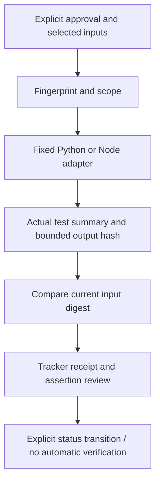
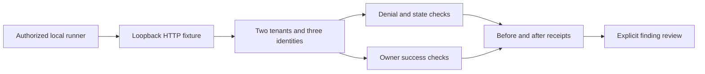
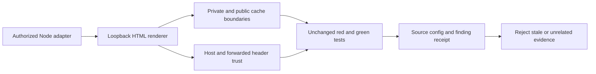
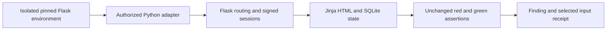
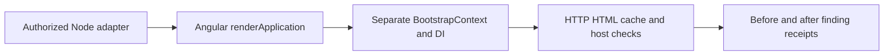
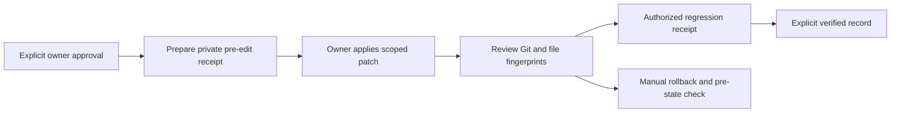

# Explicitly authorized local verification runner

Maintainer: [@omidkh68](https://github.com/omidkh68). P0, Milestone v1.3.0, #53 / RFC #35. [فارسی](verification-runner-FA.md)

## Contract

The initial adapter runs one explicitly selected, trusted Python `unittest` test module on POSIX using the current Python interpreter. The user must authorize local execution; never invoke it automatically during an audit. It does not accept arbitrary shell commands, install tools, or change Tracker status.

```bash
python3 <skill-dir>/scripts/security_test_runner.py --root . --test-file tests/test_security.py --file tests/test_security.py --file src/app.py --finding-id SG-ANG-01-0123456789AB --timeout 15 --authorize-local-test
```

Use an actual finding ID and explicitly select every relevant source/config/test input. The test file must be a selected relative `test_*.py` file. Known private files, traversal, symlinks, missing inputs and fingerprint budgets follow [fingerprint rules](verification-fingerprint.md). This is local test execution, not an exploit or permission to touch production.

## Receipt and outcomes

The JSON receipt records adapter identity, Python version, finding ID, test path, timeout, timestamps, actual exit code, test counts, bounded captured-output byte count/hash, before/after selected-file fingerprints and whether the child started. Normal Python stdout/stderr from tests are discarded; the hash represents the retained worker protocol/direct FD output, not a full raw test log.

| Result | Meaning | CLI exit |
|---|---|---|
| PASS | Nonzero tests executed, no failure/error/skip/expected failure, unchanged selected inputs | 0 |
| FAIL | Assertion failure, test error or unexpected success | 1 |
| INCOMPLETE | No tests or skipped/expected-failure cases | 2 |
| BLOCKED | No approval, invalid scope, unsupported OS, launch/import/protocol problem | 2 |
| TIMEOUT / OUTPUT_LIMIT / CANCELLED | Execution could not complete within the bounds or was cancelled | 2 |
| STALE | Selected fingerprints differ or become unavailable; original execution result is retained separately | 2 |

No outcome sets `independently_verified_fix` to true. The next increment must validate receipts against the active run, finding, current inputs, scope and relevant security assertions.

## Safety and limitations

Timeout is 1–60 seconds; retained combined output is capped at 16 KiB. The worker is a separate process group; failure/cancellation attempts to terminate the group. Python isolated mode and a reduced environment are defense-in-depth, not a sandbox. A trusted test can still write files, read accessible data, access networks, spawn detached processes or falsify protocol output. Use an owned, appropriately isolated local fixture, no production credentials, and review the test code and dependencies first. Do not run untrusted repository code merely because the flag exists. No receipt is cryptographically authenticated. Before/after fingerprints cover selected disk inputs only, not transitive dependencies, external services, unsaved editor buffers or temporary changes restored before the second fingerprint.

## Verification and rollback

Run `python3 scripts/validate_package.py` and `python3 -m unittest discover -s plugins/security-guardian/skills/security-guardian/tests -v`. Synthetic tests cover consent, scope, real pass/fail, zero/skipped tests, timeout, stale source and direct-output cap. Windows and framework-specific adapters are not implemented. Revert this isolated adapter, tests and docs if required; existing ledger records are not migrated.

For active-run evidence collection, use the authorized [tracker integration](tracker-execution-evidence.md) rather than importing the standalone JSON receipt. The standalone CLI still does not change finding status.

## Node.js local adapter (#35)

`--adapter node-test-v1` selects a trusted external Node 22/24 binary on PATH and a single explicit JS/MJS/CJS test module named `*.test.*` or `test_*`. No npm scripts, install, arbitrary shell or production execution. The fixed worker consumes node:test's final summary, validates counts, maps failed/cancelled/skipped/todo, and never returns test stdout. Runtime version and selected-file fingerprints accompany the receipt. Missing/unsupported Node is BLOCKED, zero/skipped/todo tests INCOMPLETE, failures FAIL. Same process-group, output and time limits as Python. Use only reviewed local fixture code; this is not sandboxing, authenticated attestation or proof of framework-wide security.

```bash
python3 <skill-dir>/scripts/security_tracker.py run-test --root . --run <run-id> --finding-id <finding-id> --adapter node-test-v1 --test-file api/guard.test.mjs --file api/guard.test.mjs --file api/guard.mjs --timeout 15 --authorize-local-test
```



Regression fixture exercises actual owner/nonowner assertions, stale test input, fail, skip, todo, excluded component and explicit receipt linkage. Browser/Flutter/Android/JVM adapters and real framework SSR/cache/race acceptance remain pending. Before-failing evidence and coverage adequacy require reviewer judgment; no claim of full RFC acceptance.


## Local before/after scenario acceptance (#35)

The synthetic tracker fixture checks two tenants and GET/PATCH/DELETE operation policies; two actual SQLite workers synchronize at a barrier and contend for a state transition. The unchanged test module must fail both assertions before the fix and pass both after ownership and conditional UPDATE corrections. Source digest must change across the patch and match before/after successful execution. A receipt cannot verify a different finding. This is not a real framework API, network authentication or production database test.

## Final hardening (#35)

Before local execution and before accepting a PASS receipt, rediscover the component inventory with the originally selected roots. Changed ownership, invalid manifests or incomplete discovery block acceptance; start a new explicitly scoped run. No source edits are made by this check. This is not a manifest-content hash for every dependency: selected source/config inputs still need explicit fingerprint coverage. Ctrl-C during the local runner kills its worker process group and produces CANCELLED (not passing evidence). Detached children and hostile test code remain outside the trusted-local adapter contract. Regression tests interrupt a live fixture worker, check stale inventory rejection and preserve both staged and unstaged unrelated Git edits; they do not prove arbitrary agent patch behavior.

## CI deadline regression (#111 prerequisite / #35)

Main CI run 45792838058 returned TIMEOUT instead of PASS in the Node receipt test with an explicit 5-second budget. The log does not establish whether the worker was slow or stuck. The Python CI matrix now explicitly selects Node 24 and records runtime versions. Functional receipt tests use the documented 15-second default; a separate intentionally slow Node fixture must return TIMEOUT under an explicit one-second deadline and its receipt must be rejected for VERIFIED_FIXED. There is no change to the production runner's deadline, maximum, result classification, or authorization. No automatic retry of passing assertions. Diagnostic messages contain only synthetic receipt metadata. CI evidence pending.

## Loopback HTTP authorization acceptance fixture (#35)

The Python adapter executes an unchanged test module against a disposable standard-library HTTP server bound exclusively to 127.0.0.1 on an OS-assigned port. Three synthetic identities span two tenants. GET/PATCH/DELETE requests cover missing/invalid credentials, same-tenant nonowner, cross-tenant access in both directions, forged tenant headers, nonexistent records, and successful owner operations. Denied requests must not disclose values or change state. The insecure fixture must fail assertions (not infrastructure errors); only the reviewed synthetic authorization policy changes, and the same tests must then pass. A failed receipt cannot establish VERIFIED_FIXED; the passing receipt binds the changed source digest and unchanged test input to the same finding, with explicit assertion review.



Run the existing offline unittest suite. No new runtime dependency or runner permission; rollback by reverting the fixture/docs increment. This exercises actual HTTP transport, not NestJS, Angular SSR, production authentication, a real database, or cryptographic credential validation. Fixture evidence does not certify arbitrary customer applications. CI evidence pending.

### Python subtest outcome accounting (#35)

CI #222 (45829434169) failed on all three Python versions because the HTTP matrix produced multiple failed `unittest.subTest()` events within one test method. `tests_run` counts started test methods; `failures` counts failure events and can legitimately exceed it. The adapter now preserves these counts and classifies exit 1 with failures as FAIL rather than BLOCKED. Malformed, negative/non-integer counts and inconsistent exit outcomes still fail closed; a PASS still requires nonzero tests and zero failure/error/skip/expected-failure/unexpected-success counts. Node's fixed worker retains its separate count validation. A focused regression checks three failed subtests in one method, successful subtests, bounded sanitized receipts and unchanged fingerprints; the HTTP fixture additionally requires multiple actual failure events. No assertion, test, permission or timeout removed. CI confirmation pending.

## SSR HTTP response and shared-cache fixture (ANG-06, #35)

Node 22/24 adapter executes unchanged node:test assertions against a disposable loopback HTTP server rendering HTML. Two synthetic authenticated identities and anonymous requests exercise private cache isolation, invalid sessions, cookie/Authorization handling, logout-equivalent anonymous access, hostile Host/forwarded headers, canonical URL and public cache behavior. Three assertions must fail on the deliberately insecure fixture while the public-route control remains passing; after the bounded fixture policy change all four must pass. Failed and stale config-bound receipts cannot verify a fix; cross-component inputs rejected. The source, config and test are explicitly fingerprinted; no target project files or permissions changed. The fixture uses standard Node HTTP rendering, not Angular/React framework runtime, a deployed reverse proxy, browser cache or real session invalidation. Real framework integration and remediation approval/rollback evidence remain open. No external network or new dependencies. CI pending.



## Real Flask runtime verification gate (#35)

A required step of the existing Python 3.12 CI job installs explicitly version-pinned Flask, Jinja, Werkzeug and transitive dependencies in a disposable virtual environment, validates dependencies and executes the framework receipt fixture. The core offline tests and product installation remain dependency-free. The existing authorized Python adapter exercises real Flask routing, signed session cookies, Jinja HTML rendering, SQLite in-memory state, and Flask's test client (WSGI, not network transport). Six unchanged tests cover private cache isolation, logout/anonymous access, trusted Host, forwarded headers, tenant/owner data operations and public-cache success. Before: five assertion failures and one positive control; after: six passing tests. Failed receipt rejected; passing receipt binds source, dependency manifest and unchanged test bytes to the finding. Versions are checked in the outer test, not cryptographic dependency attestation; no production traffic, real credentials or transactions. Logout clears the client session, not stolen-cookie revocation. Angular/NestJS runtime and approval/rollback acceptance remain open. Run `python -m venv /tmp/sg-framework-fixture`, install `scripts/requirements-framework-fixture.txt` using that interpreter, then run `scripts/test_framework_verification.py -v`. CI evidence pending; revert test/CI increment to roll back.



## Real Angular SSR runtime gate (#35, ANG-06)

The required Python 3.12 CI step installs exact direct Angular 20.3.34 dependencies in a disposable directory, with lifecycle scripts disabled. The existing Node 24 adapter runs real Angular JIT standalone `renderApplication` with a separate `BootstrapContext` and request-specific injection provider, zoneless change detection, and loopback HTTP. Five tests cover parallel independent injectors and rendered HTML, private cache/anonymous isolation, Host validation, untrusted forwarded headers and public cache positive control. Expected before: three failed tests and two positive controls; after: five passing tests on unchanged fixture. Source, test, manifest and generated npm lockfile are fingerprinted; versions checked against direct dependency manifest. The lockfile is generated in CI rather than committed; transitive versions may change between runs, and no dependency attestation is claimed. Only disposable synthetic policy changes; no product dependency or permissions changed. This is the Angular platform-server runtime, not Angular CLI AOT, @angular/ssr routing, hydration, a production proxy or real authentication. Run the CI command with a fresh temporary directory; revert fixture/CI increment to roll back. NestJS and approval/rollback acceptance remain open. CI pending.



## Strict stored execution receipt acceptance (reopened #58)

A passing local receipt must also carry a matching PASS execution_result, exact integer schema version 1, bounded integer timeout, nonnegative integer elapsed milliseconds, and nonempty bounded output count/hash. The stored test must have boolean executed=true, a recognized evidence-quality value and the same adapter as the receipt. Manual records may not carry an execution receipt; legacy manual records without quality retain their explicit MANUAL_REPORTED interpretation. Canonical fingerprint comparison rejects JSON bool/float aliases of integer metadata. Existing finalized archives are not rewritten. The tests mutate synthetic stored receipts to check fail-closed schema/metadata and restore valid evidence; this is consistency checking of trusted private local state, not cryptographic tamper resistance or a guarantee against someone able to rewrite that state. No change to runner execution permissions or test timeout limits. Run the existing offline suite; revert this increment for rollback. CI evidence pending.

## Actionable unverified finding and approval boundary (#35)

New FIXED_UNVERIFIED records without a next action receive explicit guidance to run authorized finding-specific regression and review evidence or blocker; supplied actions are preserved. The controlled remediation workflow specifies approval scope, before/after fingerprints, private diff and rollback references. No patch execution or automatic approval by the tracker. NestJS fixture, machine-checkable approval/rollback evidence and end-to-end acceptance remain open. CI pending.

## Remediation approval, diff and rollback receipts (#35)

In an explicitly scoped `fix` run record a CONFIRMED_OPEN finding. Obtain specific owner approval, then run `security_tracker.py prepare-fix --run RUN --finding-id FINDING --file api/app.py --risk HIGH --approver owner --approval-ref approved-ticket --change-summary 'Scoped change' --rollback-plan 'Reverse reviewed patch'`. This records private pre-edit Git/selected-file evidence; it does not grant or execute a patch. Apply only the approved change after checking ownership. Run `review-fix --run RUN --plan-id PLAN` and include `risk_class`, exact `files`, and `remediation_plan_id` in the fix object. Before fixed status, the tracker requires the reviewed matching receipt and unchanged evidence. For rollback, manually reverse only the reviewed change and use `review-fix --rollback --run RUN --plan-id PLAN`; it checks the pre-edit state, never edits files. Reassess/reopen the finding. Existing unstructured manual records remain compatible and do not prove approval. All declared plans require approval metadata; the workflow must not omit required high-risk classification. The bounded local contract checks existing tracked files, no overlapping changes, HEAD, index, unrelated tracked and nonignored untracked contents; ignored files and hostile filesystem actors are outside scope. No cryptographic approval attestation, arbitrary patch execution or production action. Regression fixtures use a disposable Git checkout with staged, unstaged and untracked user edits and before/after security tests. CI pending.



## Real NestJS HTTP runtime gate (#35)

The isolated required Python 3.12 CI step installs exact direct NestJS 11.1.6 dependencies with scripts disabled and executes real NestFactory, controller decorators, injected service, guard and Express HTTP transport on loopback via the existing Node adapter. Five unchanged tests: guard denies missing/invalid sessions, owner/tenant read/update/delete policy, privileged field rejection, valid owner state transitions and concurrent independent request identities. Expected two failures and three positives before, five passes after. Source/test/manifest/generated lockfile bound to receipt, no target dependency or production service. Synthetic credentials and in-memory data; explicit field policy, not a claim of ValidationPipe/ORM/database coverage. Direct versions pinned; transitive lock generated per run. CI pending.
