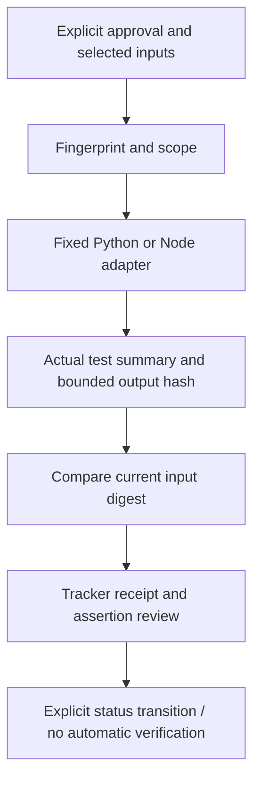

# Explicitly authorized local verification runner

Maintainer: [@omidkh68](https://github.com/omidkh68). P0, Milestone v1.3.0, #53 / RFC #35. [فارسی](verification-runner-FA.md)

## Contract

The initial adapter runs one explicitly selected, trusted Python `unittest` test module on POSIX using the current Python interpreter. The user must authorize local execution; never invoke it automatically during an audit. It does not accept arbitrary shell commands, install tools, or change Tracker status.

```bash
python3 <skill-dir>/scripts/security_test_runner.py --root . --test-file tests/test_security.py --file tests/test_security.py --file src/app.py --finding-id SG-ANG-01-0123456789AB --timeout 15 --authorize-local-test
```

Use an actual finding ID and explicitly select every relevant source/config/test input. The test file must be a selected relative `test_*.py` file. Known private files, traversal, symlinks, missing inputs and fingerprint budgets follow [fingerprint rules](verification-fingerprint.md). This is local test execution, not an exploit or permission to touch production.

## Receipt and outcomes

The JSON receipt records adapter identity, Python version, finding ID, test path, timeout, timestamps, actual exit code, test counts, bounded captured-output byte count/hash, before/after selected-file fingerprints and whether the child started. Normal Python stdout/stderr from tests are discarded; the hash represents the retained worker protocol/direct FD output, not a full raw test log.

| Result | Meaning | CLI exit |
|---|---|---|
| PASS | Nonzero tests executed, no failure/error/skip/expected failure, unchanged selected inputs | 0 |
| FAIL | Assertion failure, test error or unexpected success | 1 |
| INCOMPLETE | No tests or skipped/expected-failure cases | 2 |
| BLOCKED | No approval, invalid scope, unsupported OS, launch/import/protocol problem | 2 |
| TIMEOUT / OUTPUT_LIMIT / CANCELLED | Execution could not complete within the bounds or was cancelled | 2 |
| STALE | Selected fingerprints differ or become unavailable; original execution result is retained separately | 2 |

No outcome sets `independently_verified_fix` to true. The next increment must validate receipts against the active run, finding, current inputs, scope and relevant security assertions.

## Safety and limitations

Timeout is 1–60 seconds; retained combined output is capped at 16 KiB. The worker is a separate process group; failure/cancellation attempts to terminate the group. Python isolated mode and a reduced environment are defense-in-depth, not a sandbox. A trusted test can still write files, read accessible data, access networks, spawn detached processes or falsify protocol output. Use an owned, appropriately isolated local fixture, no production credentials, and review the test code and dependencies first. Do not run untrusted repository code merely because the flag exists. No receipt is cryptographically authenticated. Before/after fingerprints cover selected disk inputs only, not transitive dependencies, external services, unsaved editor buffers or temporary changes restored before the second fingerprint.

## Verification and rollback

Run `python3 scripts/validate_package.py` and `python3 -m unittest discover -s plugins/security-guardian/skills/security-guardian/tests -v`. Synthetic tests cover consent, scope, real pass/fail, zero/skipped tests, timeout, stale source and direct-output cap. Windows and framework-specific adapters are not implemented. Revert this isolated adapter, tests and docs if required; existing ledger records are not migrated.

For active-run evidence collection, use the authorized [tracker integration](tracker-execution-evidence.md) rather than importing the standalone JSON receipt. The standalone CLI still does not change finding status.

## Node.js local adapter (#35)

`--adapter node-test-v1` selects a trusted external Node 22/24 binary on PATH and a single explicit JS/MJS/CJS test module named `*.test.*` or `test_*`. No npm scripts, install, arbitrary shell or production execution. The fixed worker consumes node:test's final summary, validates counts, maps failed/cancelled/skipped/todo, and never returns test stdout. Runtime version and selected-file fingerprints accompany the receipt. Missing/unsupported Node is BLOCKED, zero/skipped/todo tests INCOMPLETE, failures FAIL. Same process-group, output and time limits as Python. Use only reviewed local fixture code; this is not sandboxing, authenticated attestation or proof of framework-wide security.

```bash
python3 <skill-dir>/scripts/security_tracker.py run-test --root . --run <run-id> --finding-id <finding-id> --adapter node-test-v1 --test-file api/guard.test.mjs --file api/guard.test.mjs --file api/guard.mjs --timeout 15 --authorize-local-test
```



Regression fixture exercises actual owner/nonowner assertions, stale test input, fail, skip, todo, excluded component and explicit receipt linkage. Browser/Flutter/Android/JVM adapters and real framework SSR/cache/race acceptance remain pending. Before-failing evidence and coverage adequacy require reviewer judgment; no claim of full RFC acceptance.


## Local before/after scenario acceptance (#35)

The synthetic tracker fixture checks two tenants and GET/PATCH/DELETE operation policies; two actual SQLite workers synchronize at a barrier and contend for a state transition. The unchanged test module must fail both assertions before the fix and pass both after ownership and conditional UPDATE corrections. Source digest must change across the patch and match before/after successful execution. A receipt cannot verify a different finding. This is not a real framework API, network authentication or production database test.

## Final hardening (#35)

Before local execution and before accepting a PASS receipt, rediscover the component inventory with the originally selected roots. Changed ownership, invalid manifests or incomplete discovery block acceptance; start a new explicitly scoped run. No source edits are made by this check. This is not a manifest-content hash for every dependency: selected source/config inputs still need explicit fingerprint coverage. Ctrl-C during the local runner kills its worker process group and produces CANCELLED (not passing evidence). Detached children and hostile test code remain outside the trusted-local adapter contract. Regression tests interrupt a live fixture worker, check stale inventory rejection and preserve both staged and unstaged unrelated Git edits; they do not prove arbitrary agent patch behavior.

## CI deadline regression (#111 prerequisite / #35)

Main CI run 45792838058 returned TIMEOUT instead of PASS in the Node receipt test with an explicit 5-second budget. The log does not establish whether the worker was slow or stuck. The Python CI matrix now explicitly selects Node 24 and records runtime versions. Functional receipt tests use the documented 15-second default; a separate intentionally slow Node fixture must return TIMEOUT under an explicit one-second deadline and its receipt must be rejected for VERIFIED_FIXED. There is no change to the production runner's deadline, maximum, result classification, or authorization. No automatic retry of passing assertions. Diagnostic messages contain only synthetic receipt metadata. CI evidence pending.
