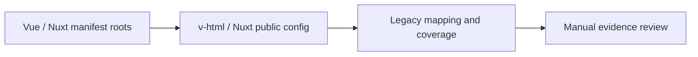

# بسته بازبینی Vue و Nuxt

نگه‌دارنده: @omidkh68 · اولویت P0 · #33، #70 · [English](vue-nuxt.md)

## قرارداد

بسته Vue/Nuxt نسخه ۱ دو نشانه متنی محدود و آفلاین در مؤلفه‌های Frontend صریحاً انتخاب‌شده و کشف‌شده از Manifest اضافه می‌کند. کاتالوگ ۱۴۵ کنترل و شناسه‌های تاریخی بدون تغییر می‌مانند. اسکن قدیمی بدون محدوده نیز تغییر نمی‌کند.

| شناسه Rule | نگاشت تاریخی | Candidate |
|---|---|---|
| VUE.DOM.RAW_HTML | ANG-01 | انتساب v-html در فایل .vue |
| NUXT.CONFIG.PUBLIC_SECRET_NAME | ANG-12 | ویژگی مستقیم useRuntimeConfig().public یا $config.public با نام حساس‌نما |

قاعده دوم به شواهد Manifest مربوط به Nuxt نیاز دارد و روی فایل‌های JS/TS یا .vue اعمال می‌شود. زیررشته‌های حساس‌نما شامل secret، private key، password، access token، refresh token و API key هستند (بدون حساسیت به بزرگی حروف و با زیرخط اختیاری). نام یا مقدار گزارش نمی‌شود. بعضی مقادیر عمداً عمومی هستند و HTML خام ممکن است پاک‌سازی شده باشد. این موارد فقط Candidate بازبینی هستند.

## استفاده و راستی‌آزمایی

```bash
python3 <skill-dir>/scripts/security_scan.py --root . --profile frontend --format json
```

خلاصه vue_nuxt ریشه‌های انتخاب‌شده و اختصاصی Nuxt، تعداد فایل واجد شرایط، شناسه قواعد، پرچم فعال‌بودن و تعداد تطابق را نشان می‌دهد. سقف‌های قبلی شواهد اعمال می‌شوند. فیلد scoped_additional_indicator_rules شامل قواعد افزوده فعال است. Tracker نگاشت تاریخی و عنوان متمایز را حفظ می‌کند؛ مهاجرت تاریخچه لازم نیست.

پیش از پذیرش یافته، منبع واقعی HTML و Sanitizer را دنبال کنید. اعلان کامل runtimeConfig.public، Overrideهای زمان اجرا و Payload رندرشده را از نظر داده خصوصی بررسی کنید؛ SSR و Cache مشترک کاربران را با Fixture محلی مجاز راستی‌آزمایی کنید. Handlerهای سرور/API در Nitro و مجوز Tenant/Resource را مستقل از Middleware فرانت بررسی کنید. دسترسی به تنظیم عمومی به‌تنهایی افشای راز یا نبود مجوز را اثبات نمی‌کند.

## محدودیت‌ها و بازگردانی

Parser Vue، تحلیل Alias، ویژگی تو‌در‌تو یا محاسبه‌شده، جریان Taint، بررسی Build یا تأیید نسخه فریم‌ورک نداریم. اسکنر فایل‌های .env حذف‌شده را نمی‌خواند و کد هدف را اجرا نمی‌کند. نبود نشانه هرگز امنیت را اثبات نمی‌کند. اعتبارسنجی بسته، مجموعه رگرسیون Python و بررسی tarball npm را اجرا کنید. Fixtureهای مصنوعی حالت مثبت/منفی، محدوده، فیلتر اختصاصی Nuxt، حالت قدیمی و عدم افشای سورس را پوشش می‌دهند. برای بازگردانی این تغییر مستقل را Revert کنید.

مراجع: [امنیت Vue](https://vuejs.org/guide/best-practices/security.html)، [Runtime Config در Nuxt](https://nuxt.com/docs/4.x/guide/going-further/runtime-config).

## معماری و ارزش تست (#70)



نمونه‌ها انتخاب فریم‌ورک، نام امن، حذف داده و محدوده را می‌سنجند؛ جداسازی SSR تست جدا می‌خواهد.
