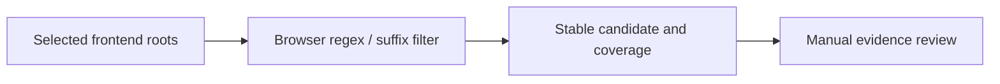

# Framework-neutral web core — initial indicator pack

Maintainer: @omidkh68 · P0 · Issues #33, #62 · [فارسی](web-core-FA.md)

## Contract

In explicitly resolved scope mode, selected frontend components with Angular, React, Next.js, Vue, Nuxt, Svelte or SvelteKit manifest hints receive the web-core v1 pack. It reuses three existing browser expressions on JS/JSX/TS/TSX/MJS/CJS source. No framework version is certified. Unscoped legacy scans and historical finding keys remain unchanged.

| Rule ID | Legacy control | Indicator |
|---|---|---|
| WEB.DOM.INNER_HTML | ANG-01 | Direct assignment to innerHTML, including the existing bounded adjacent-line case |
| WEB.STORAGE.TOKEN | ANG-04 | Browser local/session storage access for secret-like token names |
| WEB.NAV.DYNAMIC | ANG-11 | Dynamic browser location navigation |

Legacy IDs and labels remain stable for compatibility with the 145-control catalog and Tracker. A common signal is not proof that an Angular-specific control applies to another framework. Non-Angular applicability remains NEEDS_DISCOVERY; the reason describes the common mapping. Angular-only sanitizer/template rules are not enabled for other frameworks.

## Use and evidence

```bash
python3 <skill-dir>/scripts/security_scan.py --root . --profile frontend --format json
```

The summary includes web_core pack ID/version, selected component roots, inspected eligible files and counts by rule. Each matching common candidate carries pack_id, pack_version, rule_id and LEGACY_COMPATIBILITY mapping metadata. The usual scan/signal coverage caps and skipped-file accounting still apply; total rule counts are not vulnerability coverage. Tracker imports the existing candidate identity, not a confirmation or new control ID.

## Limits and next steps

This is offline regex triage, not parsing, taint analysis, SSR or client/server boundary analysis. Vue/Svelte templates, framework-specific JSX rendering APIs, unknown stacks, server-only components and native mobile are not included in this pack. A mixed framework component is scoped at the component root, not a proven browser/server file classification. Safe assignments may still match; an absent candidate never proves safety. No code is executed or modified; source values are not printed.

Synthetic positive/negative fixtures cover each discovery family, scope isolation, multiline, stable keys and template limitations. Run package validation and the full offline suite; npm bundle checks must pass. Revert the isolated changes if needed; no ledger migration. Dedicated frontend adapters, common backend rules, semantic analysis and measured accuracy remain follow-up work.

## Architecture and testing value (#62)



Positive, negative, scope, multiline and redaction fixtures exercise the three browser indicators; no runtime DOM proof.
