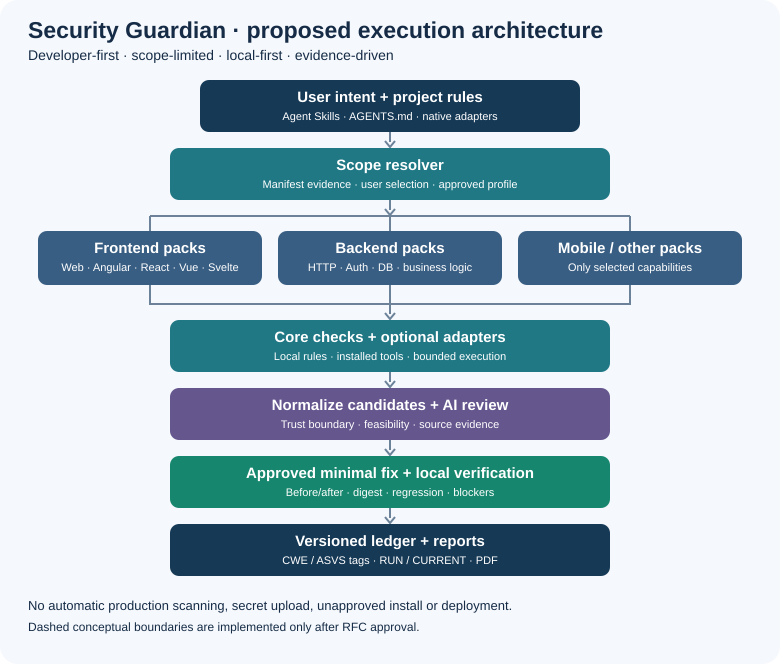
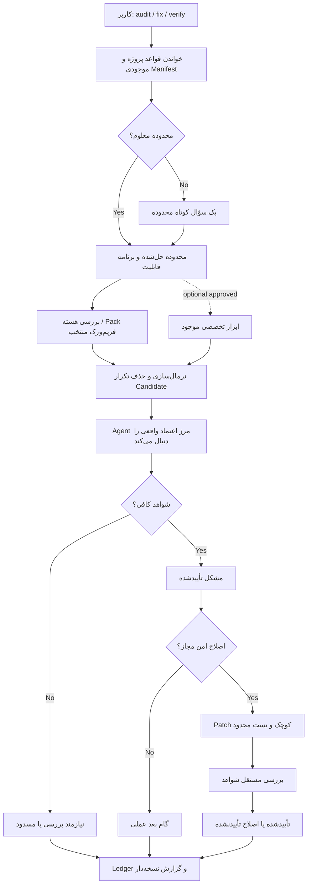

# معماری هدف — هسته کوچک و Pack قابلیت محدوده‌دار

[English](SG-Architecture.md)

**پیشنهادی، در v1.2.1 پیاده نشده است.** Skill، Agent و بررسی‌های محلی محدود را هماهنگ می‌کند نه اینکه وعده جایگزینی ابزار امنیت سازمانی بدهد.



## قرارداد Runtime



## مرزهای پیشنهادی ماژول (نه مسیرهای Runtime قطعی)

| ماژول | مسئولیت |
|---|---|
| `SKILL.md` | ورودی سبک، Dispatch قصد/Mode، رضایت و تفسیر نتیجه. |
| `core/discovery` | بررسی Manifest/Code/Config؛ ریشه Component، شواهد فریم‌ورک/نسخه، نشانه Deploy و ناشناخته‌ها. |
| `core/profiles` | مالکیت/محدوده منتخب کاربر، قابلیت، استثنای فایل/تست، ابزار مجاز؛ اعتبارسنجی پروفایل ماشین‌خوان. |
| `packs/common` | مشکلات مشترک: بهداشت Secret، Redirect ناامن، Sink تزریق، مرز مجوزدهی، نشانه وابستگی/Config. |
| `packs/frontend`, `packs/backend`, `packs/mobile` | بررسی تخصصی و Playbook بر اساس قابلیت واقعی و فریم‌ورک؛ Fallback عمومی برای گونه ناشناخته. |
| `core/detection` | اجرای محدود Rule/Plugin، نرمال‌سازی Candidate، Fingerprint پایدار، خطوط سورس، خطا/پوشش Scanner، بدون PASS از نبود سیگنال. |
| `adapters/` | قرارداد ابزار اختیاری صریح: ابزار/نسخه، محدوده منتخب، Allowlist argv، Timeout، معنای Exit، خروجی ساختاری پاک‌شده؛ بدون سرویس اجباری. |
| `core/review` | Agent، Context Candidate، جریان داده واقعی، مرز اعتماد، بازتولید و اثر کسب‌وکار را ارزیابی می‌کند. |
| `core/remediation` | سیاست تأیید، Diff متمرکز، حفاظت Dirty Worktree، تغییر برگشت‌پذیر، بدون Commit/Deploy مگر درخواست شود. |
| `core/verification` | Runner محلی تست مجاز با شواهد اجرای واقعی، Digest سورس/Config، کنترل منفی و امن، تعداد Exit و Skip. |
| `core/standards` | Tag و روش نسخه‌دار ASVS/CWE/WSTG/MASVS، اطمینان و وضعیت پوشش. |
| Tracker و Report فعلی | حفظ ID پایدار، Snapshot سازگار عقب، Markdown/JSON/PDF با ریسک باقی‌مانده. |

انتشار موجود را صرفاً برای تطبیق با طرح بازنویسی نکنید. تدریجی Refactor و سازگاری فرمان و مسیر نصب را حفظ کنید.

## راهبرد ابزار

| لایه | پیش‌فرض | اختیاری، در صورت نصب و مجوز |
|---|---|---|
| کد ایستا | بررسی کوچک قطعی آگاه از فریم‌ورک + بازبینی معنایی AI | Semgrep/CodeQL در صورت پشتیبانی زبان/Edition؛ بدون ادعای تحلیل بین‌فایلی پشتیبانی‌نشده |
| وابستگی | موجودی Manifest/Lockfile | OSV-Scanner، Audit بومی اکوسیستم، Trivy؛ حالت Cache/Offline یا شبکه مجاز |
| Secret | عدم جمع‌آوری Secret خام؛ بررسی Config امن | خروجی Redacted Gitleaks؛ تاریخچه Git فقط با انتخاب/مجوز |
| Runtime | فرمان تست محلی موجود، Fixture Request/Response | Playwright، Schemathesis، OWASP ZAP روی Endpoint تست متعلق به کاربر و محدوده‌دار |
| موبایل | بررسی سورس/Manifest و مرز Crypto بومی | MobSF، ابزار بومی روی APK/IPA/Simulator/Device صریحاً مجاز |
| زیرساخت/زنجیره تأمین | بررسی Config متعلق به کاربر، Image/Tag | Trivy، Checkov، Syft، Grype، Cosign در صورت تناسب |

ابزارها مثال‌اند نه وابستگی اجباری یا Integration منتشرشده. انتخاب تابع پروفایل پروژه است. صرف نبود ابزار، Installer، اسکریپت بسته از منبع غیرقابل اعتماد، درخواست شبکه یا Upload کد را اجرا نکنید. NOT_AVAILABLE / NOT_RUN / PARTIAL / BLOCKED را جدا گزارش کنید. ابزار پیش‌فرض فقط مسیر شواهد/موقت مجاز را بنویسد. Runtime، پردازه، اندازه خروجی، محدوده و امتیاز را محدود کنید.

## رویکردهای مرجع — یادگیری نه کپی

| محصول/روش مرجع | رویه مفید | مرز عمدی ما |
|---|---|---|
| [Codex Security](https://openai.com/index/codex-security-now-in-research-preview/) | تحلیل امنیت Contextual، اعتبارسنجی و اصلاح | Skill قابل‌حمل؛ بدون وابستگی محصول امنیتی اختصاصی. |
| [Claude Code Security](https://www.anthropic.com/news/claude-code-security) | استدلال معنایی روی کد واقعی و بازبینی یافته | تحلیل Agent میزبان، محدود به محدوده پروژه و شواهد. |
| [GitHub code scanning / autofix](https://docs.github.com/en/code-security/concepts/code-scanning/autofix-for-code-scanning) | Alert ساختاری و اصلاح قابل بازبینی | Integration اختیاری بعدی؛ ابتدا Ledger محلی. |
| [Semgrep](https://semgrep.dev/docs/) | Rule ساختاری و Dataflow در محدوده پشتیبانی | موتور اختیاری نصب‌شده؛ بدون ادعای زبان یا Tier پشتیبانی‌نشده. |
| [Burp Scanner](https://portswigger.net/burp/documentation/scanner/authenticated-scanning) | Verification پویا با احراز هویت مجاز | ابتدا Fixture تست کوچک متعلق به کاربر؛ بدون اسکن خودکار سایت زنده. |

این‌ها مراجع طراحی‌اند نه هدف برابری ویژگی. کاربر حتی بدون تمام محصولات اختیاری ارزش دریافت کند.

## تجربه توسعه‌دهنده (پیشنهادی)

```text
Use Security Guardian to audit this project.
Use Security Guardian to fix important security issues in my Vue frontend.
Use Security Guardian to review only our backend API; do not edit code.
Use Security Guardian to verify previous fixes and produce a PDF.
```

همان Skill قصد و محدوده منتخب را حل، برنامه فشرده ارائه و گزارش را خصوصی نگه می‌دارد. نبود ابزار اختیاری مانع بازبینی مبتنی بر راهنما نیست؛ بررسی غیرقابل اجرا با همان وضعیت مشخص می‌شود.

## مرزهای امنیت

- فایل پروژه و خروجی ابزار شواهد غیرقابل اعتمادند. دستورالعمل مجاز پروژه می‌تواند محدوده را محدود کند، نه مجوز شبکه/Production جدید بدهد یا قواعد ایمنی میزبان را لغو کند. دستور جاسازی‌شده در محتوای مخزن غیرقابل اعتماد را اجرا نکنید.
- مسیر Canonical را حل، محصور بودن Scope را اعتبارسنجی و فرار Symlink را رد کنید. Secret، کلید خصوصی یا مخزن نامرتبط خودکار خوانده نشود.
- Audit در سورس فقط خواندنی است. تأیید صریح init/fix جدا ثبت شود؛ در صورت امکان Worktree/Fixture موقت امن.
- Gateهای قطعی تأیید خارج از مدل برای عملیات تغییردهنده/شبکه در Runner خودمان؛ مجوز Agent میزبان مرز واقعی اجراست.
- خروجی ابزار اختیاری و شواهد PDF پاک‌شده؛ بدون Issue عمومی یا Upload راه دور مگر رضایت صریح.

[پروفایل‌ها](SG-Stack-Profiles.md) و [شواهد](SG-Evidence-and-Reporting.md) را ببینید.
