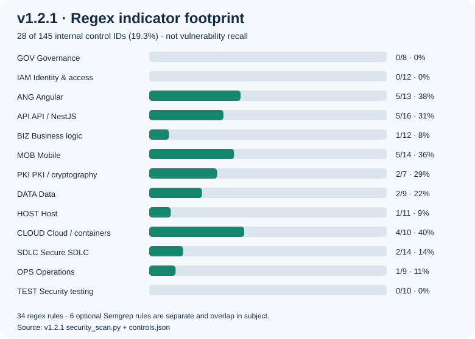
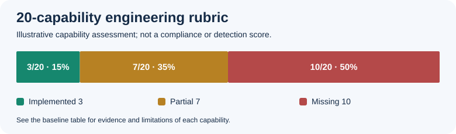
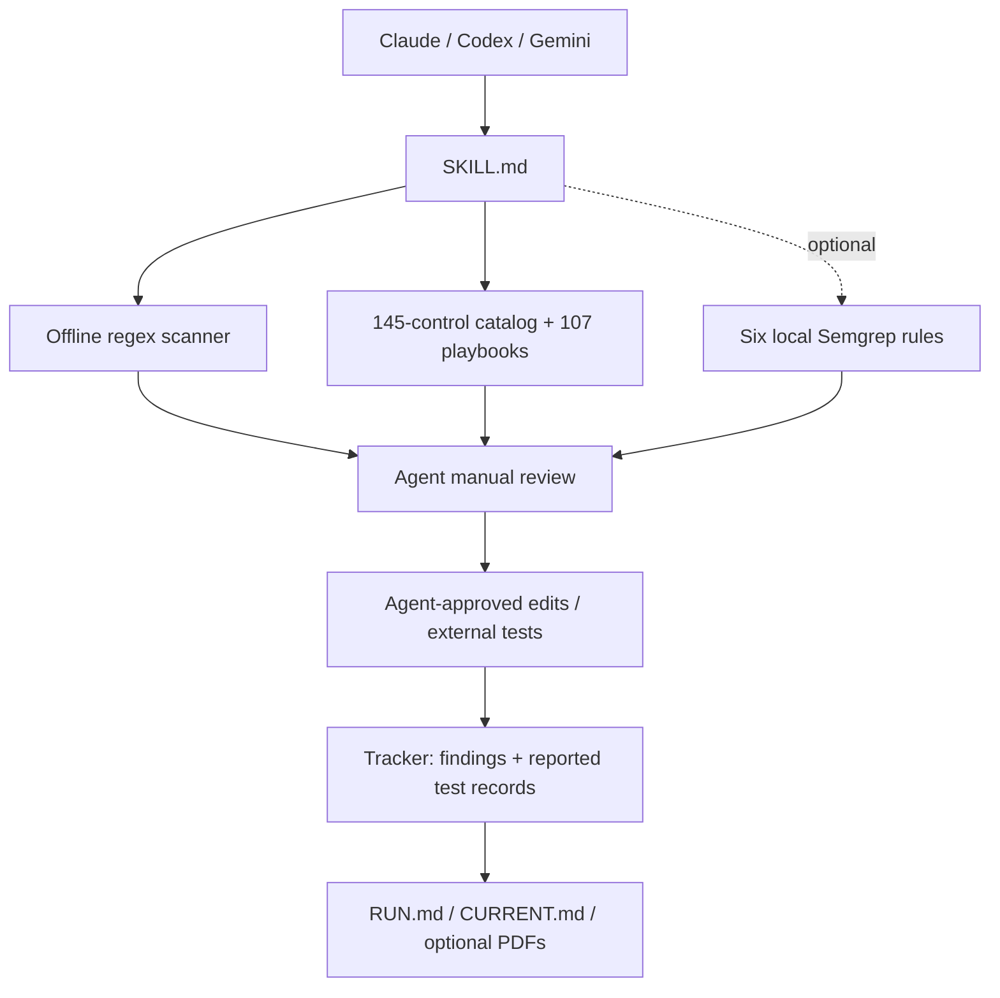

# نسخه v1.2.1 — خط مبنای اندازه‌گیری‌شده و فهرست شکاف‌ها

**تصویر ثابت:** [انتشار v1.2.1](https://github.com/omidkh68/security-guardian/releases/tag/v1.2.1)، کامیت `9003933adf710517523f4474874ef21482808b22`، بررسی‌شده در 2026-11-18 UTC. این بررسی سورس و ارزیابی قابلیت مهندسی است، نه تست نفوذ مستقل جدید.

## موجودی

| شواهد | مشاهده‌شده |
|---|---:|
| کنترل‌های داخلی | 145 |
| حوزه‌ها | 13 |
| راهنماهای تخصصی | 107 |
| قواعد Regex | 34 |
| شناسه‌های داخلی متمایز دارای نشانه Regex | 28 / 145 (19.3%) |
| قواعد ساختاری اختیاری Semgrep | 6 |
| تست‌های آماده‌سازی انتشار Python 3.12 | 34 موفق |
| نگاشت رسمی در سطح الزامات خارجی | ندارد |
| Precision/Recall اندازه‌گیری‌شده آسیب‌پذیری | تعیین نشده |

کتابچه اولیه ۲۰۲۶ ارائه‌شده توسط کاربر خط مبنای داخلی مهندسی است، نه انتشار رسمی استاندارد. ۱۰۷ راهنمای Markdown راهنمای پیاده‌سازی/پذیرش نگاشت‌شده هستند، نه ۱۰۷ اسکنر اجرایی. سیگنال‌های اسکنر کنترل‌ها را تأیید نمی‌کنند. تعداد قواعد معیار Recall یا انطباق نیست.

منابع: [controls.json](https://github.com/omidkh68/security-guardian/tree/v1.2.1/plugins/security-guardian/skills/security-guardian/references/controls.json)، [security_scan.py](https://github.com/omidkh68/security-guardian/tree/v1.2.1/plugins/security-guardian/skills/security-guardian/scripts/security_scan.py)، [قواعد Semgrep](https://github.com/omidkh68/security-guardian/tree/v1.2.1/plugins/security-guardian/skills/security-guardian/references/semgrep/security-guardian.yaml)، [SKILL.md](https://github.com/omidkh68/security-guardian/tree/v1.2.1/plugins/security-guardian/skills/security-guardian/SKILL.md)، [ردیاب](https://github.com/omidkh68/security-guardian/tree/v1.2.1/plugins/security-guardian/skills/security-guardian/scripts/security_tracker.py)، [اجرای CI](https://github.com/omidkh68/security-guardian/actions/runs/44264053797).

## گستره نشانه‌های Regex به تفکیک حوزه

| حوزه | کنترل داخلی | شناسه متمایز دارای Regex | گستره |
|---|---:|---:|---:|
| GOV — حاکمیت | 8 | 0 | 0.0% |
| IAM — هویت و دسترسی | 12 | 0 | 0.0% |
| ANG — Angular | 13 | 5 | 38.5% |
| API — API / NestJS | 16 | 5 | 31.3% |
| BIZ — منطق کسب‌وکار | 12 | 1 | 8.3% |
| MOB — موبایل | 14 | 5 | 35.7% |
| PKI — رمزنگاری و PKI | 7 | 2 | 28.6% |
| DATA — داده | 9 | 2 | 22.2% |
| HOST — میزبان | 11 | 1 | 9.1% |
| CLOUD — ابر و کانتینر | 10 | 4 | 40.0% |
| SDLC — چرخه توسعه امن | 14 | 2 | 14.3% |
| OPS — عملیات | 9 | 1 | 11.1% |
| TEST — تست امنیت | 10 | 0 | 0.0% |
| **مجموع** | **145** | **28** | **19.3%** |

۱۱۷ کنترل نشانه اختصاصی Regex ندارند؛ بررسی Agent و راهنماها همچنان ممکن است آن‌ها را پوشش دهند. شش قاعده Semgrep موتور اختیاری جداگانه‌ای با موضوعات هم‌پوشان هستند؛ شش را به ۲۸ اضافه نکنید. این گستره شمارش ثابت شناسه‌های متمایز کنترل قواعد است، نه درصد پروژه واقعاً اسکن‌شده یا محافظت‌شده.

## معیار ارزیابی قابلیت مهندسی

پیاده‌سازی‌شده = کاربردی در محدوده اعلام‌شده؛ جزئی = گردش کار/راهنما یا موتور محدود وجود دارد؛ فاقد = قابلیت عملیاتی اختصاصی موجود نیست. این ۲۰ قابلیت برای نمایش وزن برابر دارند، نه امتیاز وزنی استاندارد یا تشخیص.

| قابلیت | وضعیت | شواهد / محدودیت |
|---|---|---|
| کاتالوگ و کشف فناوری | پیاده‌سازی‌شده | کاربردپذیری اکتشافی؛ فرضیات فریم‌ورک باقی است |
| چرخه عمر نسخه‌دار یافته | پیاده‌سازی‌شده | شناسه پایدار، تاریخچه، مهاجرت صریح |
| گزارش فنی/مدیریتی | پیاده‌سازی‌شده | Markdown/JSON؛ PDF نیازمند ReportLab |
| SAST اولیه | جزئی | ۳۴ Regex + شش قاعده اختیاری ساختاری |
| بررسی معنایی امنیت توسط AI | جزئی | به کمک Agent؛ Recall اندازه‌گیری نشده |
| تست منطق کسب‌وکار | جزئی | راهنماها؛ بدون ماتریس تولید/اجراشده |
| اسکن کانتینر / IaC | جزئی | نشانه سورس؛ بدون آداپتور عملیاتی اختصاصی |
| ممیزی PKI | جزئی | کنترل‌ها و نشانه‌ها؛ بدون چارچوب آزمون مصنوع/سخت‌افزار |
| راستی‌آزمایی خودکار شواهد | جزئی | رکوردهای تست ارائه‌شده و مرتبط؛ بدون اجراکننده مستقل |
| اصلاح خودکار | جزئی | Agent و راهنمای تأیید؛ بدون خط لوله قطعی Diff/Verification |
| تحلیل Taint بین فایل‌ها | فاقد | بدون موتور اختصاصی بین‌رویه‌ای |
| DAST احرازشده | فاقد | فقط دستورالعمل؛ بدون اجراکننده یکپارچه Runtime |
| Fuzzing | فاقد | فقط راهنما |
| SCA | فاقد | بدون تحلیلگر واقعی Lockfile/CVE |
| کشف Secret | فاقد | بدون موتور تخصصی Secret |
| SBOM / VEX | فاقد | صرفاً اشاره |
| تحلیل باینری APK/IPA | فاقد | صرفاً اشاره |
| نگاشت استانداردها | فاقد | بدون مدل داده نسخه‌دار شناسه الزام |
| CI Gate پروژه هدف / SARIF | فاقد | فقط CI خود بسته؛ بدون Gate/Export هدف |
| بنچمارک دقت | فاقد | بدون Ground Truth نمونه‌گذاری‌شده هر دسته |

۳ پیاده‌سازی‌شده (۱۵٪)، ۷ جزئی (۳۵٪)، ۱۰ فاقد (۵۰٪). این گواهی بلوغ نیست. بسیاری از قابلیت‌های فاقد عمداً اختیاری یا به آینده موکول شده‌اند؛ عرضه همه برای مفید بودن ضروری نیست.

## نقاط قوت و گردش کار موجود

- نصب قابل‌حمل Claude Code/Codex/Gemini؛ محدوده و رضایت صریح، نسخه‌های پشتیبان نسخه‌دار.
- بررسی اولیه فقط‌خواندنی سورس و تفکیک Candidate از یافته تأییدشده.
- بررسی سورس و مرز اعتماد، اصلاح حداقلی تأییدشده، راهنمای تست منفی.
- شناسه پایدار، دفتر ثبت و تصاویر ثابت اجرا نسخه‌دار، مهاجرت صریح نگاشت، رکورد تست مرتبط، خروجی PDF و Markdown.
- ارزیابی محلی واقعی Codex، فعال‌سازی Gemini، Smoke نصب دسکتاپ، بررسی PDF مصنوعی و محلی، و تشخیص نگاشت قدیمی (۱۲/۱۲ تطابق) مشاهده شد. این تشخیص صرفاً طبقه‌بندی است؛ **نه** بنچمارک دقت آسیب‌پذیری. کار جاری شواهد خصوصی پروژه هدف را حفظ می‌کند.

## محدودیت‌های فنی مشخص

| مشاهده در پیاده‌سازی | پیامد / پیگیری |
|---|---|
| Regex خط‌به‌خط اسکن می‌کند و پس از نخستین تطابق در هر خط متوقف می‌شود | احتمال از دست رفتن سیگنال‌های متعدد یا چندخطی؛ پیش از تغییر معنا تست کنید. |
| عمق محدود ۷ پوشه، ۲۵٬۰۰۰ فایل و ۹۰۰٬۰۰۰ بایت/فایل | اسکن بزرگ/Monorepo ممکن است ناقص باشد؛ پوشش را آشکار و محدوده/بودجه امن را قابل تنظیم کنید. |
| شکست پیمایش/خواندن فایل و خروجی سیگنال سقف‌دار | خطا و کوتاه‌شدن خروجی را لحاظ کنید؛ اسکن پاک بی‌صدا ممنوع. |
| Lockfile و نام فایل حساس مستثنا هستند | اسکنر وابستگی یا Secret نیست؛ در صورت فعال‌سازی از آداپتور اختصاصی پاک‌سازی‌شده استفاده کنید. |
| کاربردپذیری فریم‌ورک مبتنی بر Angular / NestJS / Flutter | احتمال طبقه‌بندی نادرست React/Vue/Svelte و API غیر Nest؛ با کشف مبتنی بر قابلیت جایگزین کنید. |
| Node TLS override فعلاً به کنترل موبایل MOB-02 نگاشت شده | اصلاح نگاشت زمینه‌محور لازم است؛ شناسه‌های تاریخی تا مهاجرت عمدی حفظ شوند. |
| شش قاعده Semgrep، بدون Taint بین‌رویه‌ای؛ اجراکننده اختیاری تعداد نتایج را گزارش می‌کند | Pack هدفمند و مدیریت صریح خطا/ناقص بسازید؛ نه ادعای پشتیبانی بی‌شاهد زبان. |
| شواهد تست مرتبط به Tracker داده می‌شود؛ کنترل Git HEAD تغییرات ثبت‌نشده را مقید نمی‌کند | اجراکننده مستقل محلی، Exit Code و Digest سورس پیش از تأیید اصلاح لازم‌اند. |
| بدون ثبت اجرایی ارزیابی به تفکیک الزام | ادعای پوشش مفهومی است؛ نگاشت نسخه‌دار و وضعیت شواهد پیاده شود. |
| GitHub Actions از تگ نسخه تغییرپذیر استفاده می‌کند؛ منشأ وابستگی انتشار ناقص است | زنجیره تأمین خودمان سخت‌سازی شود؛ SHA تغییرناپذیر معتبر و بررسی به‌روزرسانی. |
| بدون Corpus/Precision/Recall | نمونه مثبت و منفی بسازید؛ پیش از تعیین هدف اندازه بگیرید. |

سورس مرتبط: [تست‌ها](https://github.com/omidkh68/security-guardian/tree/v1.2.1/plugins/security-guardian/skills/security-guardian/tests)، [گردش کار Verification](https://github.com/omidkh68/security-guardian/tree/v1.2.1/plugins/security-guardian/skills/security-guardian/references/workflows/verification.md)، [مدل امنیت](https://github.com/omidkh68/security-guardian/tree/v1.2.1/docs/security-model.md)، [CI](https://github.com/omidkh68/security-guardian/tree/v1.2.1/.github/workflows/ci.yml).

## معماری جاری در تصویر ثابت

معماری هدف، حل محدوده و هسته اجرا/شواهد را تغییر می‌دهد، نه کل دفتر ثبت کاربردی یا قالب عمومی Skill. [معماری](SG-Architecture.md) را ببینید.
