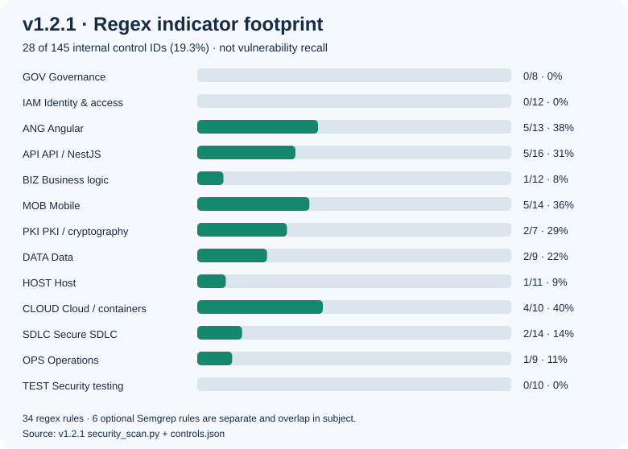
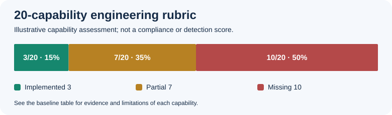
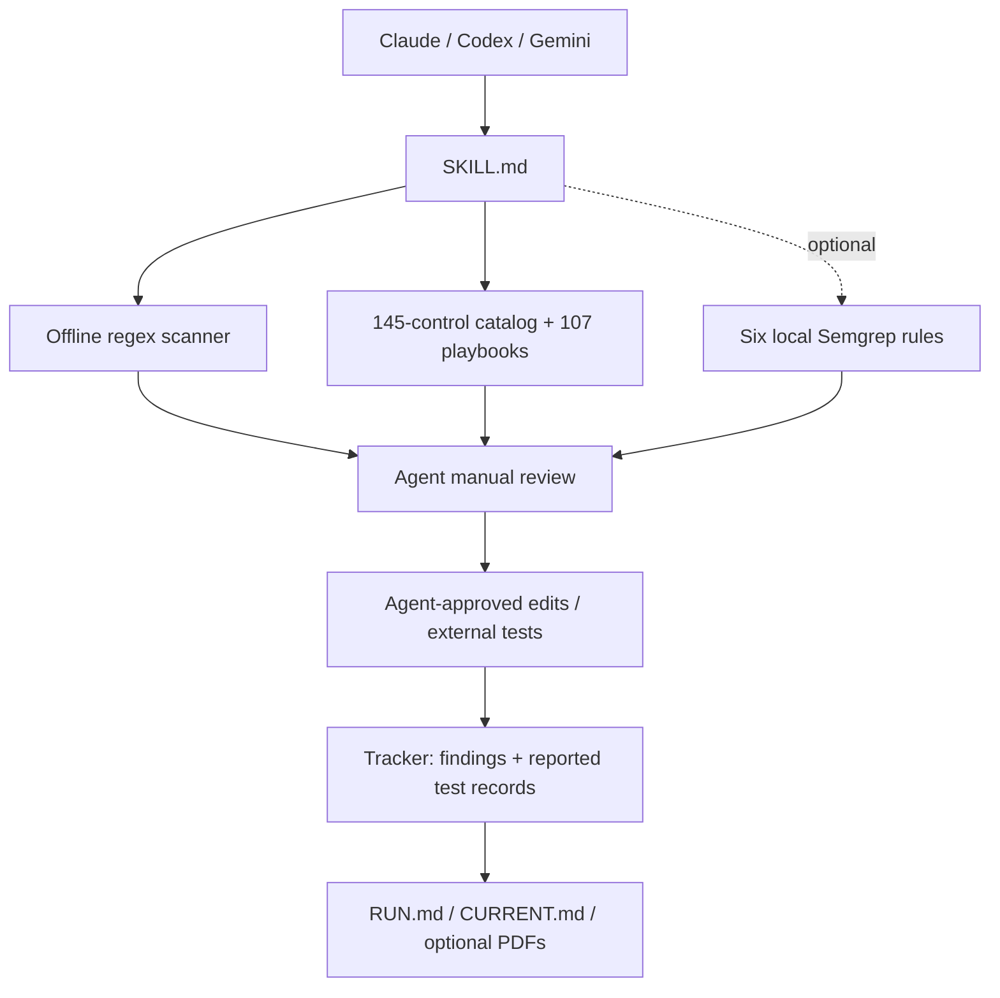

# v1.2.1 — measured baseline and gap inventory

**Snapshot:** [release v1.2.1](https://github.com/omidkh68/security-guardian/releases/tag/v1.2.1), commit `9003933adf710517523f4474874ef21482808b22`, reviewed 2026-11-18 UTC. This is a source inspection and an engineering capability assessment, not a new independent pentest.

## Inventory

| Evidence | Observed |
|---|---:|
| Internal controls | 145 |
| Domains | 13 |
| Specialist playbooks | 107 |
| Regex rules | 34 |
| Distinct internal IDs with regex hints | 28 / 145 (19.3%) |
| Optional Semgrep structural rules | 6 |
| Python 3.12 release preparation tests | 34 passing |
| Formal external requirement-level crosswalk | None |
| Measured vulnerability precision/recall | Not established |

The original user-provided 2026 handbook is an internal engineering baseline, not an official standards publication. The 107 Markdown playbooks provide mapped implementation/acceptance guidance, not 107 executable scanners. Scanner signals do not certify controls. Rule counts cannot measure recall or compliance.

Sources: [controls.json](https://github.com/omidkh68/security-guardian/tree/v1.2.1/plugins/security-guardian/skills/security-guardian/references/controls.json), [security_scan.py](https://github.com/omidkh68/security-guardian/tree/v1.2.1/plugins/security-guardian/skills/security-guardian/scripts/security_scan.py), [Semgrep rules](https://github.com/omidkh68/security-guardian/tree/v1.2.1/plugins/security-guardian/skills/security-guardian/references/semgrep/security-guardian.yaml), [SKILL.md](https://github.com/omidkh68/security-guardian/tree/v1.2.1/plugins/security-guardian/skills/security-guardian/SKILL.md), [tracker](https://github.com/omidkh68/security-guardian/tree/v1.2.1/plugins/security-guardian/skills/security-guardian/scripts/security_tracker.py), [CI run](https://github.com/omidkh68/security-guardian/actions/runs/44264053797).

## Per-domain regex indicator footprint

| Domain | Internal controls | Distinct IDs with regex | Footprint |
|---|---:|---:|---:|
| GOV — Governance | 8 | 0 | 0.0% |
| IAM — Identity & access | 12 | 0 | 0.0% |
| ANG — Angular | 13 | 5 | 38.5% |
| API — API / NestJS | 16 | 5 | 31.3% |
| BIZ — Business logic | 12 | 1 | 8.3% |
| MOB — Mobile | 14 | 5 | 35.7% |
| PKI — PKI / cryptography | 7 | 2 | 28.6% |
| DATA — Data | 9 | 2 | 22.2% |
| HOST — Host | 11 | 1 | 9.1% |
| CLOUD — Cloud / containers | 10 | 4 | 40.0% |
| SDLC — Secure SDLC | 14 | 2 | 14.3% |
| OPS — Operations | 9 | 1 | 11.1% |
| TEST — Security testing | 10 | 0 | 0.0% |
| **Total** | **145** | **28** | **19.3%** |

117 controls lack a dedicated regex hint; agent review and playbooks may still address them. The six Semgrep rules are a separate optional engine, overlapping subjects; do not add six to 28. This footprint is a frozen count of distinct rule control IDs, not the percentage of any project actually scanned or successfully protected.

## Capability rubric (engineering assessment)

Implemented = functional within its stated scope; partial = workflow/guidance or limited engine exists; missing = dedicated operational capability absent. These 20 capabilities are equally counted for illustration, not weighted standards or detection scores.

| Capability | Status | Evidence / limit |
|---|---|---|
| Catalog and stack discovery | Implemented | Heuristic applicability; framework assumptions remain |
| Versioned finding lifecycle | Implemented | Stable IDs, history, explicit migration |
| Technical / executive reports | Implemented | Markdown/JSON; PDF needs ReportLab |
| Initial SAST | Partial | 34 regex + 6 optional structural rules |
| AI semantic security review | Partial | Agent-led; no measured recall |
| Business logic testing | Partial | Playbooks; no generated/executed matrix |
| Container / IaC scanning | Partial | Source hints; no dedicated operational adapter |
| PKI audit | Partial | Controls and hints; no artifact/hardware harness |
| Automated evidence verification | Partial | Linked supplied test records; no independent runner |
| Automated remediation | Partial | Agent and approval guidance; no deterministic diff/verification pipeline |
| Cross-file taint analysis | Missing | No dedicated interprocedural engine |
| Authenticated DAST | Missing | Instructions only; no integrated runtime runner |
| Fuzzing | Missing | Playbook only |
| SCA | Missing | No actual lockfile/CVE analyzer |
| Secret detection | Missing | No specialized secret engine |
| SBOM / VEX | Missing | Referenced only |
| APK/IPA binary analysis | Missing | Referenced only |
| Standards crosswalk | Missing | No versioned requirement-ID data model |
| Target CI gate / SARIF | Missing | Own package CI only; no target gate/export |
| Accuracy benchmark | Missing | No seeded per-class ground truth |

3 implemented (15%), 7 partial (35%), 10 missing (50%). Do not use this as a maturity certification. Many missing capabilities are deliberately optional or deferred in the product vision; not all must ship to be useful.

## Existing strengths and workflow

- Portable Claude Code/Codex/Gemini installation; explicit scope and consent, versioned backups.
- Read-only source triage and candidate-vs-confirmed classification.
- Source and trust-boundary review, minimal approved remediation, negative-test guidance.
- Stable IDs, versioned ledger and run snapshots, explicit mapping migration, linked test records, exportable PDF and Markdown.
- Real local Codex assessment, Gemini activation, desktop installer smoke, synthetic and local PDF review, and legacy mapping diagnostic (12/12 matched) were observed. That diagnostic is classification only; **not** a vulnerability accuracy benchmark. Current work preserves private target evidence.

## Concrete technical limitations

| Finding in the implementation | Consequence / follow-up |
|---|---|
| Regex scans line by line, breaks after first rule match per line | Multiple or multiline signals can be missed; test before changing matching semantics. |
| Bounded 7-directory depth, 25,000 files and 900,000 bytes/file | Large/monorepo scans may be incomplete; expose coverage, make safe scope/budgets configurable. |
| File traversal / read failures and capped signal output | Account for errors and truncation; no silent clean scan. |
| Lockfiles and sensitive filenames excluded | Scanner is not a dependency or secret scanner. Use dedicated redacted adapters if enabled. |
| Framework applicability assumes Angular / NestJS / Flutter | React/Vue/Svelte and non-Nest APIs may be misclassified; replace with capability-based discovery. |
| Node TLS override currently mapped to mobile control MOB-02 | Context-specific mapping needs correction; preserve historical IDs until deliberate migration. |
| Six Semgrep rules, no interprocedural taint coverage; optional runner reports result counts | Build targeted packs and explicit partial/error handling, not unsupported claims about language coverage. |
| Linked test evidence is supplied to tracker, Git HEAD check does not bind dirty worktree | Independent local runner, exit code and source digest needed before verified fixes. |
| No executable per-requirement assessment registry | Coverage claims remain conceptual; implement versioned crosswalk and evidence state. |
| GitHub Actions use mutable version tags, release dependency provenance incomplete | Harden our own supply chain; pin trusted immutable action SHAs and verify updates. |
| No benchmark corpus/precision/recall | Seed positive and negative examples; measure before targets. |

Relevant source: [tests](https://github.com/omidkh68/security-guardian/tree/v1.2.1/plugins/security-guardian/skills/security-guardian/tests), [verification workflow](https://github.com/omidkh68/security-guardian/tree/v1.2.1/plugins/security-guardian/skills/security-guardian/references/workflows/verification.md), [security model](https://github.com/omidkh68/security-guardian/tree/v1.2.1/docs/security-model.md), [CI](https://github.com/omidkh68/security-guardian/tree/v1.2.1/.github/workflows/ci.yml).

## Current architecture

The target architecture changes the scope resolver and execution/evidence core, not the entire working ledger or public Skill format. See [architecture](SG-Architecture.md).
