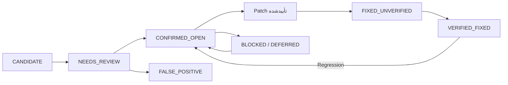

# اصلاح امن، Verification و گزارش عملیاتی

[English](SG-Evidence-and-Reporting.md)

**قرارداد پیشنهادی نسل بعدی.** بر Ledger و PDFهای v1.2.1 بنا شود، نه جایگزینی کامل.

## چرخه یافته

وضعیت Mapping از وضعیت امنیت مستقل است. تطابق CWE/ASVS/Control ID آسیب‌پذیری را اثبات نمی‌کند، نبود Candidate امنیت را اثبات نمی‌کند و نبود تست ثبت‌شده یعنی اصلاح تأییدشده نداریم.

## فیلدهای نرمال یافته (پیشنهادی، سازگار عقب)

ID پایدار، نسخه Schema، Component/Root متأثر، فریم‌ورک/قابلیت، کنترل داخلی و شناسه نگاشت خارجی نسخه‌دار، CWE/CVE در صورت ارتباط، محل سورس و ارجاع شواهد، شدت + منطق/بردار اختیاری CVSS، اطمینان، ورودی قابل دسترسی/Trust boundary، اثر و پیش‌نیاز، وضعیت، اصلاح پیشنهادی و ریسک، تأیید، فایل تغییرکرده/Diff digest، شناسه نتایج تست، ریسک باقی‌مانده، دلیل مانع، گام بعد و مالک. ابزار/Rule/نسخه اصلی و Fingerprint برای حذف تکرار حفظ شود؛ ID قدیمی و Run آرشیوی حفظ شوند.

## کیفیت Verification

- در صورت امکان در Fixture محلی/Staging متعلق به کاربر بازتولید کنید؛ شواهد علت ریشه‌ای و قابلیت بهره‌برداری یا عدم قطعیت.
- تست شکست قبل از Patch و موفق بعد از آن همراه Fixture رگرسیون منفی/امن ترجیح دارد. بدون Credential تولید، تراکنش واقعی یا فعالیت مخرب.
- فرمان واقعی، محدوده مجاز، هویت/نسخه ابزار، Worktree و Digest Config مرتبط، Exit code، Timeout، ارجاع/Hash خروجی محدود، تعداد executed/skipped/failed و Assertion مورد انتظار/مشاهده‌شده را ثبت کنید. خروجی Secret را حفاظت کنید.
- Digest کد/Config را پیش از Verification نهایی بررسی؛ در صورت تغییر شواهد Stale گزارش شود. اتصال PASS ارائه‌شده در v1.2.1 سازگاری را می‌سنجد، نه اجرای تست.
- تست unavailable، شکست، اجرا نشده، ناقص، نامرتبط و موفق را جدا کنید. بدون کفایت شواهد لازم، اصلاح مستقل تأییدشده نیست؛ دلیل نبود بازتولید قبل/بعد ثبت شود.
- تغییر موجود کاربر را حفظ، Patch کوچک ترجیح، تست برای PASS دستکاری نشود؛ تأیید برای Auth، امضا، پرداخت، Migration DB، شبکه یا رفتار پرتأثیر دیگر الزامی است.

## قرارداد PDF/Report

`.security-guardian/` خصوصی، RUN نسخه‌دار و CURRENT تجمعی Markdown/JSON را حفظ کنید؛ بخش PDF مدیریت و توسعه‌دهنده از شواهد ثبت‌شده یکسان. ReportLab اختیاری می‌ماند؛ پایان Run در صورت نبود آن PDF Warning می‌دهد. تولید/خروجی مجدد PDF عملیات صریح و قابل پیش‌بینی در محیط دارای وابستگی باشد؛ بدون موفقیت ساختگی یا Audit جدید برای Export.

| عنصر الزامی PDF | جزئیات |
|---|---|
| محدوده و محدودیت | Stack کشف‌شده در مقابل منتخب، Component داخل/خارج، مالکیت حل‌نشده، ابزار غایب، پوشش ناقص، وضعیت Run |
| خلاصه مدیریتی | Confirmed open، verified fixed، fixed-unverified، needs review، blocked، false positives، شدت باقی‌مانده و Delta |
| شواهد | ID یافته، ضعف، Component مرتبط، ارجاع سورس، کیفیت شواهد، اثر، نتیجه Verification و فرض‌ها |
| اقدام اصلاح | علت ریشه‌ای، خلاصه تغییر، وضعیت Patch، ریسک/تأیید، رکورد تست واقعی و رگرسیون |
| حل‌نشده/مسدود | چرا اصلاح نشده؛ چه باید رخ دهد؛ تیم/نقش مسئول اگر معلوم؛ اصلاح امن یا بررسی پیشنهادی؛ شرط تأیید |
| پوشش | گستره کنترل داخلی در برابر ارزیابی/Verification قابل‌اعمال، استاندارد منتخب و نسخه نگاشت؛ بدون «۱۰۰٪ امن» نادرست |
| محرمانگی | Redaction، بدون Credential خام/Payload بهره‌برداری، خروجی متناسب مخاطب، تازگی/نسخه گزارش |

### نمونه (مصنوعی)

| یافته | وضعیت | دلیل عدم Verification/اصلاح | اقدام بعد |
|---|---|---|---|
| SG example A — Authorization شیء | BLOCKED | Fixture کاربر دوم متعلق به ما نیست | دو هویت تست بسازید؛ رد درخواست Cross-user را تأیید کنید |
| SG example B — رندر DOM ناامن | FIXED_UNVERIFIED | Patch اعمال شده؛ تست مرورگر محلی در دسترس نیست | تست منفی متمرکز رندر پیش از VERIFIED اجرا شود |
| SG example C — Config اعتماد سرور | NEEDS_REVIEW | Config Deployment خارج محدوده است | مالک سرویس Allowlist Proxy را در محیط مجاز بررسی کند |

مثال‌ها توضیحی‌اند، نه شواهد خصوصی پروژه هدف.

## راهبرد Benchmark

OWASP Benchmark را در صورت کاربرد و Fixtureهای Seed بومی Stack در Angular، React، Vue، Svelte، Nest/Express/Fastify و قابلیت‌های منتخب موبایل/PKI استفاده کنید. گونه آسیب‌پذیر و امن، Fixture منفی Stack نامرتبط، مثال عمدی تست، Redaction و تله Prompt injection، اصلاح قبل/بعد و موارد مسدود را شامل کنید. تست قطعی Scanner را جدا از ارزیابی واقعی با Agent اجرا کنید؛ مدل/نسخه، Config، نسخه ابزار، Commit، حجم نمونه و هزینه/زمان را مستند کنید. Precision، Recall، نرخ مثبت/منفی کاذب، موفقیت اصلاح تأییدشده، رگرسیون معرفی‌شده، دقت محدوده و زمان تا اولین یافته معتبر را اندازه بگیرید. پیش از آستانه انتشار، خط مبنای هر خانواده تعیین کنید؛ نشت Fixture آموزش/تست را جلوگیری و مخرج‌ها را تعریف کنید. اعداد مصنوعی را جدا از نتیجه مشاهده‌شده پروژه واقعی گزارش کنید.

[معماری](SG-Architecture.md)، [استانداردها](SG-Standards-and-Coverage.md) و [نقشه راه](SG-Roadmap-and-RFCs.md) را ببینید.
