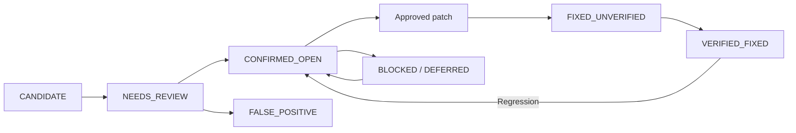

# Safe remediation, verification and actionable reports

**Proposed next-generation contract.** Build on, rather than discard, the v1.2.1 ledger and PDFs.

## Finding lifecycle

Mapping status is independent from security status. A matched CWE/ASVS/control ID does not prove a vulnerability, an absence of a candidate does not prove safety, and no test recorded means no verified fix.

## Normalized finding fields (proposed, backward compatible)

Stable ID, schema version, affected component/root, framework/capability, internal control and versioned external mapping IDs, CWE/CVE when relevant, source location and evidence reference, severity + rationale/optional CVSS vector, confidence, reachable input/trust boundary, impact and prerequisites, state, proposed fix and risk, approval, changed files/diff digest, test result IDs, residual risk, blocker reason, next action and owner. Keep original tool/rule/version and fingerprint for deduplication; preserve old IDs and archived runs.

## Verification quality

- Reproduce in an owned local/staging fixture where feasible; evidence of root cause and exploitability or uncertainty.
- Prefer test failing before and passing after patch plus a negative/safe regression fixture. No production credentials, real transactions or destructive activity.
- Record actual command, allowed scope, tool identity/version, worktree and relevant config digest, exit code, timeout, bounded output reference/hash, executed/skipped/failed count and expected/observed assertion. Protect secret output.
- Check code/config digest before final verification; report stale evidence if changed. Linking a supplied PASS record in v1.2.1 validates consistency, not that the test ran.
- Separate tests unavailable, failed, not run, incomplete, unrelated and passing. No independently verified fix unless required evidence is sufficient; record why pre/post reproduction was unavailable.
- Preserve existing user changes, prefer minimal patch, do not alter tests to force pass; approval required for auth, signing, payment, DB migrations, network or other high-impact behavior.

## PDF/report contract

Maintain private `.security-guardian/` versioned RUN and cumulative CURRENT Markdown/JSON; management and developer PDF sections from the same persisted evidence. ReportLab remains optional; run completion returns PDF warnings when unavailable. PDF generation/re-export should be an explicit, predictable operation using the environment with its dependency; no bogus success or new audit for exporting.

| Required PDF element | Details |
|---|---|
| Scope & limitations | Detected vs selected stacks, included/excluded components, unresolved ownership, unavailable tools, incomplete coverage, run status |
| Executive summary | Confirmed open, verified fixed, fixed-unverified, needs review, blocked, false positives, residual severity and change delta |
| Evidence | Finding ID, weakness, relevant component, source refs, evidence quality, impact, verification result and assumptions |
| Fix action | Root cause, change summary, patch status, risk/approval, actual test records and regressions |
| Unresolved / blocked | WHY not fixed; what must happen next; responsible team/role if known; suggested safe fix or investigation; verification condition |
| Coverage | Internal control footprint vs applicable assessment/verification, selected standards and mapping version; no false “100% secure” |
| Confidentiality | Redaction, no credential values/raw exploit payloads, audience-specific export, report freshness/version |

### Example (synthetic)

| Finding | Status | Reason not verified / fixed | Next action |
|---|---|---|---|
| SG example A — object authorization | BLOCKED | No owned second-user fixture | Create two test identities; confirm cross-user requests denied |
| SG example B — unsafe DOM rendering | FIXED_UNVERIFIED | Patch applied; local browser test unavailable | Run focused negative rendering test before marking verified |
| SG example C — server trust config | NEEDS_REVIEW | Deployment configuration outside scope | Ask service owner to validate proxy allowlist in authorized environment |

The examples are illustrative, not private target-project evidence.

## Benchmark strategy

Use OWASP Benchmark where applicable and stack-native seeded fixtures in Angular, React, Vue, Svelte, Nest/Express/Fastify and selected mobile/PKI capabilities. Include vulnerable and safe variants, unrelated stack negative fixtures, intentional test examples, redaction and prompt-injection traps, before/after fixes and blocked cases. Run deterministic scanner tests separately from real agent-assisted evaluation; document model/version, config, tool versions, commit, sample size and cost/time. Measure precision, recall, false positive/negative rate, success of verified fixes, introduced regressions, scope precision and time-to-first-valid-finding. Establish per-family baseline before any release threshold; avoid training/test fixture leakage and define denominators. Report synthetic numbers separately from observed real-project results.

See [architecture](SG-Architecture.md), [standards](SG-Standards-and-Coverage.md) and [roadmap](SG-Roadmap-and-RFCs.md).
