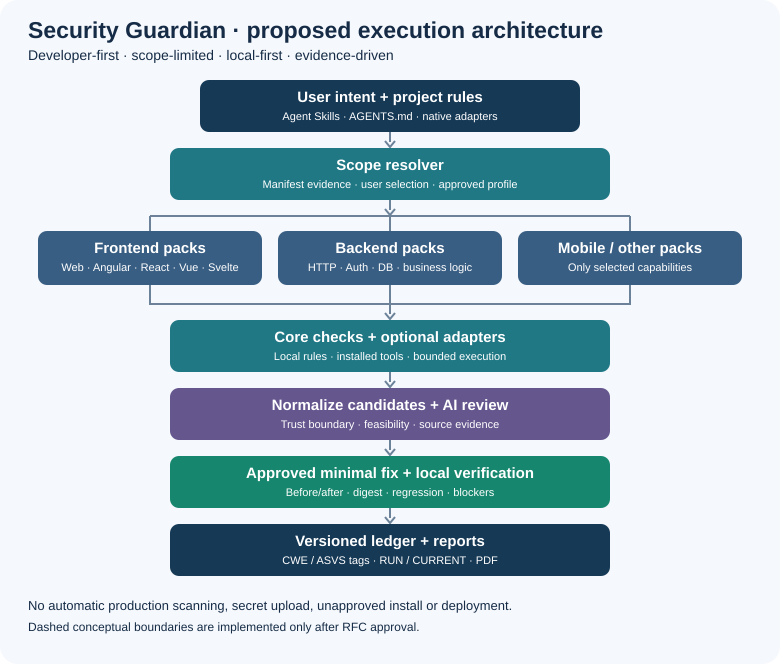
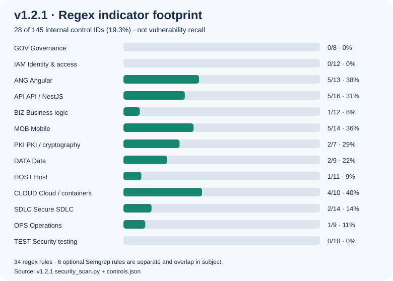

# Security Guardian — ویکی مهندسی

[English](SG-Home.md)

**خط مبنای محصول:** [v1.2.1](https://github.com/omidkh68/security-guardian/releases/tag/v1.2.1) · **ارزیابی:** 2026-11-18 UTC · **طراحی بعدی:** پیشنهادی، در انتظار بازبینی RFC.

Security Guardian یک Skill امنیتی قابل‌حمل و توسعه‌دهنده‌محور است که به توسعه‌دهندگان کمک می‌کند نقص‌های مهم امنیتی Stack خود را بیابند، درک و اصلاح کنند. ابزار تست نفوذ سازمانی خودمختار، جایگزین Codex Security/Claude Code Security یا مرجع گواهی نیست.

## به‌ترتیب مطالعه کنید

| صفحه | هدف |
|---|---|
| [چشم‌انداز محصول](SG-Vision.md) | مرزهای محصول، مخاطب و معیار موفقیت |
| [خط مبنای v1.2.1](SG-Baseline-v1.2.1.md) | موجودی قابل Audit، پوشش واقعی، محدودیت و شکاف فنی |
| [استانداردها و پوشش](SG-Standards-and-Coverage.md) | منابع ۲۰۲۶، شکاف Crosswalk و قرارداد اندازه‌گیری |
| [معماری هدف](SG-Architecture.md) | Pipeline سبک اجرا، مرز Adapter و مدل اعتماد |
| [پروفایل فناوری](SG-Stack-Profiles.md) | محدوده Frontend/Backend/Fullstack/Mobile و قواعد پروژه |
| [چرخه یافته و گزارش‌دهی](SG-Evidence-and-Reporting.md) | اصلاح امن، Verification و قرارداد PDF یافته حل‌نشده |
| [نقشه راه و RFCها](SG-Roadmap-and-RFCs.md) | پیشنهاد به‌ترتیب وابستگی و Gate پذیرش |

## خط مبنا در یک نگاه

۱۴۵ کنترل داخلی، ۱۳ Domain، ۱۰۷ Playbook، ۳۴ Rule Regex (۲۸ کنترل متمایز)، شش Rule اختیاری ساختاری Semgrep و ۳۴ تست موفق بسته/رگرسیون در Job Python 3.12 آماده‌سازی انتشار. این اعداد **Recall اندازه‌گیری‌شده آسیب‌پذیری، پوشش رسمی استاندارد یا اثبات امنیت پروژه هدف نیستند**.

منابع فعلی: [سورس انتشار ثابت](https://github.com/omidkh68/security-guardian/tree/v1.2.1/)، [تاریخچه تغییرات](https://github.com/omidkh68/security-guardian/tree/v1.2.1/CHANGELOG.md)، [منشأ](https://github.com/omidkh68/security-guardian/tree/v1.2.1/docs/provenance.md)، [ماتریس Verification](https://github.com/omidkh68/security-guardian/tree/v1.2.1/docs/verification-matrix.md). ارزیابی تاریخی ثابت می‌ماند؛ تغییر طراحی و انتشار آینده تاریخ‌دار باشد.

مستندات ویکی در مخزن پروژه زیر `docs/wiki/` نگهداری و به مخزن جداگانه GitHub Wiki همگام می‌شود. یافته پروژه هدف، مسیر سورس، Secret یا لاگ خصوصی Audit منتشر نکنید.
