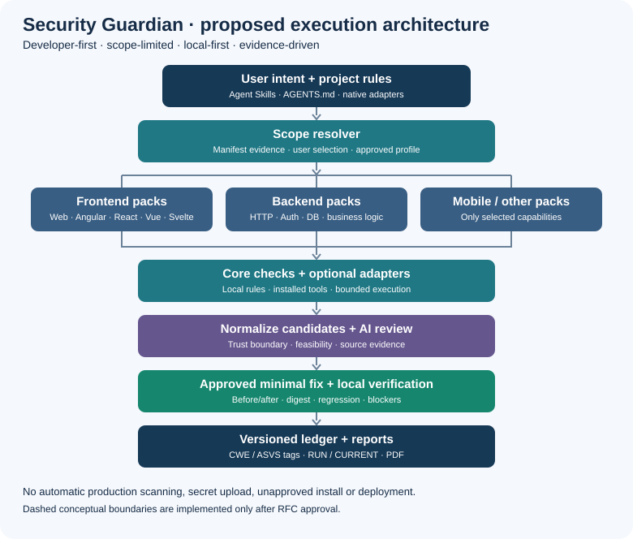
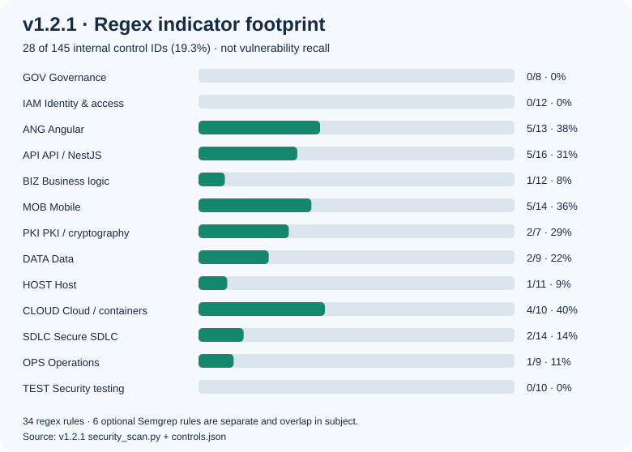

# Security Guardian — engineering wiki

**Product baseline:** [v1.2.1](https://github.com/omidkh68/security-guardian/releases/tag/v1.2.1) · **Assessment:** 2026-11-18 UTC · **Next design:** proposed, pending RFC review.

Security Guardian is a portable, developer-first security skill that helps developers find, understand and fix important security defects in their own stack. It is not an enterprise autonomous penetration tester, a replacement for Codex Security/Claude Code Security, or a certification authority.

## Read in order

| Page | Purpose |
|---|---|
| [Product vision](SG-Vision.md) | Product boundaries, audience and success criteria |
| [v1.2.1 baseline](SG-Baseline-v1.2.1.md) | Auditable inventory, actual coverage, limitations and technical gaps |
| [Standards and coverage](SG-Standards-and-Coverage.md) | 2026 references, crosswalk gaps and measurement contract |
| [Target architecture](SG-Architecture.md) | Lightweight execution pipeline, adapter boundaries and trust model |
| [Stack profiles](SG-Stack-Profiles.md) | Frontend/backend/fullstack/mobile scope and project rules |
| [Finding lifecycle and reporting](SG-Evidence-and-Reporting.md) | Safe fix, verification and unresolved-finding PDF contract |
| [Roadmap and RFCs](SG-Roadmap-and-RFCs.md) | Dependency-ordered proposals and acceptance gates |

## Baseline at a glance

145 internal controls, 13 domains, 107 playbooks, 34 regex rules (28 distinct controls), six optional structural Semgrep rules and 34 passing package/regression tests in the release preparation Python 3.12 job. These numbers are **not** measured vulnerability recall, formal standards coverage or proof that a target project is secure.

Current sources: [immutable release source](https://github.com/omidkh68/security-guardian/tree/v1.2.1/), [changelog](https://github.com/omidkh68/security-guardian/tree/v1.2.1/CHANGELOG.md), [provenance](https://github.com/omidkh68/security-guardian/tree/v1.2.1/docs/provenance.md), [verification matrix](https://github.com/omidkh68/security-guardian/tree/v1.2.1/docs/verification-matrix.md). Historical assessment stays frozen; future design and release changes should be dated.

This wiki documentation is maintained in the project repository under `docs/wiki/` and synchronized into the separate GitHub wiki repository. Do not publish target-project findings, source paths, secrets or private audit logs.
